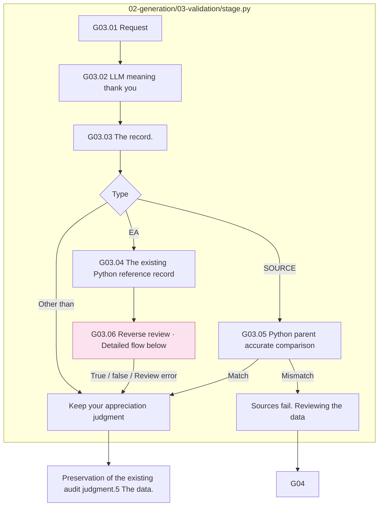
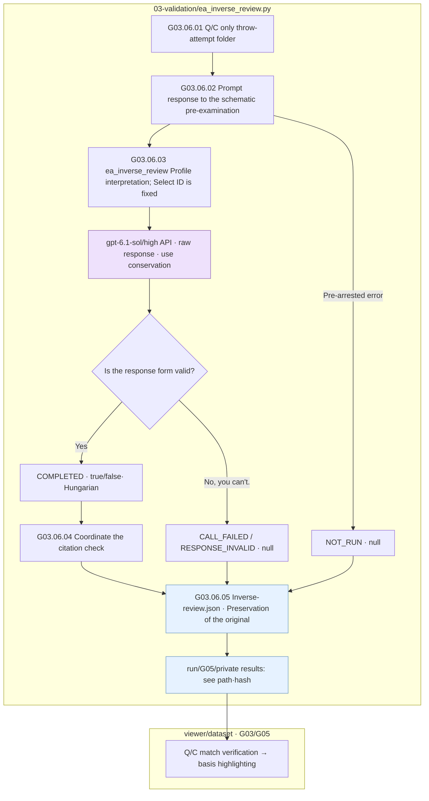
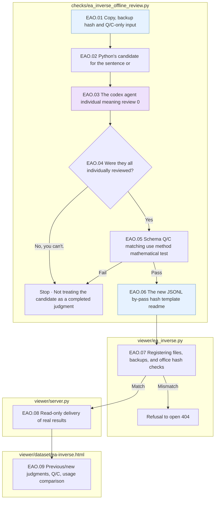
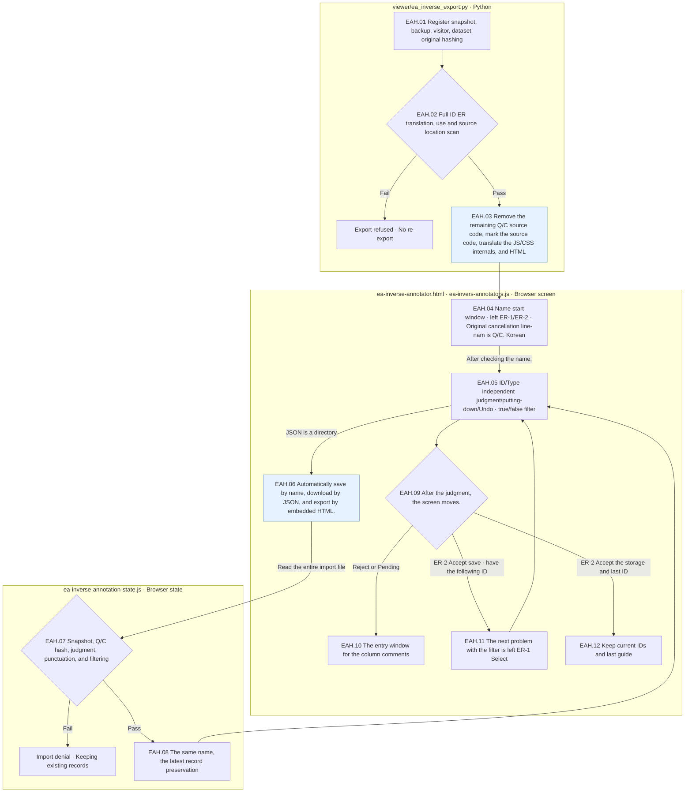
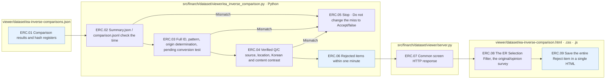

# G03 Complete the sentence and type-by-type condition verification

[Top: Generation](../README.md) · Previous: [G0]2](../02-generate-text/README.md) · Failure: [G0]4](../04-exception-handler/README.md) · Review: [G05](../05-human-review/README.md)

The resulting sentence checks that the plan has been maintained. EA's calculation error and the collision of ICs are intended, so we don't check on the basis that one numerical answer should come out of every type.

## Requirements and current judgments

- It's about whether the questions and the non-event data, the company, the timing, the identity, the planned changes have been implemented, the context is natural and valid.
- It connects the original, the actual, the actual editing, the latest Q/C to the same hash, without bringing the PASS of previously different text.
- The three judgments and the reason for the reduced meaning audit are checked with the same response scheme, not changing the citation-state test results of the frame v2 to the new v3 judgments.
- Sources' Python accurate comparison failure keeps EA's reversal record for analysis and true/false and verification errors do not change the production judgment.
- IC-RELATION verifies the meaning of the base of the parentheses, the whole/part direction, and each period, and rejects the remaining numerical repetition. It also verifies whether the object of the table has placed an additional sentence in an independent document after the last row of the table, and it rejects the sentence inside the cell or between the rows. It does not PASS just because it is the same as the plan or the calculation value has changed. It does NOT reject any other planned periodic relationship as a simple periodic change, and it does not fail just because the same periodicity is the same.

Current instructions: [IC-RELATION verification prompt](../../../../src/finarch/dataset/prompts/shared.01-02.02-03.review-and-validation.ic-relation.md)Meaning judgement is the old `planned_change`, `unintended_change`, `readability` The IC-RELATION prompt selection version is a three-item and response schema. 4.

|Step by step|Subject / function|Input → output|
|---|---|---|
|G03.01|Python `gg01_build_verification_request`|Planning, resource, complete, patch → meaning of the request for an audit|
|G03.02|LLM `gg02_llm_verify`|Types of instructions. General contracts. Semantic assessment.|
|G03.03|Python `gg03_record_verdict`|Audit, auditing and comparison → Early judgment records|
|G03.04|Python `gg04_screen_recovery`|Conventional limit calculation → reference record, production judgment maintained|
|G03.05|Python `gg05_validate_source`|Source and VALUE parent → Q/C accurate comparison after removal of source|
|G03.06|LLM + Python `gg06_record_inverse_review` / `ea_inverse_review.review`|After deleting EA's Q/C·ea_inverse_review profile → gpt-6.1-sol/high API inverse true/false; root; see path/hash of the original|



The box is the actual file responsibility.3.06 The node refers to the detailed flow provided just below. LLM performs both meaning audit and astral regression review. The SOURCE final state also reflects the Python accuracy comparison.

## EA reviews for the analysis of records

2026-10-01 And it was used with user permission. `ea_inverse_review.py` **After deleting question/context, only two strings.** It's transmitted to an independent call. The original C, the default value, the gold, the source code, the graph, the pre-audit, the feedback is not transmitted. 2026-10-08G0 from general to G03 And it's separate from the verification. `ea_inverse_review` for `sol61-high-api` We use profiles. `gpt-6.1-sol`And effort is the `high`So, the output limit of the API is 32,768• The total token limit 500,000Generation Schedule is a way of looking at the future. `config/hyperparameter.json` `generation.run.models.ea_inverse_review`So, the individual calls are `codex-profiles.toml` `[selection].ea_inverse_review`I'm reading the specific call. `profile_id`And the past settings of the current are maintained. 1Turn, automatically re-set, and 0calls.

LLM is missing quantity, probability, and if it returns the basis form. True needs the basis and the formula, and the formula of false is null. **So true and false go on.** It doesn't change existing deletion, preservation, toxicity failures into passing. Review errors, detection errors, response errors are not false, but a null state and null judgment.

Python checks the request-response schema, the quote coordinates, the save-description. It only corrects the display coordinates if the quote is unique, and preserves the raw response. **It doesn't do the execution and the judgment.** LLM results are not a complete and irreversible proof.



Purple is the LLM call, blue is the save file. There are no additional extension nodes to this detail. The call error also keeps the production judgement after recording.](../../../../reports/run/20261001-ea-inverse-review-pilot/README.md)is the location.

Existing `ea_inversion.py` The limit calculation is G0.3.04 The rules that changed RECOVERABLE to FAIL or modified quality_status have been removed. No automatic connection-to-computation reactions have been added.](01-ea-recoverability-review-plan.md)is the basis of the change.

Contract: [Request the JSON schema](../../../../src/finarch/dataset/schemas/json/02-generation.03-validation.ea-recoverability-review.request.schema.json)[JSON schema is answered](../../../../src/finarch/dataset/schemas/json/02-generation.03-validation.ea-recoverability-review.response.schema.json)[Prompt action](../../../../src/finarch/dataset/prompts/02-generation.03-validation.ea-recoverability-review.md).

## SOURCE Accurate comparison

`source_validation.py`The VALUE Q/C should be equal to that of the input source. If there is a discrepancy, it is not passed arbitrarily as a recoverability advice, but left for reviewing of the dependent data. It is the responsibility of the LLM review to make sure that the source represents the trust conditions correctly.

The output: `03-validation/04-comparison.json`, `05-recovery-screen.json`(EA notes) `06-source-exact.json`(SOURCE), audit call, response, judgment record. `07-ea-inverse-review/attempt-NNN/` Q/C. Guidance and Schema`02-call/` raw response/use volume; check for the coordinates of the display;`inverse-review.json`·Adding ReadME and `latest.ref.json`It only stores paths/interfaces.

Based on: [g0]3_verification.py](../../../../src/finarch/dataset/02-generation/03-validation/stage.py), [ea_inversion.py](../../../../src/finarch/dataset/02-generation/01-perturbation/ea_inversion.py), [source_validation.py](../../../../src/finarch/dataset/02-generation/03-validation/source_validation.py)[Thanks for the code](../../../../src/finarch/dataset/shared/review/dtt_audit.py)[Thanksgiving reduction agreement](../../../../archive/20260923-documentation-reorganization/docs/23-stage17-compact.md)[Two Python tests in the back](../../../../archive/20260923-documentation-reorganization/docs/quality-improvement-summary-20260917.md).

## The order of the real run is the lower folder.

The path used in the gravel counterpart: `reports/run/20260917-003/02-generation/01-round/test-0001/01-ic-value-before/03-validation`The following is the actual verified folder in the execution, but that doesn't mean that all of them are in the wrong quarter.

```text
03-validation/
  01-input/
  03-LLM-call/
  audit/
```


## Offline review of the final EA copy 2026-10-08

By user request. `dataset.jsonl`The EA_01·EA_02But I added a bit of a re-examination task.3 The production call or production judgement doesn't change. `ea_inverse_offline_review.py`The candidate formula is Python diagnostics, and the Codex agent only matches the judgments that individually verify the Q/C's duration, unit, whole/part relationship. 0The existing results are saved by the same hash as the byte backup and then merged into the new file, so the notion of judgment is not a complete impossibility, nor is the person's meaning verification a distinction.

|File|Input → Responsibility → Output|
|---|---|
|`src/finarch/dataset/checks/ea_inverse_offline_review.py`|Q/C-only record: Agent judgement → Subject candidate, mathematical use; schema test → star final JSONL; previous/new comparison; hash; template README|
|`src/finarch/dataset/viewer/ea_inverse.py`|Registered final file; file by-pass; backup → hash; round check → complete pre-dry or selected type Q/C; past/new judgment|
|`src/finarch/dataset/viewer/server.py`|Common dataset viewer request → read for re-examination path → actual storage results|
|`viewer/dataset/ea-inverse.html`|Actual results → Full/Conversion/New/Type Filter → Original Q/C, Judgment Reasoning, Forming, Unicode citation marks|



The file-by-file subgraph is the responsibility range, the purple is the meaning review of the current agent, and the blue is the file output. There are no further detail expanding nodes, so there are no pink nodes. The check failure stops without automatic reset; the LLM re-exposure stops. The API call failure status does not change to false, and the previous memory failure is kept in the comparison to UNKNOWN. `reports/dataset-review` Follow the README template of execution.

## ER-1 / ER-2 Human annotation Export · 2026-10-08

Common EA comparison screen **Exporting HTML for the Annotator**The current screen filter is id-0001~id-1354I put two whole types of HTML in one.1- Right ER.2So the name is a linear number. `paper/TERMINOLOGY.md`Following the taxonomy of Evidence Removal, the internal EA_01·EA_02And the existing annotation retains the JSON identifier. `inverse_possible` The record doesn't overwrite the production judgement or the reverse printing. Korean translations are just the display material. 0It's a very simple thing, and it doesn't require an external server library to run an annotation HTML.

The number removed is the original Context and the corresponding type of `01-perturbation/03-result.json` So we're going to compare the target data to the exact source location.1The red canceled line, ER-2The original is separated from the actual Q/C remaining, and the original is not used to recalculate the inverse evaluation performed on the existing Q/C.2The true/false filter in both columns shows only the satisfactory ID and the save/export keeps the entire case.

|File|Input → Responsibility → Output|
|---|---|
|`src/finarch/dataset/viewer/ea_inverse_export.py`|Registered snapshot; tag translation; dataset copy; object recording → hash;1354 ID·2708 ER: Confirmed base and location check removed → Single HTML including remaining Q/C source markings|
|`src/finarch/dataset/checks/build_ea_inverse_display_ko.py`|English subtitles fixed by hash 55Translation of the items's reasoning `viewer/dataset/ea-inverse-ko.json`|
|`viewer/dataset/ea-inverse-annotator.html`·`.css`|Left screen of single HTML; true green/false yellow badge; Accept green/Reject red/Pending yellow of judgement button; cross; red/see cancellation line; name start window; filter; step key popup|
|`viewer/dataset/ea-inverse-annotation-state.js`|Name, ID, type, judgment, punctuation, filtering, independent status, and JSON validity checks, imported and stored|
|`viewer/dataset/ea-inverse-annotator.js`|Actual remaining Q/C. Location of the station, judgement, Korean → left-handed temperature, judgement-specific cross colour;6The shortcut key is the key to the automatic focus.2 Accept next move → auto save by annotator.JSON.|



Blue is the file output, and there's no detailed and extended nodes, no pink nodes. Q/E moves the ID shown in the filter and keeps the selection column, and A/D keeps the current ID, and it selects the left/right column. 1/3/5Right, right. 2/4/6Each type of bullet and judgement mark is changed to Accept green/Reject red/Pending yellow.2 Accept is the first to save the determination, then the next ID of the filter and the left ER-1Select the last ID. Export will embed the entire case and progress and include the file title in the download link, and the exported HTML will not leave the previous download link. Ignore the determination and activation key in the input/folder key pop-up. The key/button opens a brief guide pop-up and closes with Esc. `check_ea_inverse_annotator.py`and `test_ea_inverse_annotator.cjs`is the completeness of the actual whole package;2708It checks the location of the items removal, the conservation of the original resource, the left-hand judgment and the filter-to-the-new import isolation.

## ER two evaluators Reject results 2026-10-12

Common screen `/ea-inverse/comparison`The first is to read the actual comparison results of the two registered evaluators, and then run the Rejected case and Examples in a numbered order for more than one minute.1·ER-2· Full selection, inconsistency/two minutes each provides Reject/reviewer-by-reject filter, reverse true/false filter, question-by-response search and carriage direct movement. Judgments and opinions are displayed in sequence by evaluator, and the actual question-by‐response location of the text source is contrasted with the country-by-country and English reverse-results determination. 2,708It's a comparison, and Kim Jin-soo's Pending. 1That's the Accept for computation as agreed.

|Actual file|Responsibility|
|---|---|
|`viewer/dataset/ea-inverse-comparisons.json`|Current comparison results are folder, evaluator, input and statistics/file hash register|
|`src/finarch/dataset/viewer/ea_inverse_comparison.py`|Register file hash ·Complete ID/Type; Original Judgment/Conversion; Input hash verification → Combined with verified ER package → Reject only items contained in a single HTML|
|`src/finarch/dataset/viewer/server.py`|Common `/ea-inverse/comparison` Connect the screen request to the respective renderer|
|`viewer/dataset/ea-inverse-comparison.html`·`.css`·`.js`|ER selection filter25Two evaluator comments, a member tab/tab mark, a Q/E move, a/d type conversion, and a single HTML save|



Blue nodes mean stored file/content data. There are no detailed or extended nodes, no pink nodes. All processes are Python or browser-based, and there is no LLM call/judgment schedule. Q/E is the previous/next item on the current list, A/D is the ER-1/ER-2It keeps its position if there's a case on the list, like when you type, and the inverse true is green, false is yellow, the evaluator Accept is green, and the Reject is red. A single HTML storage contains the entire Reject contained item, regardless of the search and filter, and can be accessed without a server or external library.
