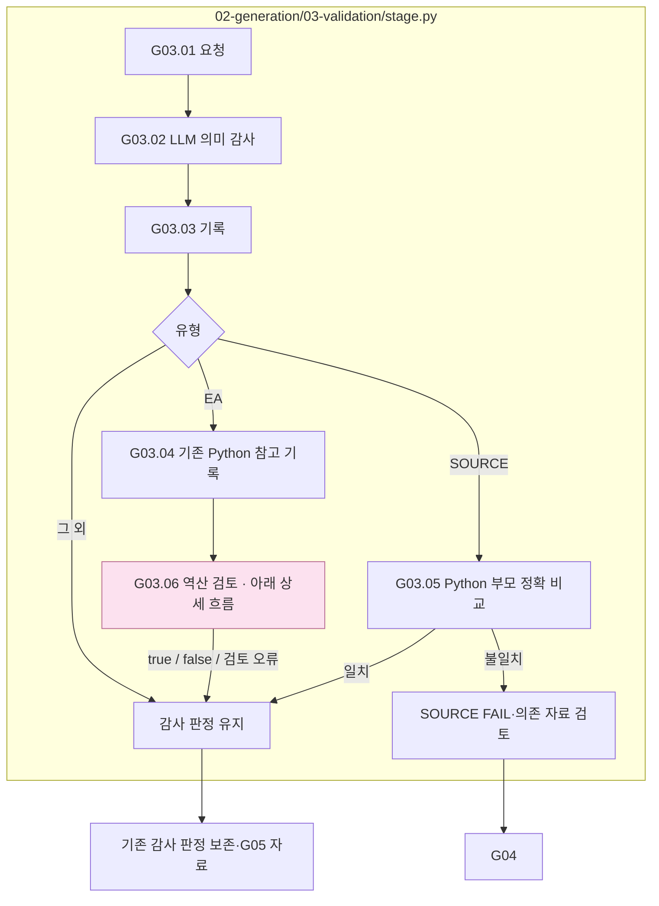
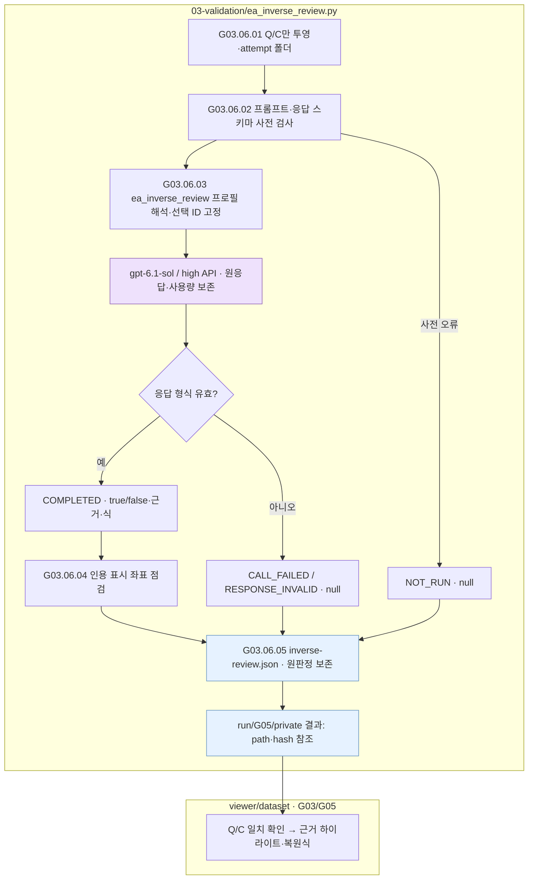
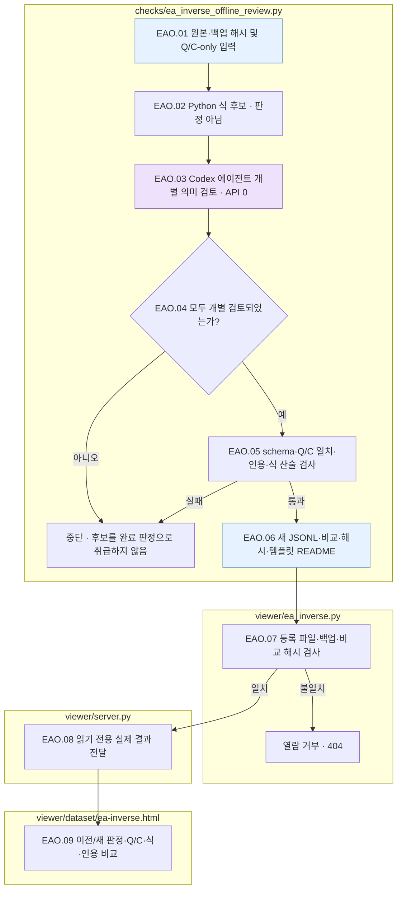
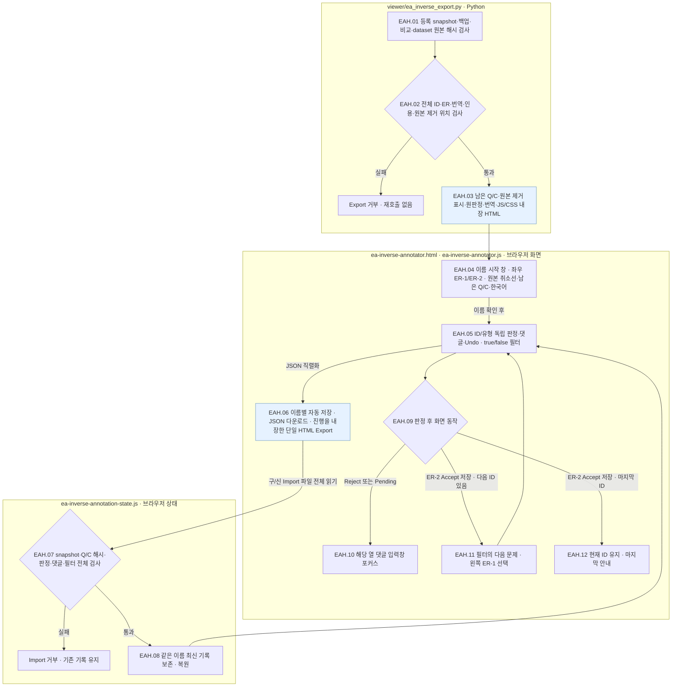
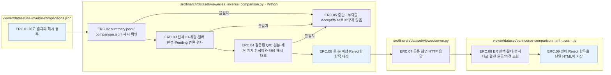

# G03 완성 문장과 유형별 조건 검증

[상위: Generation](../README.md) · 이전: [G02](../02-generate-text/README.md) · 실패: [G04](../04-exception-handler/README.md) · 검토: [G05](../05-human-review/README.md)

생성된 문장이 계획을 지켰는지 확인합니다. EA의 계산 불가와 IC의 충돌은 의도한 상태이므로, 모든 유형에서 숫자 답 하나가 나와야 한다는 기준으로 검사하지 않습니다.

## 요구사항과 현재 판정

- 질문과 비대상 근거·회사·기간·단위를 보존했는지, 계획한 변경이 구현됐는지, 자연스럽고 타당한 문맥인지 확인합니다.
- 원문·계획·실제 편집·최종 Q/C를 같은 해시로 연결합니다. 과거 다른 본문의 PASS를 가져오지 않습니다.
- 축소된 의미 감사의 세 판단과 이유를 동일 응답 스키마로 검사합니다. 구형 v2의 인용·상태 검사 결과를 새 v3 판정으로 바꾸지 않습니다.
- SOURCE의 Python 정확 비교 실패는 유지합니다. EA 역산은 분석용 LLM 기록이며 true/false·검토 오류 모두 제작 판정을 바꾸지 않습니다.
- IC-RELATION은 원문 근거·전체/부분 방향·각 연도의 의미를 확인하고 왼쪽 기존 수치 반복을 거절합니다. 표의 대상은 추가 문장이 표의 마지막 행 뒤 독립 문단에 놓였는지도 확인하며, 행·셀 내부 또는 행 사이에 들어간 문장은 거절합니다. 계획과 같거나 계산값이 달라졌다는 이유만으로 PASS하지 않습니다. 계획된 다른 연도 관계를 단순 기간 변경으로 거절하지 않으며, 같은 연도라는 이유만으로 실패시키지 않습니다.

현재 지침: [IC-RELATION 검증 프롬프트](../../../../src/finarch/dataset/prompts/shared.01-02.02-03.review-and-validation.ic-relation.md). 의미 판단은 기존 `planned_change`, `unintended_change`, `readability` 세 항목과 응답 schema를 유지하며 IC-RELATION 프롬프트 선택 버전은 4입니다.

|스텝|주체 / 함수|입력 → 출력|
|---|---|---|
|G03.01|Python `gg01_build_verification_request`|계획·원문·완성문·patch → 의미 감사 요청|
|G03.02|LLM `gg02_llm_verify`|유형별 지침·공통 계약 → 의미 판정|
|G03.03|Python `gg03_record_verdict`|감사·원문/변형 비교 → 초기 판정 기록|
|G03.04|Python `gg04_screen_recovery`|기존 제한 계산 → 참고 기록, 제작 판정 유지|
|G03.05|Python `gg05_validate_source`|SOURCE와 VALUE 부모 → 출처 제거 후 Q/C 정확 비교|
|G03.06|LLM + Python `gg06_record_inverse_review` / `ea_inverse_review.review`|EA의 삭제 후 Q/C·ea_inverse_review 프로필 → gpt-6.1-sol/high API 역산 true/false·근거·식, 원본의 path/hash 참조|



상자는 실제 파일 책임입니다. 분홍색 G03.06 노드는 바로 아래에 제공한 상세 흐름을 뜻합니다. LLM은 의미 감사와 별도 역산 검토를 각각 수행합니다. SOURCE 최종 상태는 Python 정확 비교도 반영합니다.

## EA 역산 검토 · 분석용 기록

2026-10-01 사용자 승인으로 적용했습니다. `ea_inverse_review.py`는 **삭제 후 question/context 두 문자열만** 독립 호출에 전달합니다. 원문 C·삭제값·gold·원본 코드·그래프·이전 감사·feedback은 전달하지 않습니다. 2026-10-08부터 일반 G03 검증과 분리한 `ea_inverse_review` 목적의 `sol61-high-api` 프로필을 사용합니다. 모델은 `gpt-6.1-sol`, effort는 `high`, API 출력 한도는 32,768·총 토큰 한도는 500,000입니다. Generation Schedule은 `config/hyperparameter.json`의 `generation.run.models.ea_inverse_review`, 개별 호출은 `codex-profiles.toml`의 `[selection].ea_inverse_review`를 읽습니다. 명시적인 호출별 `profile_id`와 과거 동결 설정은 유지합니다. EA마다 1회, 자동 재시도 0회입니다.

LLM이 누락 수량·역산 가능 여부·이유·남은 근거·식을 반환합니다. true에는 근거와 식이 필요하고 false의 식은 null입니다. **true와 false 모두 다음으로 진행합니다.** 기존 삭제·보존·가독성 실패를 통과로 바꾸지도 않습니다. 검토 미실행·호출 실패·응답 오류는 false가 아니라 별도 상태와 null 판정입니다.

Python은 요청·응답 스키마, 인용 좌표, 저장·해시를 확인합니다. 위치가 틀려도 인용이 유일하면 표시 좌표만 보정하고 원응답을 보존합니다. 인용이 중복되거나 없으면 강조하지 않습니다. **식 실행·의미 재판정은 하지 않습니다.** LLM 결과는 완전한 복원 불가능 증명이 아닙니다.



보라색은 LLM 호출, 파란색은 저장 파일·참조입니다. 이 상세도에는 추가 확장 노드가 없습니다. 호출 오류도 기록 후 제작 판정을 유지합니다. 모델·비용·실행 증거는 각 호출 폴더와 [소규모 확인 README](../../../../reports/run/20261001-ea-inverse-review-pilot/README.md)에 있습니다.

기존 `ea_inversion.py` 제한 계산은 G03.04 참고 자료로만 남겼습니다. RECOVERABLE을 FAIL로 바꾸거나 quality_status를 수정하던 규칙은 제거했습니다. 자동 연결·범용 역산 프로그램은 추가하지 않았습니다. 과거 run의 FAIL·원응답은 소급 변경하지 않습니다. [승인 당시 계획·조사](01-ea-recoverability-review-plan.md)는 변경 전 근거입니다.

계약: [요청 JSON schema](../../../../src/finarch/dataset/schemas/json/02-generation.03-validation.ea-recoverability-review.request.schema.json), [응답 JSON schema](../../../../src/finarch/dataset/schemas/json/02-generation.03-validation.ea-recoverability-review.response.schema.json), [실행 프롬프트](../../../../src/finarch/dataset/prompts/02-generation.03-validation.ea-recoverability-review.md).

## SOURCE 정확 비교

`source_validation.py`는 지정 VALUE 부모·경로·해시·patch 위치·질문을 확인합니다. 삽입 출처만 제거해 VALUE Q/C와 같아야 합니다. 불일치면 재생성 조언으로 임의 통과시키지 않고 의존 자료 검토 대상으로 남깁니다. 출처가 신뢰 조건을 올바르게 표현하는지는 LLM 검토의 책임입니다.

산출물: `03-validation/04-comparison.json`, `05-recovery-screen.json`(EA 참고), `06-source-exact.json`(SOURCE), 감사 호출·응답·판정 기록. EA는 `07-ea-inverse-review/attempt-NNN/` 아래 Q/C·지침·스키마·`02-call/` 원응답/사용량·표시 좌표 검사·`inverse-review.json`·README를 추가하고 `latest.ref.json`에 경로/해시만 저장합니다.

근거: [g03_verification.py](../../../../src/finarch/dataset/02-generation/03-validation/stage.py), [ea_inversion.py](../../../../src/finarch/dataset/02-generation/01-perturbation/ea_inversion.py), [source_validation.py](../../../../src/finarch/dataset/02-generation/03-validation/source_validation.py), [감사 코드](../../../../src/finarch/dataset/shared/review/dtt_audit.py), [감사 축소 합의](../../../../archive/20260923-documentation-reorganization/docs/23-stage17-compact.md), [후속 두 Python 검사](../../../../archive/20260923-documentation-reorganization/docs/quality-improvement-summary-20260917.md).

## 실제 run의 하위 폴더 순서

채번 대조에 사용한 경로: `reports/run/20260917-003/02-generation/01-round/test-0001/01-ic-value-before/03-validation`. 아래는 해당 실행에서 실제 확인한 폴더이며, 미실행 분기까지 모두 존재한다는 뜻은 아닙니다.

```text
03-validation/
  01-input/
  03-LLM-call/
  audit/
```


## 최종 EA 합본의 오프라인 재검토 · 2026-10-08

사용자 요청으로 `dataset.jsonl`의 EA_01·EA_02만 재검토하는 별도 작업을 추가했습니다. 기존 G03 제작 호출이나 제작 판정은 변경하지 않습니다. `ea_inverse_offline_review.py`의 후보 식은 Python 진단이며, Codex 에이전트가 Q/C의 기간·단위·전체/부분 관계를 개별 확인한 판정만 취합합니다. 이 명령 자체가 의미 판단을 자동 생성하지 않습니다. 외부 모델/API 호출은 0건입니다. 기존 결과는 해시가 같은 바이트 백업과 원본으로 보존하고 새 파일로 취합합니다. 음의 판정은 완전한 불가능 증명이 아니며 사람의 의미 검증은 별도입니다.

|파일|입력 → 책임 → 출력|
|---|---|
|`src/finarch/dataset/checks/ea_inverse_offline_review.py`|Q/C-only 기록·에이전트 판정 → 식 후보, 산술·인용·schema 검사 → 별도 최종 JSONL·이전/새 비교·해시·템플릿 README|
|`src/finarch/dataset/viewer/ea_inverse.py`|등록된 최종 파일·비교·백업 → 해시·경로 검사 → 전체 전이 건수 또는 선택한 유형의 Q/C·이전/새 판정|
|`src/finarch/dataset/viewer/server.py`|공통 dataset viewer 요청 → 읽기 전용 재검토 경로 → 실제 저장 결과|
|`viewer/dataset/ea-inverse.html`|실제 결과 → 전체/변경/신규·유형 필터 → 원문 Q/C, 판정 이유·식·Unicode 인용 표시|



파일별 subgraph가 책임 범위이며, 보라색은 현재 에이전트의 의미 검토, 파란색은 파일 입출력입니다. 추가 상세도로 확장하는 노드가 없으므로 분홍색 노드도 없습니다. 검사 실패는 자동 재시도·LLM 재호출 없이 중단합니다. API 호출 실패 상태를 false로 바꾸지 않고, 이전 미기록·실패는 비교에서 UNKNOWN으로 보존합니다. 실제 산출물 읽는 순서는 해당 `reports/dataset-review` 실행의 템플릿 README를 따릅니다.

## ER-1 / ER-2 역산 Human annotation Export · 2026-10-08

공통 EA 비교 화면의 **Annotator용 HTML Export**는 현재 화면 필터와 관계없이 id-0001~id-1354의 두 유형 전체를 한 HTML에 담습니다. 같은 ID를 왼쪽 ER-1·오른쪽 ER-2로 나란히 표시합니다. 명칭은 `paper/TERMINOLOGY.md`의 Evidence Removal taxonomy를 따르며, 내부 EA_01·EA_02와 기존 annotation JSON 식별자는 유지합니다. Accept는 저장된 `inverse_possible` 판정에 동의, Reject는 비동의, Pending은 보류입니다. 이 기록은 제작 판정이나 역산 원판정을 덮어쓰지 않습니다. 한국어 번역도 표시 자료로만 병기합니다. 외부 모델/API 호출은 0건이며, annotation HTML의 실행에는 서버·외부 라이브러리가 필요하지 않습니다.

제거된 수치는 원본 Context와 해당 유형의 `01-perturbation/03-result.json` 대상 기록을 대조해 정확한 원본 위치에 표시합니다. ER-1은 분홍 취소선, ER-2는 보라 취소선입니다. 원본 표시와 실제 남은 Q/C는 분리하며, 원본은 기존 Q/C만으로 수행한 역산 판정을 다시 계산하는 데 사용하지 않습니다. ER-2는 원본에서 다른 입력을 독립적으로 제거한 조건입니다. 두 열의 true/false 필터는 모두 만족하는 ID만 보여 주며 저장·Export는 전체 문항을 유지합니다.

|파일|입력 → 책임 → 출력|
|---|---|
|`src/finarch/dataset/viewer/ea_inverse_export.py`|등록된 snapshot·표시 번역·dataset 원본·제작 대상 기록 → 해시·1354 ID·2708 ER·정확한 근거 및 제거 위치 검사 → 남은 Q/C·원본 표시를 포함한 단일 HTML|
|`src/finarch/dataset/checks/build_ea_inverse_display_ko.py`|해시로 고정된 영어 원판정 → 55개 이유의 번역·누락 수량 표시 → `viewer/dataset/ea-inverse-ko.json`|
|`viewer/dataset/ea-inverse-annotator.html`·`.css`|단일 HTML의 좌우 화면·true 녹색/false 노란색 배지·Accept 초록/Reject 빨강/Pending 노랑의 판정 버튼·목차·분홍/보라 취소선·이름 시작 창·필터·단축키 팝업|
|`viewer/dataset/ea-inverse-annotation-state.js`|이름·ID/유형·판정·댓글·열별 필터 → 독립 상태·구/신 JSON 유효성 검사 → JSON 저장·Import·되돌리기|
|`viewer/dataset/ea-inverse-annotator.js`|실제 남은 Q/C·제거 위치·판정·한국어 → 좌우 열·판정별 목차 색상·6개 판정 단축키·댓글 자동 포커스·ER-2 Accept 다음 이동 → annotator별 자동 저장·JSON·진행을 내장한 단일 HTML Export와 다운로드 링크|



파란색은 파일 산출물이며, 별도 상세도 확장 노드는 없어 분홍색 노드가 없습니다. Q/E는 필터에 표시된 ID를 이동하면서 선택 열을 유지하고 A/D는 현재 ID를 유지하면서 왼쪽/오른쪽 열만 선택합니다. 왼쪽 1/3/5, 오른쪽 2/4/6은 각각 Accept/Reject/Pending이며 해당 유형의 bullet과 판정 표시를 Accept 초록 / Reject 빨강 / Pending 노랑으로 바꿉니다. Reject·Pending은 해당 댓글 입력창을 바로 선택하고, ER-2 Accept는 판정을 먼저 저장한 뒤 필터의 다음 ID와 왼쪽 ER-1을 선택합니다. 마지막 ID는 이동하지 않습니다. Export는 전체 문항과 진행을 내장하고 다운로드 링크에 파일 본문을 포함하며, Export된 HTML에는 이전 다운로드 링크를 남기지 않습니다. 입력란·단축키 팝업 안의 판정·이동 키는 무시합니다. ? 키/버튼은 간략한 안내 팝업을 열고 Esc로 닫습니다. `check_ea_inverse_annotator.py`와 `test_ea_inverse_annotator.cjs`는 실제 전체 package의 완전성·2708개 제거 위치·역산 원본 보존·좌우 판정 및 필터·구/신 Import 격리를 검사합니다. 브라우저 QA는 의미 판정의 휴먼 검증이 아닙니다.

## ER 두 평가자 Reject 결과 조회 · 2026-10-12

공통 화면 `/ea-inverse/comparison`은 등록된 두 평가자의 실제 비교 결과를 읽고, 한 분 이상 Reject한 문항·유형을 번호순으로 모두 펼칩니다. ER-1·ER-2·전체 선택, 불일치/두 분 모두 Reject/평가자별 Reject 필터, 역산 true/false 필터, 질문·의견 검색과 목차 바로 이동을 제공합니다. 판정과 의견은 평가자별로 나란히 표시하며, 실제 질문·삭제 후 본문·원본의 제거 위치·한국어 및 영어 역산 판정을 대조합니다. 제작 판정이나 두 평가자의 저장 파일을 수정하지 않습니다. 현재 등록 자료는 정유미·김진수의 2,708건 비교이며, 김진수의 Pending 1건은 기존 합의대로 계산용 Accept입니다.

|실제 파일|책임|
|---|---|
|`viewer/dataset/ea-inverse-comparisons.json`|현재 비교 결과 폴더·평가자·입력과 집계/비교 파일 해시 등록|
|`src/finarch/dataset/viewer/ea_inverse_comparison.py`|등록 파일 해시·전체 ID/유형·원래 판정/변환·내용 해시 확인 → 검증된 ER package와 결합 → Reject 포함 항목만 단일 HTML에 내장|
|`src/finarch/dataset/viewer/server.py`|공통 `/ea-inverse/comparison` 화면 요청을 해당 renderer로 연결|
|`viewer/dataset/ea-inverse-comparison.html`·`.css`·`.js`|ER 선택·필터·25건 연속 목록·두 평가자 의견·원문 표/삭제 표시·Q/E 이동·A/D 유형 전환·단일 HTML 저장|



파란색 노드는 저장된 파일/내장 자료를 뜻합니다. 상세도 확장 노드가 없어 분홍색 노드는 없습니다. 모든 처리는 Python 또는 브라우저 표시이며 LLM 호출·판정 재시도는 없습니다. Q/E는 현재 목록의 이전/다음 항목, A/D는 ER-1/ER-2입니다. 유형 전환 시 같은 문항이 목록에 있으면 그 위치를 유지합니다. 역산 true는 녹색, false는 노란색, 평가자 Accept는 녹색, Reject는 빨간색입니다. 단일 HTML 저장에는 검색·필터와 관계없이 전체 Reject 포함 항목을 담으며 서버·외부 라이브러리 없이 조회합니다.
