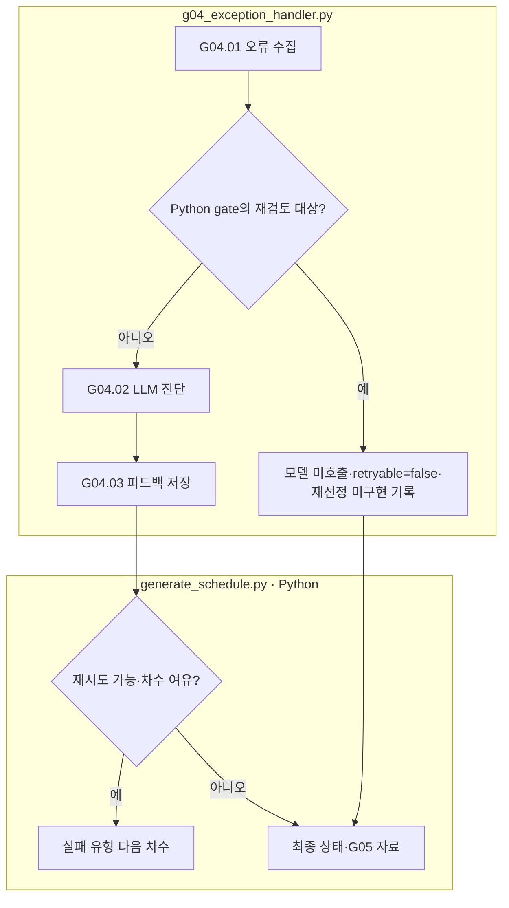

# G04 생성 실패 진단과 재시도

[상위: Generation](../README.md) · 이전: [G03](../03-validation/README.md) · 공통: [차수·피드백](../../90-operations/01-execution.md)

한 문항의 한 유형이 실패하면 그 유형의 계획·요청·응답·감사를 모아 수정 지침을 만듭니다. 다른 문항의 피드백으로 대체하지 않습니다. 정상 경로의 필수 직렬 단계가 아니라 실패 분기입니다.

|스텝|주체 / 함수|입력 → 출력|
|---|---|---|
|G04.01|Python `gg01_collect_error`|문항·유형·차수·실패 단계·증거 → 오류 요청|
|G04.02|LLM `gg02_llm_diagnose`|허용 수정 대상·증거 → diagnosis·guidance·target_step·retryable|
|G04.03|Python `gg03_record_feedback`|대상 검사 → 다음 차수 원본 피드백 및 참조|

상자는 실제 책임이며 분홍 확장 노드는 없습니다. 일반 LLM handler의 허용 대상은 `02-generate-text`, `03-validation`입니다. `IC_SOURCE_EXACT_MISMATCH:`는 Python 분기에서 의존 자료 재검토로 기록합니다. EA_RECOVERABLE_TARGET 등은 과거 기록 읽기 호환만 유지하며, 새 G03의 역산 true/false/호출 오류는 제작 실패나 재시도 조건으로 보내지 않습니다. **자동 대상 재선정은 구현돼 있지 않습니다.** 실패 표시를 해결 완료로 보고하지 않습니다.

VALUE 앞/뒤는 같은 문장을 사용하므로 뒤쪽의 실패 피드백도 같은 문항의 공유 문장 재생성에 연결될 수 있습니다. 각 피드백 원본·적용 출처는 별도 보존합니다. 다른 유형 전체를 무조건 새로 생성하는 정책으로 확대하지 않습니다.

`04-exception-handler/01-error.json` → `02-llm` 또는 모델 미호출 분기 → `03-retry.json` → `feedback/<다음 차수>/feedback.json`을 확인합니다.

근거: [g04_exception_handler.py](../../../../src/finarch/dataset/02-generation/04-exception-handler/stage.py), [generate_schedule.py](../../../../src/finarch/dataset/02-generation/generate_schedule.py), [case_feedback.py](../../../../src/finarch/dataset/02-generation/04-exception-handler/feedback/case_feedback.py), [문항별 피드백 요구](../../../../archive/20260923-documentation-reorganization/docs/48-case-scoped-feedback.md).
