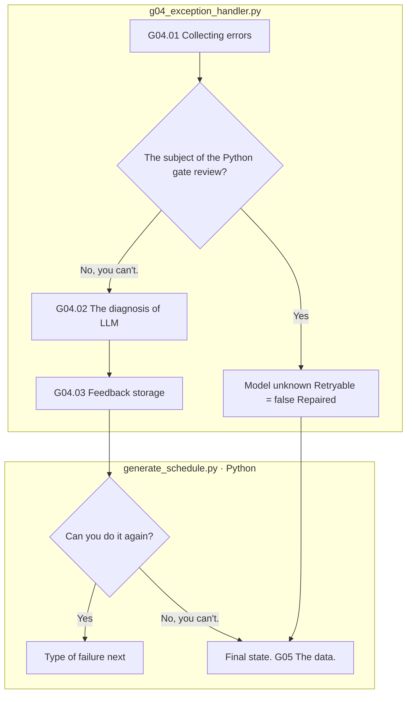

# G04 The diagnosis and re-examination of the failure of production

[Top: Generation](../README.md) · Previous: [G0]3](../03-validation/README.md) · Common: [number and feedback](../../90-operations/01-execution.md)

When one type of case fails, we combine that type of planning, request, response, and feedback to create a corrective guide, not replace it with feedback from another case. It's not an essential alignment step on the normal path, but a failure quorum.

|Step by step|Subject / function|Input → output|
|---|---|---|
|G04.01|Python `gg01_collect_error`|cases, types, numbers, failures, steps, proofs, errors, and errors|
|G04.02|LLM `gg02_llm_diagnose`|Allow correction of subject; proof → diagnosis; guidance; target_step; retryable|
|G04.03|Python `gg03_record_feedback`|Subject inspection → next dimensional original feedback and references|

The box is the actual responsibility and there are no rose extending nodes. `02-generate-text`, `03-validation`. `IC_SOURCE_EXACT_MISMATCH:`The EA_RECOVERABLE_TARGET, which is backwards compatible with the previous record, is the new G03The inverse true/false/output error is not sent as a manufacturing failure or re-setting condition. **Automatic target re-selection is not implemented.** Failure markers are not reported as resolved.

VALUE uses the same phrases in front/back, so the back-failed feedback can also be linked to the shared phrases playback of the same phrase. Each feedback source is not stored, and does not scale to a policy that unconditionally creates the entire other type.

`04-exception-handler/01-error.json` → `02-llm` Or the model of the misapprehension fountain `03-retry.json` → `Feedback.json`I'll check it out.

Based on: [g0]4_exception_handler.py](../../../../src/finarch/dataset/02-generation/04-exception-handler/stage.py), [generate_schedule.py](../../../../src/finarch/dataset/02-generation/generate_schedule.py), [case_feedback.py](../../../../src/finarch/dataset/02-generation/04-exception-handler/feedback/case_feedback.py)[Requests for feedback on issues](../../../../archive/20260923-documentation-reorganization/docs/48-case-scoped-feedback.md).
