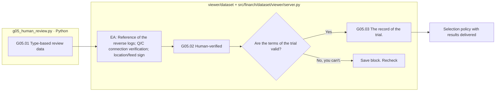

# G05 Final production review data

[Top: Generation](../README.md) · Follow-up: [reporting, reporting, transmission](../../03-release/README.md)

We collect the results of the type-based production and verification so that people can compare them. Automatic testing PASS, human judgement, and designation for experimentation are different records.

## Requirements and Detailed Processing

|Step by step|Subject|Input → output|
|---|---|---|
|G05.01|Python `gg01_collect_results`|Latest results of the type → review data, pending initial status|
|G05.01-EA|Python + viewer|G03The inverse_review_ref → remaining Q/C basis highlighted LLM recovery method true/false/performing error displayed|
|G05.02|The person / viewer|The first question, the second question, the third question, the first question, and the second question.|
|G05.03|Python / viewer save path|Judgment, examiner, EU, data currently available|

The boxes are actually responsible and there are no pink extension nodes. It's different from what a scheduler calls a collected function and what a person judges. Type fails is left undervalued and not shown instead as a past success story. When the approved version changes, the existing approval is not automatically pre-dated to the new version.

EA's record of reversals is [G0].3](../03-validation/README.md)Refer to the same source as path/hash. It doesn't replicate the value. True/false is all analytical records and it's not an automatic approval/disapproval condition. Call failure isn't false, and Q/C doesn't show past highlights when it changes.

18The independent pool calls, called the times, are excluded from the manufacturing required procedure, and there are records that have been moved to the experiment after data verification. Existing reserve responses are preserved, but are not reintroduced as mandatory passing requirements for current manufacturing review.

Failure is common. `run()`And it's a separate user action. It reads the existing results and creates an analytics-English rendering, but it doesn't automatically modify the original judgments or feedback. The fail-to-review button is actually a re-enactment function, so it distinguishes it from the read-only failure interpretation.

Based on: [g0]5_human_review.py](../../../../src/finarch/dataset/02-generation/05-human-review/stage.py)[Introduction of the survey collection](../../../../src/finarch/dataset/02-generation/05-human-review/stage.py)[Created boundary of necessity and choice](../../../../archive/20260923-documentation-reorganization/docs/21-generation-required-optional-review.md)[Request for failure interpretation](../../../../archive/20260923-documentation-reorganization/docs/75-failure-interpretation.md).
