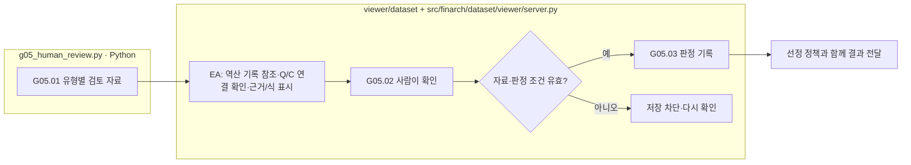

# G05 최종 제작 검토 자료

[상위: Generation](../README.md) · 후속: [선정·고정·전달](../../03-release/README.md)

유형별 생성·검증 결과를 사람이 비교할 수 있게 모읍니다. 자동 검사 PASS, 사람 판정, 실험에 사용하기 위한 선정은 서로 다른 기록입니다.

## 요구사항과 세부 처리

|스텝|주체|입력 → 출력|
|---|---|---|
|G05.01|Python `gg01_collect_results`|유형의 최신 결과 → 검토 자료, PENDING 초기 상태|
|G05.01-EA|Python + viewer|G03의 inverse_review_ref → 남은 Q/C 근거 하이라이트·LLM 복원식·true/false/실행 오류 표시|
|G05.02|사람 / viewer|원문·변형·조건부 답·검사·피드백 확인 → 판단|
|G05.03|Python / viewer 저장 경로|판정·검토자·이유·현재 자료 해시 → 판정 이력|

상자는 실제 책임이며 분홍 확장 노드는 없습니다. 스케줄러가 수집 함수를 호출하는 것과 사람이 판정하는 것은 다릅니다. 미실행 유형은 미평가로 남기고 과거 성공 본문으로 대신 표시하지 않습니다. 승인된 버전이 바뀌면 기존 승인을 새 버전에 자동 전이하지 않습니다.

EA 역산 기록은 [G03](../03-validation/README.md)의 동일 원본을 path/hash로 참조합니다. 판정값을 복제하지 않습니다. true/false 모두 분석용 기록이며 자동 승인·거절 조건이 아닙니다. 호출 실패는 false가 아니고, Q/C가 바뀌면 과거 하이라이트를 표시하지 않습니다.

18번으로 불리던 독립 풀이 호출은 제작 필수 절차에서 제외되어 데이터 확정 뒤 실험으로 이동한 기록이 있습니다. 기존 예비 응답은 보존하되 현행 제작 검토의 필수 통과 조건으로 다시 넣지 않습니다.

실패 해석은 일반 `run()`과 별개 사용자 동작입니다. 기존 결과를 읽고 분석·한국어 표시 번역을 만들지만 원래 판정이나 feedback을 자동 수정하지 않습니다. 실패건 재검토 버튼은 실제 재실행 기능이므로 읽기 전용 실패 해석과 구별합니다.

근거: [g05_human_review.py](../../../../src/finarch/dataset/02-generation/05-human-review/stage.py), [검토 수집 구현](../../../../src/finarch/dataset/02-generation/05-human-review/stage.py), [제작 필수·선택 경계](../../../../archive/20260923-documentation-reorganization/docs/21-generation-required-optional-review.md), [실패 해석 요구](../../../../archive/20260923-documentation-reorganization/docs/75-failure-interpretation.md).
