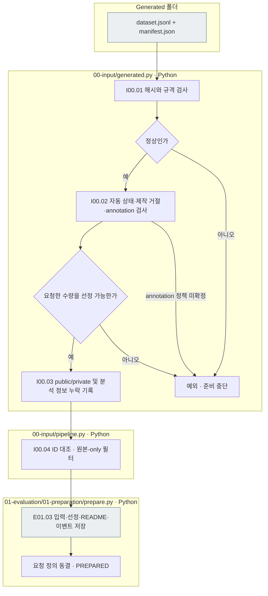

# 00 Input — Generated 데이터 입력

[상위: 실험 전체](../README.md) · [다음: E01 준비](../01_evaluation/01_preparation/README.md)

## 사용법

다음 명령은 프로젝트 루트에서 실행합니다. `RUN_PATH`는 `prepare`가 출력한 실험 폴더입니다. 이미 생성한 실험을 이어갈 때는 같은 경로를 사용합니다.

```sh
PYTHONPATH=src .venv/bin/python -u -B -m finarch.experiments.pipeline config --config config/experiments/config.toml
PYTHONPATH=src .venv/bin/python -u -B -m finarch.experiments.pipeline prepare --config config/experiments/config.toml
```

`evaluation.schedule.dataset.generated_path`에 `data/generated/<제작 run-id>`를 지정합니다. 실제 입력은 `dataset.jsonl`과 `manifest.json`이며 제작 run의 조각 파일을 다시 읽지 않습니다. 준비하면 `00_input/public.jsonl`, `private.jsonl`, `selection.json`과 E02 요청이 함께 생성됩니다. `prepare`는 대상 모델을 호출하지 않습니다.

이번 TAT-QA 실행은 합본 717원본 중 원본과 7변형이 모두 자동 PASS이고 Reject가 없는 291원본을 선정했습니다. 원본 291 + 변형 2,037 = 2,328입력입니다. 선정 조건과 실제 제외 이유는 `selection.json`에서 확인합니다. 사람의 검토 완료와는 구별합니다. 분석용 메타 누락도 이 파일의 `analysis_metadata_status`와 `analysis_metadata_gaps`에서 확인합니다.

새 evaluation은 `evaluation.schedule.dataset.generated_path`가 가리키는 `data/generated/<run-id>/`를 읽습니다. 기본 설정은 TAT-QA `20261003-003`, 기존 기준의 앞 291문항군입니다. 제작 run 경로는 provenance 기록일 뿐, 준비 중 해당 파일을 열지 않습니다.

## 입력 계약과 선정

필수 파일은 `dataset.jsonl`과 `manifest.json`입니다. 프로그램의 `finarch-generated-dataset-v1` 규격으로 행을 검사합니다. 전달본의 schema·README·이벤트는 안내 자료이며 실험 입력을 만들기 위한 별도 필수 파일은 아닙니다.

- 파일 해시·건수·run/문항 ID·7유형 순서·Q/C 해시·annotation 연결을 확인합니다.
- `original`의 최종 Q/C와 정답 메타정보를 사용합니다. `source_input`으로 조용히 대체하지 않습니다.
- 자동 PASS, 명시적 제작 거절, count·excluded_ids·7종 통과 조건을 적용합니다. 원본-only도 먼저 같은 자격 조건을 검사합니다.
- 별도 annotation 미검토는 Accept가 아닙니다. 현재 미검토 데이터는 기존 자동 PASS 정책으로 선정합니다. ratings가 연결된 문항은 다수결·최종 승인 정책이 확정되지 않아 `ANNOTATION_SELECTION_POLICY_REQUIRED`로 중단합니다.
- ID는 generated의 item_id를 유지하므로 폴더를 복사해도 변하지 않습니다.
- public은 item_id와 Q/C·decimal_places입니다. solver에는 item_id도 제외한 세 항목만 전달합니다. 정답·판정·유형·편집/외부사용 정보는 private입니다.
- SOURCE의 부모 연결은 보존된 편집 단계와 VALUE의 단계를 대조합니다. 대안 답 등 미수록 정보는 추측하지 않고 selection의 analysis_metadata_gaps에 기록합니다. 입력 준비 성공과 후속 분석 준비 완료는 다릅니다.
- 기존 동결 실험 읽기와 구형 JSON 입력 경로는 호환용으로 보존합니다. 새 TOML 준비에는 generated가 필수이며 제작 run/사본 경로·이전 실험 재사용과 혼합할 수 없습니다.

## 실제 파일 책임과 흐름

|번호|파일|입력 → 처리 → 출력|
|---|---|---|
|I00.01|[generated.py](../../../src/finarch/experiments/00-input/generated.py) load|manifest·JSONL → 해시·규격·내용/ID 검사 → 전체 후보|
|I00.02|같은 select|후보·선정 설정 → 자동 상태·거절·annotation 확인 → 선정/제외|
|I00.03|같은 select|선정 원문·7변형 → 공개 입력·비공개 분석 정보 분리 → public/private/selection|
|I00.04|[pipeline.py](../../../src/finarch/experiments/00-input/pipeline.py) prepare|선정 → ID 일치 및 원본-only 적용 → E01 전달|
|E01.03|[prepare.py](../../../src/finarch/experiments/01-evaluation/01-preparation/prepare.py) prepare|입력 → 저장·템플릿 README·로그·요청 정의 동결 → PREPARED|



회색은 저장 파일입니다. 이 단계에는 LLM 호출·자동 재시도가 없으며 추가 상세도 확장 노드가 없어 분홍색을 사용하지 않습니다. 실패 시 오류를 고친 뒤 준비를 다시 수행합니다. 모델 제출과 Analysis는 별도 실행입니다.

## 확인한 범위

두 파일만 임시 폴더에 복사하고 외부 경로 읽기를 차단한 상태에서 실제 TAT-QA 291원문·2,037변형의 공개 입력과 안정 ID가 일치함을 확인했습니다. 변조·거절·annotation 내용 불일치·원본-only 검사는 `checks/test_generated_input.py`에 있습니다. 원천 데이터 생성이나 모델 호출 검증이 아닙니다.
