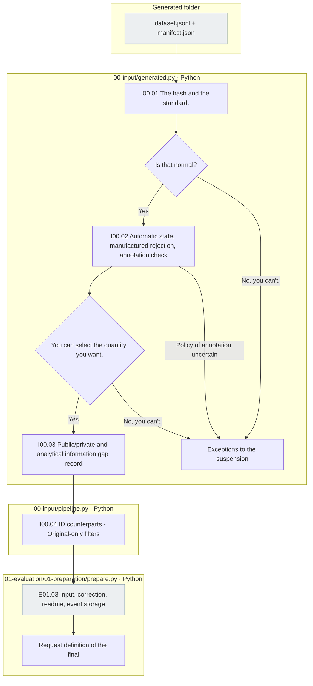

# 00 Input  Generated data input

[Top: The whole experiment.](../README.md) · [Next: E0]1 Preparation](../01_evaluation/01_preparation/README.md)

## Usage

The next command runs from the project root. `RUN_PATH` `prepare`It's an experimental folder that G.O.A. has created, and it uses the same path as the experiment that he's already created.

```sh
PYTHONPATH=src .venv/bin/python -u -B -m finarch.experiments.pipeline config --config config/experiments/config.toml
PYTHONPATH=src .venv/bin/python -u -B -m finarch.experiments.pipeline prepare --config config/experiments/config.toml
```

`evaluation.schedule.dataset.generated_path`in `The data generated`The actual input is the `dataset.jsonl`and `manifest.json`And you don't read the slice file of the production run again. `00_input/public.jsonl`, `private.jsonl`, `selection.json`and E02 So the request is generated together. `prepare`It doesn't call the object model.

This TAT-QA execution is a copy of the 717The original of the original. 7All the variations are automatic PASS and there is no Reject. 291I picked the original. 291 + the transformation 2,037 = 2,328The reason for this is that the selection conditions and the actual exclusion `selection.json`The metaphysics of the analysis is also missing from the file. `analysis_metadata_status`and `analysis_metadata_gaps`Check it out.

The new evaluation is `evaluation.schedule.dataset.generated_path`referenced by `data/generated/<run-id>/`The default setting is TAT-QA. `20261003-003`And that's the same as the standard. 291The output run path is just a provenance record, and you don't open the file when you're preparing it.

## Entry contracts and selection

The essential files are `dataset.jsonl`and `manifest.json`And that's the program. `finarch-generated-dataset-v1` The schema-README event in the transcript is a guide and not a separate file for making an experimental entry.

- File hash ·number run/problem ID;7Check the type order, Q/C hash, annotation connection.
- `original`We use the final Q/C and the correct meta-information. `source_input`It's not a silent replacement.
- Automatic PASS, explicit refusal of manufacture, count·excluded_ids;7The type passing conditions apply, and the original-only test the same qualification conditions first.
- The separate annotation sub-test is not Accept. The current sub-test data selects the existing automatic PASS policy. `ANNOTATION_SELECTION_POLICY_REQUIRED`Stop it.
- ID keeps the item_id of generated, so it doesn't change even if you copy the folder.
- The public is the item_id and Q/C·decimal_places. The solver only transmits three items, excluding the item_i. The correct answer, the judgment, the type, the editing/external information is private.
- The parent connection in SOURCE contrasts the stages of the preserved editing with the stages in the VALUE. The more alternative answers, the more information is recorded in the analysis_metadata_gaps of the selection, without speculation. The success of the input preparation is different from the completion of the subsequent analysis preparation.
- The existing synchronized test readings and the generated JSON input paths are preserved for compatibility. The new TOML preparation requires generated and cannot be mixed with the production run/copy path and previous test reuse.

## The actual file responsibilities and flow

|ID|File|Input → process → output|
|---|---|---|
|I00.01|[generated.py](../../../src/finarch/experiments/00-input/generated.py) load|Manifest JSONL → hashing, regulation, use/ID testing → full candidate|
|I00.02|The same select|Select/excluded|
|I00.03|The same select|Selection of the source material7Modification → public input; non-public analysis of information separation → public/private/selection|
|I00.04|[pipeline.py](../../../src/finarch/experiments/00-input/pipeline.py) prepare|Select → ID matches and apply only to the original → E01 Delivery.|
|E01.03|[prepare.py](../../../src/finarch/experiments/01-evaluation/01-preparation/prepare.py) prepare|Enter → Save Template README logs Request definition synchronized → PrepARED|



The gray is the storage file. There is no automatic call-to-call for the LLM, no additional detailed or extended nodes, no use of the pink color. When the failure occurs, the preparation is re-run, model submission and analysis are no longer running.

## The range we've been looking at.

You copy both files into a temporary folder and block the external path reading from the actual TAT-QA. 291The original.2,037We verified that the public input of the variation matched the stable ID. `checks/test_generated_input.py`It's not a source data creation or model call verification.
