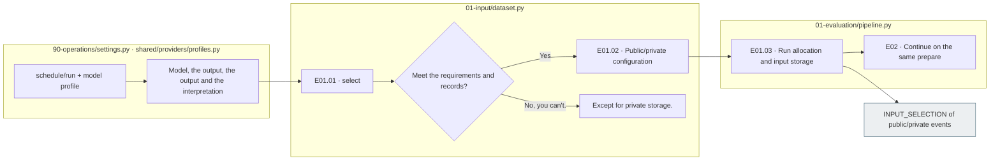

# E01 Experimental subject: condition prepared

[Top of the list: Evaluation](../README.md) · [Previous: Input](../../00_input/README.md) · [Next: E0]2 Request](../02_request/README.md)

## Usage

The next command runs from the project root. `RUN_PATH` `prepare`It's an experimental folder that G.O.A. has created, and it uses the same path as the experiment that he's already created.

```sh
PYTHONPATH=src .venv/bin/python -u -B -m finarch.experiments.pipeline config --config config/experiments/config.toml
PYTHONPATH=src .venv/bin/python -u -B -m finarch.experiments.pipeline prepare --config config/experiments/config.toml
```

`config`And then the model reads the input path, the input path and the output path. `prepare` 00 Select the input, E01 Set the equation, E02 Run the new run path and run the output path to the next run. This step calls the model 0entries.

`config.json` → `00_input/selection.json` → `01_evaluation/02_request/plan.json` I'll check the subject, condition, request, and cost estimates in order, and then change the project TOML, and the Evaluation settings of the run that's ready won't change.

The user is the original 100and each 7If you ask for a variation, you fix the variation that's connected to the elemental ID that meets the selection rules. **Public/private is not a public distribution, but sharing information that the grass will show the model, and comparing it locally.**.

The problem is that the grass will be transferred to the LLM data from the public **Question: Q. The text is precise.**The connection and experimental conditions for the expression ID and the variation are E02generated in **E02The model `manifest.jsonl`Integrated into**And I'm not going to start running this new thing. `input-selection.json`is not created. Selection provenance follows the existing `events.jsonl`So let's just leave it there.

## Detailed steps and actual files.

|Step by step|Call file-function|What to do → input → output|
|---|---|---|
|E01.01 · select_cases|[dataset.py](../../../../src/finarch/experiments/00-input/dataset.py) `select(settings)`|00 Candidate/user settings → excluded ID; cancellation status; Preparation PASS; changeable conditions verified → selected/excluded record|
|E01.02 · split_solver_reference|The same. `select()` internal, `public_input(row, precision)`|Selection rows → Q/C·precision completed public and evaluation answers; production basis separation → public/private rows|
|E01.03 · record_conditions|[prepare.py](../../../../src/finarch/experiments/01-evaluation/01-preparation/prepare.py) `prepare(config_path)`|Select row, model, comment, output setting → run allocated; input stored; log recording → config;00_input·events|

[settings.py](../../../../src/finarch/experiments/90-operations/settings.py) `load()` `evaluation.schedule/run`and `analysis.schedule/run`Read the existing `codex-profiles.toml`Interpret the selection profile of the model, the reference output limit, and then set the configuration of the run to the `pipeline.prepare()`When you reopen the ready run, you don't reapply the entire profile.

Current `select()`The front of the order in which the condition is met `count`And I'm going to pick a items. `events.jsonl` `INPUT_SELECTION`It's not excluded because the target model didn't solve it.



The gray is the file, the rest is the local processing. There are no LLM calls. Candidate lack and discrepancy failures and willfully do not mitigate conditions.

## The output of the actual run

```text
The first is the "experimental ID".
── config.json model promotion output expected
├── 00_input/
│   ├── public.jsonl              item_id, question, context, answer_format
│ ── private.jsonl See correct answer, numeric, model, product basis
── events.jsonl INPUT_SELECTION: Selection order, rules, private and foreign sources
```

The actual data from the new contract is:](../../../../reports/run/20260927-experiment-documentation/01-input-example/public.jsonl), [private](../../../../reports/run/20260927-experiment-documentation/01-input-example/private.jsonl)[Log of the Charity](../../../../reports/run/20260927-experiment-documentation/01-input-example/events.jsonl)[Luna requested manifest,](../../../../reports/run/20260927-experiment-documentation/01-input-example/luna-api/01-requests/manifest.jsonl)It's a validation file that's stored in a dataset without a model call.

|The data.|The real field.|Grass to deliver LLM|
|---|---|---|
|Public Line|`item_id`, `question`, `context`, `answer_format.decimal_places`|E02Use the finished input except for item_id|
|Private originals|`item_id`, `case`, `experiment`, `variant`, `reference`, `answer_metadata`, `source`, `human_decision`|No fields are transmitted.|
|Private modification|References + source links, replacement answers, patches, relationship of purpose, source hash, etc.|No fields are transmitted.|
|Precision source|The raw materials of the dataset `input.reference_precision`|E01in `public.answer_format.decimal_places`Save to private. The same digit left in the private is the evaluation reference and not read in the request.|

**Public is the complete pool of information to precision, private is the evaluation information.** When you create a request, you don't extract and replenish the value from private.2This linking information is not included in the problem content of the LLM. If there are no digits in the public, it's a failure to prepare. The existing run is preserved as a past contract, and the new entries are re-prepared in the dataset.

## Reuse and decomposition and the next step.

- `require_collected_results`And then we need to make the results necessary. `reuse_input_run`The results of previous experiments are verified by the public/private and model request manifests and reused.](../../../../src/finarch/experiments/01-evaluation/02-request/request_order.py) `selection_from_manifests()`It restores the case connection and stops if the same case's connection-foil input is different or the object is different by model. New request generation and reuse of past responses are different. The two input paths cannot be used simultaneously. Public's precision gaps are not supplemented by private.
- `originals_only`The call test range is the one that leaves only the original after selection. 7It's not a test called a transformation.
- The test compares the audit, inspection, Q/C of the modification candidate to the existing production record.1It's not the new LLM quality check. **Confirmation of consistency of records used in the appointment**.
- E0 after storage2matching `prepare()`Copy the definition from and combine the request. E01The independent completed state file of the only is not present.
