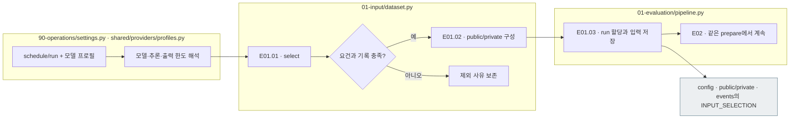

# E01 — 실험 대상·조건 준비

[상위: Evaluation](../README.md) · [이전: Input](../../00_input/README.md) · [다음: E02 요청](../02_request/README.md)

## 사용법

다음 명령은 프로젝트 루트에서 실행합니다. `RUN_PATH`는 `prepare`가 출력한 실험 폴더입니다. 이미 생성한 실험을 이어갈 때는 같은 경로를 사용합니다.

```sh
PYTHONPATH=src .venv/bin/python -u -B -m finarch.experiments.pipeline config --config config/experiments/config.toml
PYTHONPATH=src .venv/bin/python -u -B -m finarch.experiments.pipeline prepare --config config/experiments/config.toml
```

`config`는 모델·effort·입력 경로를 읽어 출력합니다. `prepare`는 00 Input 선정, E01 설정 동결, E02 prompt/schema와 요청 작성까지 함께 수행하고 새 run 경로를 출력합니다. 출력 경로를 다음 실행에 전달하십시오. 이 단계는 모델 호출 0건입니다.

`config.json` → `00_input/selection.json` → `01_evaluation/02_request/plan.json` 순으로 대상·조건·요청 수·비용 추정을 확인합니다. 이후 프로젝트 TOML을 바꿔도 준비된 run의 Evaluation 설정은 바뀌지 않습니다.

사용자가 원문 100개와 각 7변형을 요청하면 선정 규칙을 충족하는 원문 ID와 연결된 변형을 고정합니다. **public/private는 공개 배포 여부가 아니라 풀이 모델에게 보여 줄 정보와 로컬 비교 정보를 나눈 것**입니다.

풀이 LLM에 전달할 문제 데이터는 public의 **질문(Q)·본문(C)·precision**입니다. 문항 ID·원문과 변형의 연결·실험 조건은 E02에서 만드는 **E02의 모델별 `manifest.jsonl`로 통합**합니다. 새 실행에 별도 `input-selection.json`을 만들지 않습니다. 선정 경위는 기존 `events.jsonl`에 남깁니다.

## 세부 스텝과 실제 파일

|스텝|호출 파일·함수|입력 → 해야 할 일 → 출력|
|---|---|---|
|E01.01 · select_cases|[dataset.py](../../../../src/finarch/experiments/00-input/dataset.py) `select(settings)`|00 후보·사용자 설정 → 제외 ID·거절 상태·Preparation PASS·변형 조건 확인 → 선정/제외 기록|
|E01.02 · split_solver_reference|같은 `select()` 내부, `public_input(row, precision)`|선정 행 → Q/C·precision을 완성한 public과 평가용 정답·제작 근거 분리 → public/private 행|
|E01.03 · record_conditions|[prepare.py](../../../../src/finarch/experiments/01-evaluation/01-preparation/prepare.py) `prepare(config_path)`|선정 행·모델/추론/출력 설정 → run 할당·입력 저장·선정 로그 기록 → config·00_input·events|

[settings.py](../../../../src/finarch/experiments/90-operations/settings.py) `load()`가 `evaluation.schedule/run`과 `analysis.schedule/run`을 읽고 기존 `codex-profiles.toml`의 선택 프로필을 해석합니다. 모델·추론·출력 상한을 run의 config에 고정한 뒤 `pipeline.prepare()`가 사용합니다. 준비된 run을 다시 열 때는 전역 프로필을 다시 적용하지 않습니다.

현재 `select()`는 원문 순서에서 조건을 충족한 앞쪽 `count`개를 고릅니다. 무작위·난이도 균형 추출로 설명하지 않습니다. 선정 순서·규칙·제외 이유·출처 해시는 `events.jsonl`의 `INPUT_SELECTION`에 남기며, 대상 모델이 못 풀었다는 이유로 제외하지 않습니다.



회색은 파일, 나머지는 로컬 처리입니다. LLM 호출이 없습니다. 후보 부족·해시 불일치는 준비 실패이며 임의로 조건을 완화하지 않습니다.

## 실제 run의 산출물

```text
reports/experiments-run/<실험ID>/
├── config.json                   모델·추론·출력 한도·대상 요건
├── 00_input/
│   ├── public.jsonl              item_id, question, context, answer_format
│   └── private.jsonl             참조 정답·자릿수·유형·제작 근거
└── events.jsonl                  INPUT_SELECTION: 선정 순서·규칙·제외 사유·출처 확인
```

새 계약의 실제 데이터 예시: [public](../../../../reports/run/20260927-experiment-documentation/01-input-example/public.jsonl), [private](../../../../reports/run/20260927-experiment-documentation/01-input-example/private.jsonl), [선정 로그](../../../../reports/run/20260927-experiment-documentation/01-input-example/events.jsonl), [Luna 요청 manifest](../../../../reports/run/20260927-experiment-documentation/01-input-example/luna-api/01-requests/manifest.jsonl). 모델 호출 없이 저장된 dataset에서 준비한 확인 자료입니다.

|자료|실제 필드·역할|풀이 LLM 전달|
|---|---|---|
|public 행|`item_id`, `question`, `context`, `answer_format.decimal_places`|E02에서 item_id만 제외한 완성 입력을 사용|
|private 원본|`item_id`, `case`, `experiment`, `variant`, `reference`, `answer_metadata`, `source`, `human_decision`|어느 필드도 전달하지 않음. 응답을 받은 뒤 평가에 사용|
|private 변형|위 참조 + 원본 연결·대체 답·patches·의존 관계·출처 해시 등|어느 필드도 전달하지 않음. 응답을 받은 뒤 평가에 사용|
|precision 출처|dataset 원자료의 `input.reference_precision`|E01에서 `public.answer_format.decimal_places`로 저장. private에 남긴 같은 자릿수는 평가 참조이며 요청에서 읽지 않음|

**public은 precision까지 완성된 풀이 입력, private는 평가 정보입니다.** 요청을 만들 때 private에서 값을 꺼내 보충하지 않습니다. 처음 준비할 때 문항 ID·유형은 dataset 선정 결과에서 E02로 전달해 모델별 manifest에 저장합니다. 이 연결 정보는 LLM의 문제 내용에 넣지 않습니다. public에 자릿수가 없으면 준비 실패입니다. 기존 run은 과거 계약으로 보존하며 새 입력은 dataset에서 다시 준비합니다. 질문 지시와 자릿수의 충돌 여부는 별도 기록합니다.

## 재사용·분기와 다음 단계

- `require_collected_results`는 results 묶음을 필수로 하고, `reuse_input_run`은 이전 실험의 동결 public/private와 모델별 요청 manifest를 검증해 재사용합니다. [request_order.py](../../../../src/finarch/experiments/01-evaluation/02-request/request_order.py)의 `selection_from_manifests()`가 문항 연결을 복원하며 같은 문항의 연결·풀이 입력이 다르거나 모델별 대상이 다르면 중단합니다. 새 요청 생성과 과거 응답 재사용은 다릅니다. 두 입력 경로는 동시에 사용할 수 없습니다. public의 precision 누락은 private로 보충하지 않습니다.
- `originals_only`는 선정 후 원본만 남기는 호출 시험 범위입니다. 전체 7변형을 호출한 실험으로 세지 않습니다.
- 변형 후보의 audit·관찰·Q/C를 기존 제작 기록과 대조하는 검사는 E01에 남아 있습니다. 새 LLM 품질검사가 아니라 **선정에 사용한 기록의 일관성 확인**입니다.
- 저장 후 E02가 같은 `prepare()`에서 정의를 복사하고 요청을 조합합니다. E01만의 독립 완료 상태 파일은 현재 없습니다.
