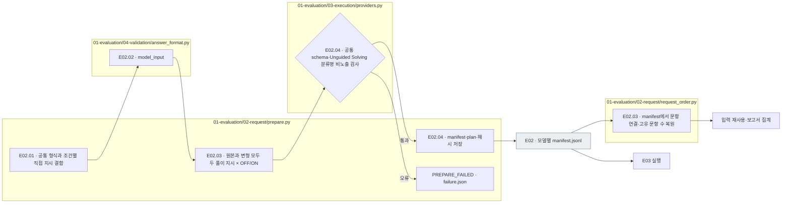

# E02 — Prompt·Schema와 요청 작성

[상위: Evaluation](../README.md) · [이전: E01 준비](../01_preparation/README.md) · [다음: E03 실행](../03_execution/README.md)

## 사용법

E02는 상위 `pipeline.py prepare --config config/experiments/config.toml`에서 E01과 함께 실행됩니다. 이 폴더의 Python 파일을 따로 실행해 기존 요청을 다시 만들지 않습니다.

읽는 순서는 `plan.json` → `common.md`·`prompt-unguided.md`·`prompt-guided.md` → `response.schema.json` → `<model>/manifest.jsonl`입니다. manifest 한 행이 실제 요청 하나이며 `item_id`, `prompt_condition`, `reasoning`과 전송할 입력을 연결합니다.

이번 실행의 네 조건은 각각 2,328건입니다. Unguided/Guided는 서로 다른 prompt이고 Reasoning OFF/ON은 제공자 요청의 `none`/`medium` 설정입니다. `evaluation.run.seed`는 로컬 요청 순서용이며 제공자 생성 seed가 아닙니다. 요청과 스키마는 생성 후 동결합니다.

예를 들어 Q/C와 소수 자릿수 2를 입력으로 만들고, 일반 풀이 또는 기준을 제공하는 풀이 지시와 **같은 응답 schema**를 붙입니다. 실제 전송 전 이 전체 요청을 파일로 고정합니다. 이 단계에서는 LLM을 호출하지 않습니다.

**E02의 모델별 `manifest.jsonl`이 문항 연결·실험 조건·실제 요청을 담는 실행 기준입니다.** 새 실행에 별도 `input-selection.json`을 만들지 않습니다. 선정 순서·규칙·제외 이유·출처 확인은 기존 `events.jsonl`의 `INPUT_SELECTION`에 기록합니다.

**풀이 LLM에 보내는 문제 데이터는 public의 질문(Q)·본문(C)·precision뿐입니다.** `item_id`는 전송 전에 제외합니다. 여기에 풀이 prompt와 응답 schema를 함께 전달합니다. manifest에 담긴 문항 ID·원본/변형 구분은 결과 연결에 쓰며 LLM 문제 내용에 넣지 않습니다.

## 세부 스텝과 실제 파일

|스텝|호출 파일·함수|입력 → 해야 할 일 → 출력|
|---|---|---|
|E02.01 · prompt_and_schema|[prepare.py](../../../../src/finarch/experiments/01-evaluation/02-request/prepare.py) `prepare()` 내부|작업 정의 또는 지정 run 정의 → 복사·공통 형식과 조건별 직접 지시 결합 → `01_evaluation/02_request`|
|E02.02 · build_input|[answer_format.py](../../../../src/finarch/experiments/01-evaluation/04-validation/answer_format.py) `model_input()`|완성된 public·schema → item_id 제외·공개 필드 확인 → `input` 객체|
|E02.03 · compose_requests|`pipeline.prepare()` · [request_order.py](../../../../src/finarch/experiments/01-evaluation/02-request/request_order.py) `prioritize_pilot()`·`selection_from_manifests()`·`summarize_items()`|public·E01의 문항 연결·prompt·schema·모델/추론 조건 → 조건 조합·ID·순서 고정 → 모델별 manifest. 재사용·문항 수 집계도 이 manifest 기준|
|E02.04 · validate_and_freeze|[providers.py](../../../../src/finarch/experiments/01-evaluation/03-execution/providers.py) `validate_request()`; `pipeline.prepare()`|요청 목록 → 분류명 노출 금지·계약·공개 필드 검사·해시·호출 수/비용 추정 → manifest·plan·PREPARED|

`prompt_and_schema.py` 같은 파일은 없습니다. E02.01/03/04의 일부는 **하나의 `prepare()` 내부 구간**입니다. 별도 파일·함수인 것처럼 분할하지 않습니다.



회색은 파일, 나머지는 로컬 처리입니다. 형식 정의가 없거나 입력에 비공개 필드가 섞이면 실패합니다. 실패한 상태에서 풀이 호출로 넘어가지 않습니다.

## Depth 1 → 3 — 요청과 응답의 의미

|깊이|Request|Response와 다음 처리|
|---|---|---|
|1 · 목적|제공한 질문·본문으로 풀게 합니다.|답과 설명을 관찰합니다. 수신 자체는 정답 판정이 아닙니다.|
|2 · 조건|원본·7변형, 두 풀이 지시, 추론 OFF/ON을 연결합니다.|같은 문항의 조건별 행동을 비교할 수 있게 저장합니다.|
|3 · 계약|Q/C·자릿수 + 영어 prompt + 동일 응답 schema를 전송합니다.|raw 보존 → E04 형식 검사 → A01 숫자·풀이·근거 검토 → A02 관계 비교 순서입니다.|

**LLM에게 보내는 문제 내용은 public에서만 읽습니다.** private는 평가용이며 precision을 포함해 어느 필드도 문제 입력에 보충하지 않습니다. 문항 연결은 E01의 선정 결과에서 받아 manifest에 저장하며, 이후 실행·재사용·보고서·뷰어가 이 manifest를 기준으로 읽습니다. public의 자릿수가 없으면 `PUBLIC_ANSWER_FORMAT_REQUIRED_REPREPARE_FROM_DATASET`로 중단합니다.

현재 원본과 7변형 모두 **Unguided Solving / Criteria-Guided Solving × Reasoning OFF/ON**의 네 조건으로 풉니다. 원본을 해결한 조건에서 변형의 답변 불가능성을 적절히 판단하는지 비교하기 위한 정상 대조입니다. 두 풀이 지시는 실행 구조에 고정하며 hyperparameter에 별도 선택 항목을 넣지 않습니다.

제공자가 특정 추론 조건을 지원하지 않으면 실행 가능한 조건만 새 run에 고정합니다. Haiku 5.5의 `max`는 추론 OFF를 지원하지 않으므로 `G⁻R⁺`·`G⁺R⁺` 두 조건이며, 최종 FInject 1,354문항·원본과 7변형 기준 21,664요청입니다. 요청에는 `reasoning_effort=max`·`thinking_type=adaptive`를 저장하고 E03에서 `output_config.effort=max`·`thinking.type=adaptive`로 전달합니다. `budget_tokens`는 사용하지 않습니다. OFF가 필요한 별도 설정은 high 이하의 effort와 disabled를 명시해야 합니다. [공식 effort 규칙](https://platform.claude.com/docs/en/build-with-claude/effort).

|풀이 지시|추론|원본|각 변형|
|---|---|---|---|
|Unguided Solving|OFF|실행|실행|
|Unguided Solving|ON|실행|실행|
|Criteria-Guided Solving|OFF|실행|실행|
|Criteria-Guided Solving|ON|실행|실행|

모델 1개·반복 1회 기준 **10원본+70변형은 320요청**, **100원본+700변형은 3,200요청**입니다. 새 manifest의 `prompt_condition`은 `unguided` 또는 `guided`입니다. 원본과 변형은 **같은 모델·원문 ID·풀이 지시·추론 설정**으로 연결합니다. 과거 2조건 원본 기록은 보존하며 없는 원본 조건을 다른 풀이 지시의 결과로 대신하지 않습니다. 계획·수집·미실행 수는 실제 저장 manifest와 결과로 셉니다.

## E02.01의 실제 정의

|재료|파일|역할|
|---|---|---|
|공통 지시|[01-evaluation.02-request.common.md](../../../../src/finarch/experiments/prompts/01-evaluation.02-request.common.md)|JSON 필드 용도·최종값 반올림·설명·근거 표기|
|Unguided Solving|[01-evaluation.02-request.unguided.md](../../../../src/finarch/experiments/prompts/01-evaluation.02-request.unguided.md)|일반 풀이와 `classification=null`을 직접 지시. 분류 기준 안내 없음|
|Criteria-Guided Solving|[01-evaluation.02-request.guided.md](../../../../src/finarch/experiments/prompts/01-evaluation.02-request.guided.md)|다섯 분류 중 하나와 그 판단 이유를 요구|
|공유 출력 형식|[01-evaluation.02-request.solver.response.schema.json](../../../../src/finarch/experiments/schemas/json/01-evaluation.02-request.solver.response.schema.json)|두 조건에 동일한 `FinancialAnswerV7` 구조. description 없음|

현행 정의는 위 소스 파일에서 읽고, 새 run의 `01_evaluation/02_request`에는 당시 사본을 `common.md`·`prompt-unguided.md`·`prompt-guided.md`·`response.schema.json`으로 동결합니다. 소스 파일명은 단계 식별용이고 run 파일명은 실행 당시의 요청·뷰어 호환용입니다.

현재 작업 파일과 저장 run의 정의는 다를 수 있습니다. `definition_source_run`을 지정하면 **그 run의 동결 정의**를 복사합니다. 과거 응답을 현행 prompt로 해석하지 않습니다.

|Criteria-Guided Solving 분류|선택 기준|answer|
|---|---|---|
|ANSWERABLE|질문의 조건과 관련 정보를 적용하면 유일한 최종값을 구할 수 있음. 남은 관계로 복원 가능한 경우 포함|숫자|
|CONFLICT|관련 정보가 서로 다른 최종값을 만들며, 어느 쪽을 따를지 명시된 해결 기준이 없음|null|
|INSUFFICIENT_EVIDENCE|필수 값이나 관계가 없고 남은 정보로 복원할 수 없음|null|
|UNRESOLVED|질문 또는 관계의 의미가 여러 가지로 해석되어 결과가 달라짐|null|
|ABSTAIN|위와 같은 입력 문제를 확정하지 못했지만 모델이 풀이·검증을 완료하지 못함|null|

**수정 채택:** Criteria-Guided Solving은 `classification` 필드에 분류 하나를 반환합니다. 별도 response mode와 `Classification: …; Response: …` 접두사는 요구하지 않습니다. 문제가 여러 개면 UNRESOLVED → CONFLICT → INSUFFICIENT_EVIDENCE 순으로 대표 이유를 고르고 나머지는 설명합니다. ABSTAIN은 입력의 결함 판정이 아닌 **풀이 미완료의 자기 보고**이므로 포괄적인 유보 용어로 사용하지 않습니다.

`explanation`에는 분류 이유와 풀이 또는 구체적인 장애를 적고, `evidence`에는 해당 원문을 인용합니다. CONFLICT/UNRESOLVED에서 계산 가능한 조건별 최종값은 조건·precision과 함께 설명에 남깁니다. 단일 `answer`에 임의의 한 가지 결과를 넣지 않습니다. 조건별 값의 별도 배열은 이번에 추가하지 않습니다.

Unguided Solving는 일반 풀이 문장을 유지하고 `classification`에 JSON null을 쓰라는 형식 지시를 직접 덧붙입니다. 공통 안내는 뒤따르는 풀이 지시를 따르라고만 하며 모델이 실험 조건을 추측하게 하지 않습니다. 분류명·판단 기준은 guided prompt에만 있고 공통 schema에는 enum·description을 넣지 않습니다. E04에서 Unguided Solving의 null, Criteria-Guided Solving의 허용 분류명, 분류와 숫자/null의 일치 여부를 검사합니다. **분류의 의미적 정답을 A01에서 새로 판정하지 않습니다.** A02는 선언·값·설명·근거 사이의 관계를 분석합니다.

ANSWERABLE의 정답 일치/불일치는 모델의 자기 분류가 아니라 **응답 이후 평가 결과**입니다. 변형 문제를 원본 gold에 무조건 비교하지 않습니다. 비교할 정답 기준이 없으면 미평가로 남깁니다. Heatmap에는 모델의 분류와 평가 여부를 구분하여 표시합니다.

`config/experiments/config.toml`의 `evaluation.run.definition_source_run=null`은 현행 작업 정의를 사용한다는 뜻입니다. 새 준비는 `prompt-unguided.md`·`prompt-guided.md`로 저장합니다. 기존 run의 옛 파일명과 explanation 접두사는 그대로 읽고 원응답·점수·정의를 소급 수정하지 않습니다. 새 정의의 실제 모델 응답 효과는 아직 미검증입니다.

## Schema와 prompt의 1:1 대조

|응답 필드|schema 검사|common의 설명|추가 검토|
|---|---|---|---|
|evidence|문자열 배열·최대12개·각1~1,500자|context에서 짧고 연속된 원문 발췌, 빈 배열 의미|인용의 정확성·근거 지지|
|explanation|비어 있지 않은 문자열·최대2,000자|영어 풀이·최종값·단위와 부호 설명|계산·설명·결론 일치, Criteria-Guided Solving 기준 이행|
|classification|string 또는 null, 필수|뒤따르는 조건별 풀이 지시대로 출력|Unguided의 null·Guided의 허용값·숫자/null 조합 검사. 의미 정답은 이 검사로 확정하지 않음|
|answer|number 또는 null|질문의 최종 숫자, `decimal_places`에 반올림, 중간값 반올림 금지|원본 숫자 일치·변형의 답변 적절성|
|answer_meta.negative|boolean 또는 null|answer가 음수인지 기록|부호/null 일관성 로컬 검사|
|answer_meta.scale|7개 배율 문자열 또는 null|표현 배율, 답에 다시 곱하지 않음|null 조합 로컬 검사, 실제 단위 타당성은 의미 검토|

최상위 다섯 필드와 metadata 두 필드는 필수이며 추가 키는 금지합니다. **`answer_format.decimal_places`는 요청 입력 필드**이고 응답 필드는 아닙니다. 숫자의 자릿수 상한·부호·null 조합은 schema 외 계약 검사가 담당합니다. 숫자의 뒤쪽 0 개수를 문자열처럼 강제하는 스키마는 아닙니다.

현재 공통 안내에는 분류 기준은 없지만 최종값 선택·설명 대조 등 형식보다 강한 지시가 있습니다. 따라서 Unguided Solving도 완전 무제약 자연 응답은 아닙니다. `common`의 근거 출처는 context인데 `reporting.screen()`은 question+context의 부분 문자열도 인정하는 **범위 불일치**가 남아 있습니다. 자릿수 지시와 질문의 충돌도 별도로 기록해야 합니다. 이 정적 검토는 **수정 채택**이며, 행동 개선을 입증한 결과는 아닙니다.

[대조 화면](http://127.0.0.1:8893/contract?source=current)은 왼쪽 schema와 오른쪽 영문 prompt·한국어 검토 번역을 실제 파일/해시로 연결합니다. [contract_view.py](../../../../src/finarch/experiments/viewer/contract_view.py)가 읽으며 번역은 모델 입력에 넣지 않습니다. schema 순서는 `evidence → explanation → classification → answer → answer_meta`이고 common의 설명 순서와 다릅니다.

## 실제 run의 산출물과 다음 단계

```text
reports/experiments-run/<실험ID>/
├── 01_evaluation/
│   ├── 01_preparation/             run/model README 생성 양식
│   └── 02_request/
│       ├── common.md, prompt-unguided.md, prompt-guided.md
│       ├── response.schema.json
│       ├── <model>/manifest.jsonl  실제 전송할 요청
│       └── plan.json              요청 수·비용 추정
├── events.jsonl                   선정·실행 기록
├── manifest.json                 동결 파일별 SHA-256
└── state.json                    PREPARED
```

과거 저장 형식 사례: [Haiku 요청 목록](../../../../reports/experiments-run/20260926-exp-001/haiku-4.5-api/01-requests/manifest.jsonl), [계획](../../../../reports/experiments-run/20260926-exp-001/plan.json).

요청 한 행에는 `trial_id`, `model`, `case`, `variant`, `prompt_condition`, `reasoning` 등 로컬 관리값과 `prompt`, `response_schema`, `input`, 출력 한도가 있습니다. 제공자는 이 행 전체를 질문으로 보내지 않습니다. E03에서 `input`만 사용자 입력으로, prompt/schema는 해당 전송 항목으로 변환합니다.

[이전 저장 구조의 manifest 예시](../../../../reports/run/20260927-experiment-documentation/01-input-example/luna-api/01-requests/manifest.jsonl)는 원문 1개·7변형의 30개 요청이며 모델 호출은 없습니다. `item_id`의 중복을 제거하면 8문항입니다. 같은 ID의 문항 연결·풀이 입력이 다르면 실패하며, 입력 재사용 시에는 모델별 문항 집합도 같아야 합니다. 최상위 `manifest.json`은 파일 해시 목록이고, 모델별 `manifest.jsonl`은 실제 요청 목록입니다.

준비 중 오류는 `failure.json`·이벤트로 남습니다. 준비가 끝나면 초기 `01_evaluation/04_validation`·README도 생성됩니다. E03은 동결 해시를 확인한 뒤 이 요청을 실행합니다.

## Private 접근 점검과 수정 경계

|이전 코드가 읽던 private 필드|이전 사용처|수정 후|
|---|---|---|
|`reference.reference_precision`|LLM 입력의 `answer_format.decimal_places`로 추가|E01에서 완성한 public만 읽음|
|`item_id`, `case`, `experiment`, `variant`|로컬 요청 ID·문항 폴더·원본/변형·풀이 지시 조합. 모델 문제 입력에는 넣지 않음|dataset 선정 결과를 모델별 manifest로 통합. 이후 이 manifest에서 읽음|
|정답·정답 메타·대체 답·patches·제작 연결|원본 비교·분석·이관 무결성 확인|평가·보존 용도로 유지. 풀이 요청에는 전달하지 않음|

정적 확인한 제공자 builder는 `request.input`만 질문 내용으로 전송합니다. [저장 전송 요청 확인](../../../../reports/run/20260927-experiment-documentation/private-access-audit.json)에서는 Haiku 1건과 Luna 60건의 입력 키가 Q/C/answer_format뿐이었으며 precision 외의 private 평가 정보는 없었습니다. 이는 두 run의 61건 확인이며 모든 과거 실행의 전수 검증을 뜻하지 않습니다. 기존 원응답·입력·점수는 바꾸지 않았습니다.

원격 인계의 새 `model-inputs.jsonl` 생성도 public만 읽도록 수정했습니다. 옛 인계 자료의 해시·참조 일치 **읽기 검사**는 당시 형식을 해석하기 위해 private를 대조할 수 있지만, 새 전송 입력을 private로 보충하는 경로는 없습니다.
