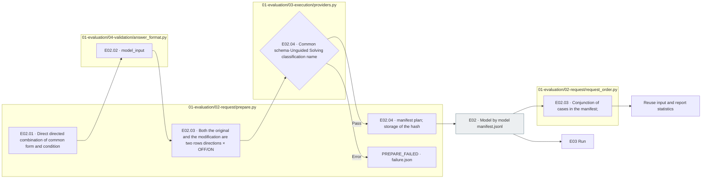

# E02 Write a request with the Prompt Schema

[Top of the list: Evaluation](../README.md) · [Previous: E0]1 Preparation](../01_preparation/README.md) · [Next: E0]3 Run](../03_execution/README.md)

## Usage

E02is the top `pipeline.py prepare --config config/experiments/config.toml`E0 from1Run the Python file in this folder separately and you don't re-create the existing request.

The order in which you read it. `plan.json` → `common.md`·`prompt-unguided.md`·`prompt-guided.md` → `response.schema.json` → `<model>/manifest.jsonl`So, if you have a line of manifest, you have one real request. `item_id`, `prompt_condition`, `reasoning`And connect the input to be transmitted.

The four conditions of this run are each 2,328Unguided/Guided is different prompt and Reasoning OFF/ON is the answer to the provider's request. `none`/`medium` configuration. `evaluation.run.seed`The request and the schema are synchronized after the creation.

For example, Q/C and the numerical minor. 2The input is made into a general grass or a grass that provides a standard direction and **Same response schema**This is the entire request file before the actual transmission.

**E02The model `manifest.jsonl`This is the execution standard for connecting, testing conditions, and actual requests.** No star in the new run. `input-selection.json`The selection order, the rules, the reasons behind the exception, the source verification, the existing `events.jsonl` `INPUT_SELECTION`I'm going to write it down.

**The problem data that we send to the LLM is just questions from the public, Q, C, Precision.** `item_id`Here, the root prompt and the response schema are conveyed together. The phrase ID/source/variant partition in the manifest is written to the resulting link and not put into the LLM problem content.

## Detailed steps and actual files.

|Step by step|Call file-function|What to do → input → output|
|---|---|---|
|E02.01 · prompt_and_schema|[prepare.py](../../../../src/finarch/experiments/01-evaluation/02-request/prepare.py) `prepare()` Internal|Definition of work or specification run Definition → Copy·common form and condition direct direct direct link `01_evaluation/02_request`|
|E02.02 · build_input|[answer_format.py](../../../../src/finarch/experiments/01-evaluation/04-validation/answer_format.py) `model_input()`|Finished public·schema → item_id excluded; public field verified → `input` The object.|
|E02.03 · compose_requests|`pipeline.prepare()` · [request_order.py](../../../../src/finarch/experiments/01-evaluation/02-request/request_order.py) `prioritize_pilot()`·`selection_from_manifests()`·`summarize_items()`|public·E01The following is a list of the most commonly used terms and conditions in the context of the current model:|
|E02.04 · validate_and_freeze|[providers.py](../../../../src/finarch/experiments/01-evaluation/03-execution/providers.py) `validate_request()`; `pipeline.prepare()`|Request list → classification name Exposure ban; agreement; public field inspection; explanation; exit number/cost estimate → manifest; plan; prepared|

`prompt_and_schema.py` There's no same file.2.01/03/04Some of the **One of them. `prepare()` The inner part.**So, you can't divide stars like a file function.



The gray is the file, the rest is the local processing. It fails if you don't have a format definition or if you mix non-public fields into the input. If it fails, the root doesn't go beyond the call.

## Depth 1 → 3 The meaning of the request and response

|Deep down.|Request|Response and next processing|
|---|---|---|
|1 • Purpose|I'll answer the questions in the text provided.|And the response and the explanation, the reception itself, it's not a judgment of the answer.|
|2 · Conditions|The original.7The transformation, the two rows are directed, the logic connects off/on.|It stores the same case to compare the conditional behavior.|
|3 · Contract|Q/C: digits + English prompt + same response schema.|Raw conservation → E04 format validation → A01 Numbers, rounded, rounded reviews → A02 It's a relationship comparison sequence.|

**The questions you send to the LLM are public.** private is evaluative and no field, including precision, is added to the problem input.1The results of the selection are taken and saved in the manifest, and then run, reuse, report, and the viewer reads the manifest based on it. `PUBLIC_ANSWER_FORMAT_REQUIRED_REPREPARE_FROM_DATASET`Stop it.

The original and the current 7All the variations. **Unguided Solving / Criteria-Guided Solving × Reasoning OFF/ON**It's a normal contrast to compare whether a variable's answering impossibility is properly judged under the conditions that the original solves. The two rows are fixed to the execution structure and do not add any selection items to the hyperparameter.

If the provider doesn't support certain inference conditions, it fixes only the executable conditions to the new run. 5.5 `max`So it doesn't support the reasoning OFF. `G⁻R⁺`·`G⁺R⁺` And the final FInject is two conditions. 1,354The text of the text and the text of the 7The transformation criteria 21,664It's a request. `reasoning_effort=max`·`thinking_type=adaptive`Save and E03in `output_config.effort=max`·`thinking.type=adaptive`It's a message. `budget_tokens`The OFF required setup must specify the effort below high and disabled.](https://platform.claude.com/docs/en/build-with-claude/effort).

|The grass is directing.|Inference|Original|Each variation|
|---|---|---|---|
|Unguided Solving|OFF|Run|Run|
|Unguided Solving|ON|Run|Run|
|Criteria-Guided Solving|OFF|Run|Run|
|Criteria-Guided Solving|ON|Run|Run|

Model 1items · repetitions 1The rotation criteria **10The original +70The transformation is 320Request**, **100The original +700The transformation is 3,200Request**And that's the new manifesto. `prompt_condition` `unguided` Or `guided`The original and the modification. **The same model, source ID, full instruction, referencing setting**It connects to the past. 2The conditioned row record is preserved and does not replace the default condition with the result of the other set of instructions. Plan, sum, and missile row count are taken as the actual storage manifest and result.

## E02.01The real definition of

|The material.|File|Role|
|---|---|---|
|Common directions|[01-evaluation.02-request.common.md](../../../../src/finarch/experiments/prompts/01-evaluation.02-request.common.md)|JSON field usage: maximum value counter-up, explanation, shortcut tag|
|Unguided Solving|[01-evaluation.02-request.unguided.md](../../../../src/finarch/experiments/prompts/01-evaluation.02-request.unguided.md)|And the common grass. `classification=null`Direct instruction. No classification guidelines|
|Criteria-Guided Solving|[01-evaluation.02-request.guided.md](../../../../src/finarch/experiments/prompts/01-evaluation.02-request.guided.md)|One of the five classifications and the reasons for that determination|
|Shared output format|[01-evaluation.02-request.solver.response.schema.json](../../../../src/finarch/experiments/schemas/json/01-evaluation.02-request.solver.response.schema.json)|The same in both conditions. `FinancialAnswerV7` Rescue. No description|

The current definition is to read from the source file, and to run the new `01_evaluation/02_request`And then there were copies of the `common.md`·`prompt-unguided.md`·`prompt-guided.md`·`response.schema.json`The source file name is for step identification and the run file name is request-viewer compatibility at run time.

The current definition of a work file and a save run may be different. `definition_source_run`If you specify **Definition of the end of the run**It doesn't interpret past responses as current prompt.

|Criteria-Guided Solving|The selection criteria|answer|
|---|---|---|
|ANSWERABLE|If you apply the question terms and related information, you can get the only final value.|Numeric|
|CONFLICT|The relevant information creates different end values, and there's no set solution to which one to follow.|null|
|INSUFFICIENT_EVIDENCE|It's not essential, it's not related, it'll never be recovered with the rest of the information.|null|
|UNRESOLVED|The meaning of a question or a relationship is interpreted in different ways, and the results are different.|null|
|ABSTAIN|We couldn't confirm the input problem like above, but the model didn't complete the full-scale verification.|null|

**Adopted amendments:** Criteria-Guided Solving is a `classification` Returns one of the categories to the field. `Classification: …; Response: …` The preamble does not require that the problem be solved in multiple ways: UNRESOLVED → CONFLICT → INSUFFICIENT_EVIDENCE, and the rest is explained. **The self-report of the grass being unfinished.**So we don't use the term "Ubo" as a comprehensive term.

`explanation`There are reasons for classification and grass or specific handicaps, `evidence`In CONFLICT/UNRESOLVED, the final value for each calculated condition is left in the description along with the condition-precision. `answer`I don't add any results to the random one.

Unguided Solving keeps the common grass phrase `classification`Add the formatting instruction directly to the JSON null. The common end follows the instruction, and the model doesn't make a guess about the experimental conditions. The classification and judgement criteria are only guided prompt, and the common schema doesn't include enum.4In the null of Unguided Solving, the permissible classification of Criteria-Guided Solving and the classification and the number/null match. **So the meaningful answer to the classification is A0.1It's not new judgement.** A02It analyzes the relationship between declaration, value, explanation, and neighborhood.

The answer to ANSWERABLE is not a self-categorization of the consistency/disconformity model. **The results of the evaluation after the response**So, we don't necessarily compare the transformation problem to the original gold, and if there's no right answer to the problem, we're left with a low rating.

`config/experiments/config.toml` `evaluation.run.definition_source_run=null`It means using the current job definition. `prompt-unguided.md`·`prompt-guided.md`The old filename and explanation prefixes of the existing run read as they are and do not modify the raw response score and correction. The actual model response effect of the new definition is still unverified.

## Schema and prompt 1:1 The opposite.

|Answer field|Schema check|Explanation of common|Additional review|
|---|---|---|---|
|evidence|String sequence: Maximum12Each corner1~1,500Now, what?|Short, continuous extracts of the context, meaning empty arrays.|Accuracy of citation: Supporting|
|explanation|The maximum of empty strings.2,000Now, what?|English root; maximum value; level and adjective description|Calculation, explanation, consistency of conclusions, implementation of the Criteria-Guided Solving criteria|
|classification|string or null, required|The output is as directed by the following conditional array|The null·Guided of the unuided is the permissible value; the numerical/null combination test.|
|answer|number or null|The final number of questions, `decimal_places`rounding; do not round intermediate values|The original number matches the variation of the answer|
|answer_meta.negative|Boolean or null|Record whether the answer is negative.|Local check for the code/null consistency|
|answer_meta.scale|7items alignment string or null|So the expression is not multiplying the answer.|null combination local checks, real unit validity meaning review|

The top five fields and the two metadata fields are required, and additional keys are prohibited. **`answer_format.decimal_places`The request is entered in the field**The combinations of the digits over and over and over again over and over over again over again are the out-of-schema contract checks. 0 It's not a scheme that forces numbers like a string.

The current common guidelines do not have classification criteria, but they have stronger guidelines than the final value selection and explanatory contrast formats, so Unguided Solving is not a complete, non-drug natural response. `common`The source of the evidence is context. `reporting.screen()`It also recognizes the partial string of question + context. **Disorderly scope**The numerical instructions and the query conflicts should be recorded separately. **Adoption of the amendment**And it's not a proven performance improvement.

[Conversation screen](http://127.0.0.1:8893/contract?source=current)Link the left schema and right English prompt to the actual file/exposure.](../../../../src/finarch/experiments/viewer/contract_view.py)The read and translate does not put into the model input. `evidence → explanation → classification → answer → answer_meta`It's different from the order of the common.

## The output of the actual run and the next step

```text
The first is the "experimental ID".
├── 01_evaluation/
│   ├── 01_preparation/ run/model README form of the generated form
│   └── 02_request/
│       ├── common.md, prompt-unguided.md, prompt-guided.md
│       ├── response.schema.json
│       ├── <model>/manifest.jsonl Request to actually transmit
│ ── plan.json request number of estimates
── events.jsonl Select and record
── manifest.json is a file by file SHA-256
└── state.json                    PREPARED
```

Past example of storage format: [Haiku request list](../../../../reports/experiments-run/20260926-exp-001/haiku-4.5-api/01-requests/manifest.jsonl)[Plans](../../../../reports/experiments-run/20260926-exp-001/plan.json).

The line you asked for is `trial_id`, `model`, `case`, `variant`, `prompt_condition`, `reasoning` And the local management values. `prompt`, `response_schema`, `input`So, there's a limit to output. The provider doesn't send this whole row to the question.3in `input`With user input only, the prompt/schema is converted to the corresponding transmission item.

[Manifest example of a pre-storage structure](../../../../reports/run/20260927-experiment-documentation/01-input-example/luna-api/01-requests/manifest.jsonl)The original 1·7perturbed 30items requests and no model calls. `item_id`If we remove the overlay of 8It's a case. If the case connection and the case plugs of the same ID fail, and when you reuse the input, the set of cases for each model must be the same. `manifest.json`It's a file hash list, model by model. `manifest.jsonl`It's a real request list.

The error in preparation is `failure.json`It's the event. `01_evaluation/04_validation`·README is also generated.3The current is checked and the request is executed.

## Private access checks and correction boundaries

|The private field that the previous code read|Previously used|After the modification|
|---|---|---|
|`reference.reference_precision`|LLM entry `answer_format.decimal_places`Add to|E01Read only the finished public|
|`item_id`, `case`, `experiment`, `variant`|Local request ID: problem folder: source/modifier: directory combination. Not included in the model problem input|The results of the dataset selection are integrated into model-by-model manifests.|
|Right answer, right answer, meta, replacement answer, patches, link to the product.|Original comparison, analysis, and proof of the integrity of the channel|Keep for evaluation and storage use.|

The statically verified provider builder is `request.input`[Check the request for a direct transmission](../../../../reports/run/20260927-experiment-documentation/private-access-audit.json)In the case of Haiku 1Go and Luna. 60The input key for the building was only Q/C/answer_format and there was no private evaluation information other than precision. 61It's verified, and it doesn't mean that all past executions are validated.

The newest of the remote human race. `model-inputs.jsonl` I've also modified the generations to be publicly read. **Read the test.**The private can be contrasted with the private to interpret the format at the time, but there is no way to replenish the new transmission input with private.
