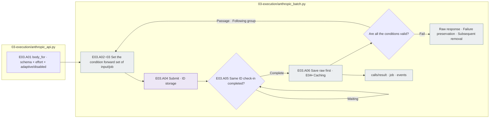
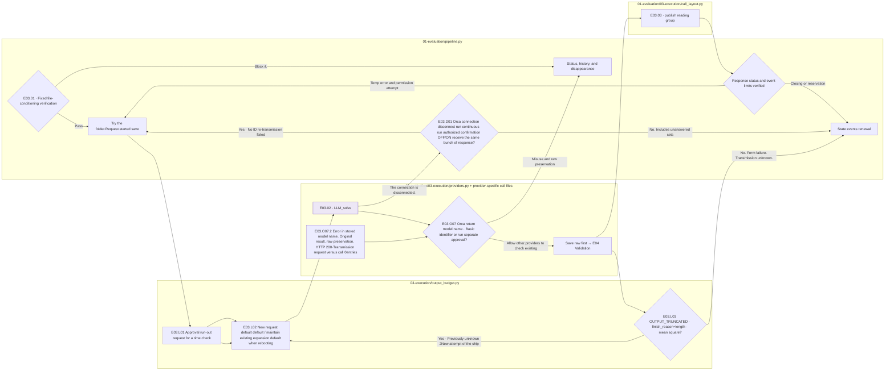
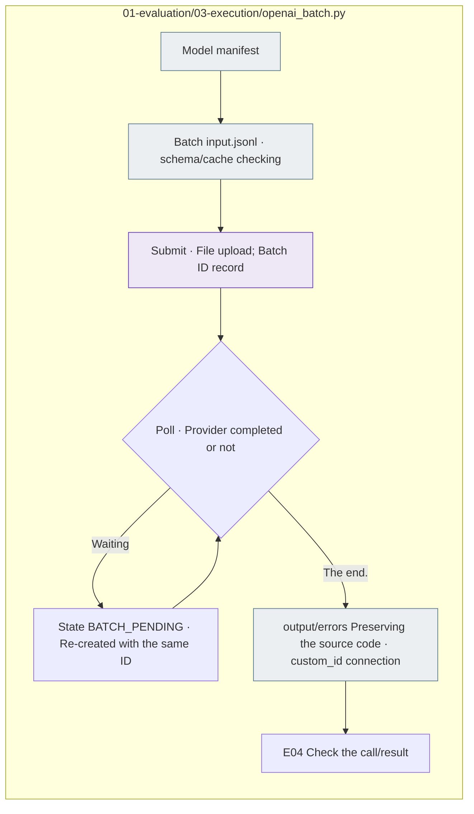

# E03 The subject of the LLM grass and raw response preservation

[Top of the list: Evaluation](../README.md) · [Previous: E0]2 Request](../02_request/README.md) · [Next: E0]4 Validation](../04_validation/README.md)

## Usage

The next command runs from the project root. `RUN_PATH` `prepare`It's an experimental folder that G.O.A. has created, and it uses the same path as the experiment that he's already created.

```sh
RUN_PATH=reports/experiments-run/20261003-exp-004-tatqa-luna
PYTHONPATH=src .venv/bin/python -u -B -m finarch.experiments.pipeline run --evaluation-only --run "$RUN_PATH"
tail -f "$RUN_PATH/pipeline.log"
```

E03 Instead of starting a new dedicated CLI, we use the top pipeline. `I'm going to be working on this.`Batch ID of the public status, completed/failed tooth check, and collect `calls/`Read the raw response and attempt records. Do not submit duplicates of the same running process or existing batch.

When the normal API execution starts, `state.json` `models.<model-key>.concurrency`I'm reading the current at the same time, and without the value, I'm going to be able to read the current at a similar time. `evaluation.schedule.concurrency`If the user approves the limit change, the end-response storage and runtime of the existing bundle will be checked and the operating state will be changed and the same as the default. `run --evaluation-only`The first attempt to config. manifest. prompt. schema. exist. `events.jsonl`·`pipeline.log`Write it down in E0.4 The report distinguishes between the current operating limit and the initial unbundling limit.

`OPENAI_BATCH_SUBMITTED`is submitted, `OPENAI_BATCH_PROGRESS`The process of handling the provider, `OPENAI_BATCH_VALIDATION_PROGRESS`The dryer completed the dryer is not going to be a local format dryer. `PIPELINE_EXIT`The entire end of the cycle is the root of the `full_pipeline.status`Check both the cache settings and the actual usage check and check the usage gap. 0It's not considered.

This step is to configure it as public only and send the fixed request to the actual provider, not add the private, and leave the success, failure and raw response of the request, and then send it to the real provider. **E0 for every response we gathered.4 Validation**Call it.

## Detailed steps and actual files.

|Step by step|Call file-function|What to do → input → output|
|---|---|---|
|E03.01 · check_execution|[pipeline.py](../../../../src/finarch/experiments/01-evaluation/pipeline.py) `run()`, `verify()`; [providers.py](../../../../src/finarch/experiments/01-evaluation/03-execution/providers.py) `preflight()`|Synchronized run·configure → hash·generator·cache·reopen state verification → run queue or block record|
|E03.02 · LLM_solve|`providers.call()` → [openai_api.py](../../../../src/finarch/experiments/01-evaluation/03-execution/openai_api.py) / [anthropic_api.py](../../../../src/finarch/experiments/01-evaluation/03-execution/anthropic_api.py) / [orca_api.py](../../../../src/finarch/experiments/01-evaluation/03-execution/orca_api.py) `call()` My back.|Request → Provider-by-provider body write → Transmission → Transmission request;raw; Usage/Rate|
|E03.03 · record_attempt|`pipeline.run()` · [call_layout.py](../../../../src/finarch/experiments/01-evaluation/03-execution/call_layout.py) `publish()`|Trial by Trial record.4 Results → Re-read/add-on processing; read bundle renewal → calls; state; events|
|E03.L01~03 · output_budget|[output_budget.py](../../../../src/finarch/experiments/01-evaluation/03-execution/output_budget.py) `configure / policy_for / prepare_attempt / retry_truncated`|The run-by-run approval, settlement request, previous attempt, new request default, only the actual length of the end 2Ship extension → original preserved request copy; actual shane; case also basis|
|E03.O07 · returned_model_policy|[orca_api.py](../../../../src/finarch/experiments/01-evaluation/03-execution/orca_api.py) `accepted_returned_models / configure_returned_model / revalidate_returned_models`|Additional date-based return identifiers allowed, the specified storage response of the HTTP-transmission request and the E04 Re-examination → original error;raw preserved test result; new call 0entries|

The compatibility process for changing the schema expression for the provider is only done within the transmission boundary, keeping the original synchronous schema. For example, the nullable expression transformation in Anthropic is for transmission, not creating a new experimental classification system.

Haiku 5.5is E02Adjusted to `reasoning_effort` `output_config.effort`, `thinking_type` `thinking.type`On is adaptive and OFF at max/xhigh blocks before calling. 4.5The ON request maintains the existing enabled·budget_tokens. The Anthropic Batch checks each forward request for the set set set set-up and reference conditions, and submits a follow-up batch after all responses have passed the formatting and cache test. 5.5 Both conditions of max apply this forward test, which preserves the return raw response and the effort·thinking_type of the request together.



The grey is the actual batch submission of the saved file, the bolay. It keeps the failed, undervalued, unverified usage as it is and does not recall the normal completed response. The number of requests and cost of this run is the plan, the actual usage is the result criterion collected.



The boar is the actual LLM call position. Requests that are unclear whether or not to be delivered are not automatically randomly recalled. The format failure is not immediately converted into a new request by the pool, and the permissible temporary error reset is also stored in the new attempt.

Whether or not the remote processing of Orca's disconnect and usage are uncertain. `disconnect_recovery.continue_unsubmitted=true`And if you have an authorization statement and you've completed the OFF/ON preview, if you have a real receiving response in the same set, you save that failed ID and continue to process the unresponsive request. `NETWORK_DISCONNECTS_PRESERVED` Save ID to event, send the message, run or not, automatically retransmit 0It records the circles.

If the user approves the date-type return identifier for the run, `orca_api.configure_returned_model()`This one. `runtime-overrides.json`And state to state `returned_model_policy`The request model is the `deepseek/deepseek-v4.1-flash`The real answer to this question is `model_version`It's preserved and approved. `deepseek-v4-1-flash-260910`It doesn't mean an accurate weighting identification or a determination of the supply route. `revalidate_returned_models()`is the default HTTP 200 The model name checks the error to save raw and re-check it to the actual transmission request. `result-before-returned-model-recovery.json`The test is based on `returned-model-recovery.json`The new model calls are 0It's that form failure, the way override, the transmission uncertainty, they preserve each state.

Orca's request-by-request output limit is only for user-authorized runs. `configure-output-budget --model-key <key> --authorization '< real instructions>' --base-output-tokens 8194`So, for example, we're going to register as 8,194The actual request that was cut from the token was 16,388Request back to the token, and the general format failure is preserved. 65,536The request that was cut from the token was 131,072It's a token. The extension is a specified source. 384,000And this value is not the same as all new requests, and it doesn't overlap the manifest-config and previous attempts. `request.json / started.json / result.json` `output_budget`and `OUTPUT_BUDGET_ATTEMPT / OUTPUT_BUDGET_INCREASED` It's a length re-review that separates it from the rate limit re-reviewer and doesn't reduce the simultaneous limit.

When you explicitly restart an execution that is closed due to the authentication key limit, the top `finarch.experiments.pipeline run --evaluation-only --resume-limits --run <run>`It only handles the short-range transmission, explicit refusal, authorized length re-interpretation, and updates the coordinator's actual PID, preview visual, command, and CWD. Analysis doesn't start.

## The output of the actual run

```text
The experiment ID.01_evaluation/03_execution/<model>/calls/<case>/<type>/
├── <case>-unguided-R-off.json reading the current result of the request-response set
└── _records/<trial_id>/attempt-001/
    ── request.json internal request copy
    ── started.json Start-Act code hash
    ── cache-control.json Cache control check
    ── provider-request.json request from the provider
    ── raw-response.json received raw response
    └── result.json                  E04 Status, pasting response, scan, use capacity
```

OpenAI is a case of `provider-request-wire.json`, `http.json`There are also timeout, computer failure, pre-blocking, and there may be no raw or HTTP files, which distinguishes between local errors and post-transmission uncertainty.

The real case: [Haiku reading bunch](../../../../reports/experiments-run/20260926-exp-001/haiku-4.5-api/calls/test-0006/00-Original/test-0006-P0-R-off.json), [Luna run](../../../../reports/experiments-run/20260923-exp-009/README.md). `00-Original`, `01-IC-value-before`through `07-EA-02`The type folder up to [call_layout.py](../../../../src/finarch/experiments/01-evaluation/03-execution/call_layout.py)It's defined as the shape of the `02-calls` There's also a corresponding path to reading records.

## Selective restricted run record

[improvement_run.py](../../../../src/finarch/experiments/02-analysis/legacy/comparison/improvement_run.py) `prepare()`The General Preparation **After that,** `00-implementation` Add a copy of the code. `run_wave()` `improvement-waves/wave-0001`And it makes a status record. `00-implementation` 00Running order 0It's not interpreted as a step. `pipeline.prepare()`There's no such folder.

The actual cost-to-completion is looking at the trial-by-test result-state instead of the plan's estimate.4 The pre-test and post-test records are in the same attempt, and they're not two separate model calls.

## OpenAI Native Batch route

The run that the user chose Batch is [openai_batch.py](../../../../src/finarch/experiments/01-evaluation/03-execution/openai_batch.py) `prepare_job → submit → poll → process`It's different from a typical API request.



The gray is file, bolas, LLM job submission provider. `01_evaluation/03_execution/<model>/batches/batch-001/` `input.jsonl`It's a real transmission format, `job.json`The ID status, `output.jsonl`·`errors.jsonl`It's a raw response. If the submission is unclear, it's checked with the same input_file_id, and it's not re-submitted. 0It doesn't show in seconds.

And the star-shaped messages of the responses. `phase=final_answer`When the final JSON is returned together, it reads from the final_answer and preserves the entire envelope as the original. It calculates the cost of the grass using the formal batch unit and the return usage and distinguishes it from the bill counterparts. 1Run the car.](../../../../reports/experiments-run/20260927-exp-001/README.md).
