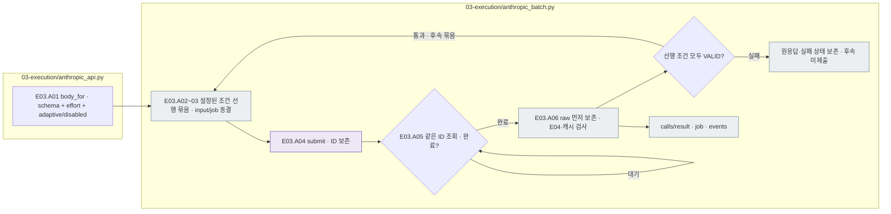
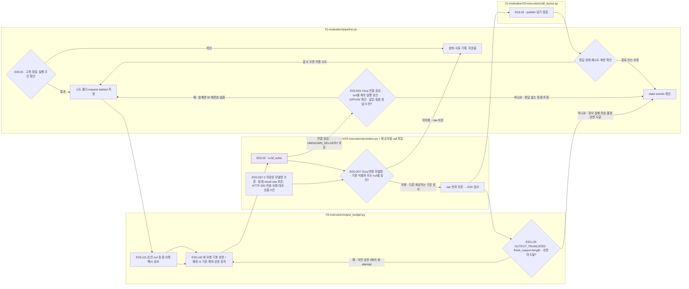
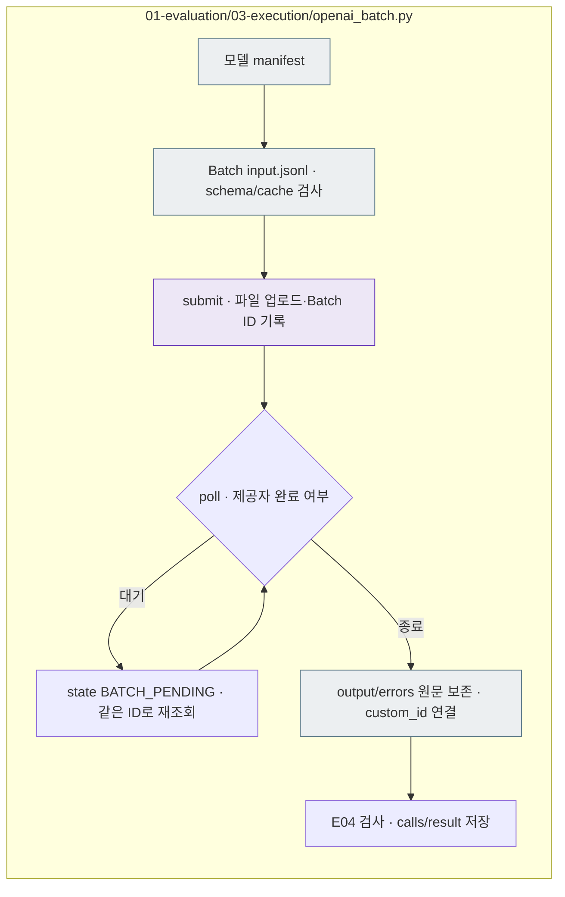

# E03 — 대상 LLM 풀이와 원응답 보존

[상위: Evaluation](../README.md) · [이전: E02 요청](../02_request/README.md) · [다음: E04 검사](../04_validation/README.md)

## 사용법

다음 명령은 프로젝트 루트에서 실행합니다. `RUN_PATH`는 `prepare`가 출력한 실험 폴더입니다. 이미 생성한 실험을 이어갈 때는 같은 경로를 사용합니다.

```sh
RUN_PATH=reports/experiments-run/20261003-exp-004-tatqa-luna
PYTHONPATH=src .venv/bin/python -u -B -m finarch.experiments.pipeline run --evaluation-only --run "$RUN_PATH"
tail -f "$RUN_PATH/pipeline.log"
```

E03 전용 CLI를 새로 띄우는 대신 상위 pipeline을 사용합니다. `batches/<묶음>/job.json`의 Batch ID·제공자 상태·완료/실패 건수를 확인하고, 수집 후 `calls/`의 원응답과 시도 기록을 읽습니다. 동일 실행 중 프로세스나 기존 Batch를 중복 제출하지 않습니다.

일반 API 실행은 시작할 때 `state.json`의 `models.<model-key>.concurrency`를 현재 동시 한도로 읽고, 값이 없으면 동결한 `evaluation.schedule.concurrency`를 사용합니다. 사용자가 한도 변경을 승인하면 기존 묶음의 종료·응답 저장과 실행기 종료를 확인한 뒤 운영 상태만 변경하고 같은 `run --evaluation-only`로 이어갑니다. 최초 config·manifest·prompt·schema·기존 시도는 보존하며 변경 전후 값과 승인은 `events.jsonl`·`pipeline.log`에 기록합니다. E04 보고서는 현재 운영 한도와 최초 동결 한도를 구별합니다.

`OPENAI_BATCH_SUBMITTED`는 제출, `OPENAI_BATCH_PROGRESS`는 제공자의 처리 현황, `OPENAI_BATCH_VALIDATION_PROGRESS`는 수집한 응답의 로컬 검사입니다. 제공자가 완료한 건수가 곧 로컬 형식 통과 건수는 아닙니다. `PIPELINE_EXIT`는 Evaluation의 한 조회 사이클 반환 기록이므로 전체 종료는 루트 `full_pipeline.status`로 확인합니다. 캐시 설정과 실제 usage 검사를 모두 확인하며 사용량 누락을 0으로 간주하지 않습니다.

이 단계는 public에서만 구성해 고정한 요청을 실제 제공자에게 보냅니다. private를 읽어 전송 내용을 추가하지 않습니다. 요청 한 건의 성공·실패와 원응답을 남기고, **수집한 응답마다 E04 검사**를 호출합니다.

## 세부 스텝과 실제 파일

|스텝|호출 파일·함수|입력 → 해야 할 일 → 출력|
|---|---|---|
|E03.01 · check_execution|[pipeline.py](../../../../src/finarch/experiments/01-evaluation/pipeline.py) `run()`, `verify()`; [providers.py](../../../../src/finarch/experiments/01-evaluation/03-execution/providers.py) `preflight()`|동결 run·설정 → 해시·제공자·캐시·재개 가능 상태 확인 → 실행 큐 또는 차단 기록|
|E03.02 · LLM_solve|`providers.call()` → [openai_api.py](../../../../src/finarch/experiments/01-evaluation/03-execution/openai_api.py) / [anthropic_api.py](../../../../src/finarch/experiments/01-evaluation/03-execution/anthropic_api.py) / [orca_api.py](../../../../src/finarch/experiments/01-evaluation/03-execution/orca_api.py) `call()` 등|요청 → 제공자별 body 작성·전송 → 전송 요청·raw·사용량/오류|
|E03.03 · record_attempt|`pipeline.run()` · [call_layout.py](../../../../src/finarch/experiments/01-evaluation/03-execution/call_layout.py) `publish()`|시도별 기록·E04 결과 → 재시도/종료 처리·읽기 묶음 갱신 → calls·state·events|
|E03.L01~03 · output_budget|[output_budget.py](../../../../src/finarch/experiments/01-evaluation/03-execution/output_budget.py) `configure / policy_for / prepare_attempt / retry_truncated`|run별 승인·동결 요청·이전 시도 → 새 요청 기본 상한, 실제 length 종료만 2배 확대 → 원본 보존한 요청 사본·실제 상한·재시도 근거|
|E03.O07 · returned_model_policy|[orca_api.py](../../../../src/finarch/experiments/01-evaluation/03-execution/orca_api.py) `accepted_returned_models / configure_returned_model / revalidate_returned_models`|run별 승인 → 날짜형 반환 식별자 추가 허용, 지정된 저장 응답의 HTTP·전송 요청 대조와 E04 재검사 → 원래 오류·raw를 보존한 검사 결과·새 호출 0건|

제공자용 schema 표현을 바꾸는 호환 처리는 전송 경계에서만 합니다. 원래 동결 schema는 유지합니다. 예를 들어 Anthropic의 nullable 표현 변환은 전송용이며 새로운 실험 분류 체계를 만드는 것이 아닙니다.

Haiku 5.5는 E02에 고정한 `reasoning_effort`를 `output_config.effort`로, `thinking_type`을 `thinking.type`으로 전달합니다. ON은 adaptive이며 max/xhigh에서 OFF는 호출 전에 차단합니다. Haiku 4.5의 ON 요청은 기존 enabled·budget_tokens를 유지합니다. Anthropic Batch는 설정된 풀이·추론 조건 각각의 선행 요청을 검사하고, 모든 응답이 형식·캐시 검사를 통과한 뒤 후속 묶음을 제출합니다. 5.5 max의 두 조건도 이 선행 검사를 적용합니다. 반환 원응답과 요청의 effort·thinking_type을 함께 보존합니다.



회색은 저장 파일, 보라는 실제 Batch 제출입니다. 실패·미평가·미확인 사용량을 그대로 보존하며 정상 완료 응답을 다시 호출하지 않습니다. 요청 수와 비용은 이 run의 plan, 실제 사용량은 수집한 result가 기준입니다.



보라는 실제 LLM 호출 위치입니다. 전달 여부가 불명확한 요청은 무작정 자동 재호출하지 않습니다. 형식 실패를 곧바로 새 풀이 요청으로 바꾸지 않으며, 허용된 일시 오류 재시도도 새 attempt에 저장합니다. 세부 재시도 횟수·한도는 해당 run config가 기준입니다.

Orca 연결 끊김의 원격 처리 여부와 사용량은 미확인입니다. run 상태의 `disconnect_recovery.continue_unsubmitted=true`와 승인 문구가 있고 OFF/ON 선행 검사를 마친 경우, 같은 묶음에 실제 수신 응답이 있으면 해당 실패 ID를 보존하고 미전송 요청만 계속 처리합니다. 응답 없는 묶음, 그 밖의 전송 불명, 인증·계정 한도·캐시 오류는 중단합니다. `NETWORK_DISCONNECTS_PRESERVED` 이벤트에 보존 ID·수신 건수·계속 실행 여부·자동 재전송 0회를 기록합니다.

사용자가 해당 run의 날짜형 반환 식별자를 승인하면 `orca_api.configure_returned_model()`이 `runtime-overrides.json`과 state에 `returned_model_policy`를 기록합니다. 요청 모델은 `deepseek/deepseek-v4.1-flash`이고 응답의 실제 `model_version`을 그대로 보존하며, 승인된 `deepseek-v4-1-flash-260910`만 추가 허용합니다. 이는 정확한 가중치 동일성 확인이나 공급 경로 고정을 뜻하지 않습니다. `revalidate_returned_models()`는 지정한 HTTP 200 모델명 검사 오류를 저장 raw와 실제 전송 요청으로 재검사합니다. 원래 result는 `result-before-returned-model-recovery.json`, 검사 근거는 `returned-model-recovery.json`에 남기며 새 모델 호출은 0건입니다. 형식 실패·길이 초과·전달 불확실은 각 상태로 보존합니다.

Orca의 요청별 출력 상한은 사용자가 승인한 run에만 `configure-output-budget --model-key <key> --authorization '<실제 지시>' --base-output-tokens 8194`로 등록합니다. 예를 들어 8,194토큰에서 실제로 잘린 요청은 16,388토큰으로 다시 요청하고, 일반 형식 실패는 보존합니다. 이미 65,536토큰에서 잘린 요청은 131,072토큰으로 재시도합니다. 확대는 지정 상한(기본 384,000)에서 멈추며, 이 값은 새 요청 모두의 상한이 아닙니다. 동결 manifest·config와 이전 시도를 덮어쓰지 않습니다. `request.json / started.json / result.json`의 `output_budget`와 `OUTPUT_BUDGET_ATTEMPT / OUTPUT_BUDGET_INCREASED` 이벤트를 확인합니다. length 재시도는 rate limit 재시도와 구분하며 동시 한도를 축소하지 않습니다.

인증·키 한도 때문에 종료된 실행을 명시적으로 재개할 때는 상위 `finarch.experiments.pipeline run --evaluation-only --resume-limits --run <run>`을 사용합니다. 미전송, 명시적 거절, 승인된 length 재시도만 처리하고 coordinator의 실제 PID·시작 시각·명령·CWD를 갱신합니다. Analysis는 시작하지 않습니다.

## 실제 run의 산출물

```text
<실험ID>/01_evaluation/03_execution/<model>/calls/<case>/<type>/
├── <case>-unguided-R-off.json              현재 결과를 읽는 요청·응답 묶음
└── _records/<trial_id>/attempt-001/
    ├── request.json                 내부 요청 원본
    ├── started.json                 시작·실행 코드 해시
    ├── cache-control.json           캐시 통제 검사
    ├── provider-request.json        제공자 요청
    ├── raw-response.json            받은 원응답
    └── result.json                  E04 상태·파싱 응답·검사·사용량
```

OpenAI 사례에는 `provider-request-wire.json`, `http.json`도 있습니다. timeout·제공자 실패·호출 전 차단이면 raw나 HTTP 파일이 없을 수 있습니다. 로컬 오류와 전송 후 불명확 상태를 구분합니다.

실제 사례: [Haiku 읽기 묶음](../../../../reports/experiments-run/20260926-exp-001/haiku-4.5-api/calls/test-0006/00-Original/test-0006-P0-R-off.json), [Luna run](../../../../reports/experiments-run/20260923-exp-009/README.md). `00-Original`, `01-IC-value-before`부터 `07-EA-02`까지의 유형 폴더는 [call_layout.py](../../../../src/finarch/experiments/01-evaluation/03-execution/call_layout.py)에 정의되어 있습니다. 구형 `02-calls` 기록도 읽는 호환 경로가 있습니다.

## 선택적인 제한 실행 기록

[improvement_run.py](../../../../src/finarch/experiments/02-analysis/legacy/comparison/improvement_run.py)의 `prepare()`는 일반 준비 **이후** `00-implementation` 코드 사본을 추가합니다. `run_wave()`는 `improvement-waves/wave-0001`과 상태 기록을 만듭니다. `00-implementation`의 00을 실행 순서 0단계로 해석하지 않습니다. 일반 `pipeline.prepare()`에는 이 폴더가 없습니다.

실제 비용·완료는 plan의 예상값 대신 시도별 결과·state를 봅니다. E04 검사 전후 기록은 같은 attempt 안에 있으며, 둘이 독립된 두 번의 모델 호출은 아닙니다.

## OpenAI Native Batch 경로

사용자가 Batch를 선택한 run은 [openai_batch.py](../../../../src/finarch/experiments/01-evaluation/03-execution/openai_batch.py)의 `prepare_job → submit → poll → process`를 사용합니다. 병렬 일반 API 요청과 다릅니다.



회색은 파일, 보라는 제공자 LLM 작업 제출입니다. `01_evaluation/03_execution/<model>/batches/batch-001/`의 `input.jsonl`은 실제 전송 형식, `job.json`은 ID·상태, `output.jsonl`·`errors.jsonl`은 원응답입니다. 제출 여부가 불명확하면 같은 input_file_id로 조회하고 중복 제출하지 않습니다. 완료·실패·만료의 반환 기록을 보존하며 누락 응답은 미평가입니다. Batch에는 건별 latency가 제공되지 않으므로 0초로 표시하지 않습니다.

Responses의 별도 보조 메시지와 `phase=final_answer`가 함께 반환되면 최종 JSON은 final_answer에서 읽고 전체 envelope는 원문으로 보존합니다. 공식 Batch 단가와 반환 usage로 풀이 비용을 집계하며 청구서 대조액과 구분합니다. [실제 1차 run](../../../../reports/experiments-run/20260927-exp-001/README.md).
