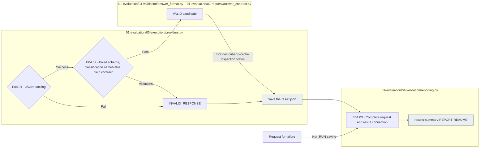
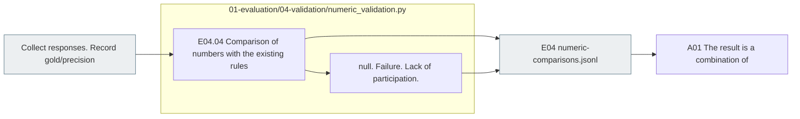

# E04 Format validation ·Total evaluation; result collection

[Top of the list: Evaluation](../README.md) · [Previous: E0]3 Run](../03_execution/README.md) · [Next: A0]1 Result collection](../../02_analysis/01_results/README.md)

## Usage

The next command runs from the project root. `RUN_PATH` `prepare`It's an experimental folder that G.O.A. has created, and it uses the same path as the experiment that he's already created.

```sh
RUN_PATH=reports/experiments-run/20261003-exp-004-tatqa-luna
PYTHONPATH=src .venv/bin/python -u -B -m finarch.experiments.pipeline report --run "$RUN_PATH"
```

`report`The normal path to proceed to the new original number comparison is to generate the data and the status statistics as a saved attempt. `run --evaluation-only --run "$RUN_PATH"`After completion of the collection of E04. `report`It's not just that we're running a new calculation until we compare the numbers.

`REPORT.md`·`summary.json` → `<model>/results.jsonl` → `numeric-comparisons.jsonl` → Individual `calls/` I check the raw response sequence, and I read the subset, the formatting failure, the numerical comparison failure separately. `EVALUATION_COMPLETE`The collection-test pathway is complete and does not mean that all responses pass through the form or mean the correct answer.

For example, `answer=-2`is `negative=false`It's a side-by-side agreement dissonance. On the contrary, JSON is correct and the code is correct, and you could have solved the question wrong.4 **Record the numerical comparison of the form and functional state and the existing set of exact answers, respectively.**The new run is numeric_validation.py is E04Record the numerical comparison in the past.1 The numerical comparison file is preserved.

## Detailed steps and actual files.

|Step by step|Call file-function|What to do → input → output|
|---|---|---|
|E04.01 · parse_response|[providers.py](../../../../src/finarch/experiments/01-evaluation/03-execution/providers.py) `call()`The following is the list of|The response text of raw → JSON pasting → response or pasting failure|
|E04.02 · check_schema_and_fields|[answer_format.py](../../../../src/finarch/experiments/01-evaluation/04-validation/answer_format.py) `response_errors()` → [answer_contract.py](../../../../src/finarch/experiments/01-evaluation/02-request/answer_contract.py) `response_errors()`|Answer: schema/number of the request → structure, classification, classification and value, symbol, null, accuracy check → error list|
|E04.03 · record_results|[reporting.py](../../../../src/finarch/experiments/01-evaluation/04-validation/reporting.py) `build(root)`|Planning request; city results → misadventures included link; collection → results/summary/REPORT/README|
|E04.04 · compare_reference|[numeric_validation.py](../../../../src/finarch/experiments/01-evaluation/04-validation/numeric_validation.py) `build()`|Answer: Correct gold/precision → Apply the existing number comparison rules → E04 Original match/disagreement/disappointment of the results and source|

The current classification field agreement is the unuided solving `classification=null`The five permissible classifications of Criteria-Guided Solving, the number of ANSWERABLE, and the null of the remaining classifications, which is the matching of the model's declaration with the output format, and not the judgement that the classification or calculation is actually correct.

Current `VALID`It's a storage state that has passed schema and additional field agreements, and it's also different from the simple JSON pasting success.



The grey is the file.4.01~03So this is the connection of E0.4.04The result of the test failure and failure to perform is left in the statistics but is not counted as meaningful success.



It preserves the existing storage results, doesn't change the comparison criteria or past judgments in the connection process of a new execution, and doesn't perform a new case-response probability check.

## The actual run's output and reading order

```text
The first is the "experimental ID".
├── 01_evaluation/
│   ├── 03_execution/<model>/calls/.../_records/<trial>/attempt-001/result.json
│   └── 04_validation/
│       ├── REPORT.md, summary.json, README.md
│       ├── numeric-comparisons.jsonl
│       └── <model>/
│ ── results.jsonl request-by-request format status; reply connection
│ ── summary.json model conditionally compiled
│ ── ReadME.md results in the order of reading
└── 02_analysis/01_results/          E04 The first is the study of the human brain.
```

You can also read files from past storage structures.

1. [Acts README](../../../../reports/experiments-run/20260926-exp-001/README.md)And state to see the preparation, the action, the material.
2. [results.jsonl](../../../../reports/experiments-run/20260926-exp-001/haiku-4.5-api/03-results/results.jsonl)I see the state and error per request.
3. The raw order of the read bundle → attempt, the exact order of the requests, contrasts the causes.

`reporting.build()`And it's going to be done right after the preparation. `NOT_RUN` The resulting folder doesn't mean the model call is complete.](../../../../src/finarch/experiments/templates/ordered-run-readme-template.md)[model template](../../../../src/finarch/experiments/templates/ordered-model-readme-template.md)It's generated from.

## The boundary when you go to Analysis.

Current `layout_version=2` `reporting.build()`is the form-acting state, and the same E04 `numeric_validation.build()`So we're going to compare the numbers to the fixed standard of private. `reporting.screen()`The old A0 is the old A0 for the old A0.1 The path or `reporting.screen()`There's also a storage comparison result.1So this is how silver is **Connect the already stored ratings and raw with the source**And the missing values are left in the U-March.4It's different to integrate a run into a run and repurchase an existing run.

The denominator of the format pass rate is the total plan request. The original number comparison is performed only in the evaluated original response, and the failure-null-misrepresentation is presented with the odd quantity and the total denominator.
