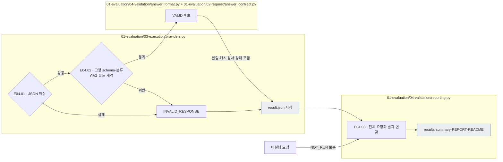
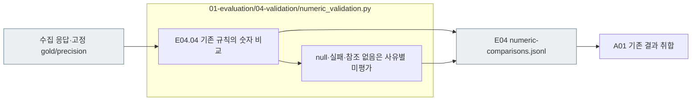

# E04 — 형식 검사·수치 평가·결과 수집

[상위: Evaluation](../README.md) · [이전: E03 실행](../03_execution/README.md) · [다음: A01 결과 취합](../../02_analysis/01_results/README.md)

## 사용법

다음 명령은 프로젝트 루트에서 실행합니다. `RUN_PATH`는 `prepare`가 출력한 실험 폴더입니다. 이미 생성한 실험을 이어갈 때는 같은 경로를 사용합니다.

```sh
RUN_PATH=reports/experiments-run/20261003-exp-004-tatqa-luna
PYTHONPATH=src .venv/bin/python -u -B -m finarch.experiments.pipeline report --run "$RUN_PATH"
```

`report`는 저장된 시도·응답으로 수집 보고서와 상태 집계를 다시 생성하며 모델 호출은 하지 않습니다. 새 원본 숫자 비교까지 진행하는 정상 경로는 `run --evaluation-only --run "$RUN_PATH"`의 수집 완료 후 E04입니다. `report`만 실행했다고 숫자 비교까지 새로 계산되었다고 판단하지 않습니다.

`REPORT.md`·`summary.json` → `<model>/results.jsonl` → `numeric-comparisons.jsonl` → 개별 `calls/` 원응답 순으로 확인합니다. 미수집, 형식 실패, 숫자 비교 불가를 별도로 읽습니다. `EVALUATION_COMPLETE`는 수집·검사 경로 완료이며 모든 응답의 형식 통과나 의미 정답을 뜻하지 않습니다.

예를 들어 `answer=-2`인데 `negative=false`이면 계약 불일치입니다. 반대로 JSON이 맞고 부호도 맞아도 질문을 잘못 풀었을 수 있습니다. E04는 **형식·실행 상태와 기존 정답 기준의 숫자 비교를 각각 기록**하는 단계로 정리합니다. 새 run은 numeric_validation.py가 E04에 숫자 비교를 기록합니다. 과거 A01 숫자 비교 파일은 그대로 보존합니다.

## 세부 스텝과 실제 파일

|스텝|호출 파일·함수|입력 → 해야 할 일 → 출력|
|---|---|---|
|E04.01 · parse_response|[providers.py](../../../../src/finarch/experiments/01-evaluation/03-execution/providers.py) `call()`의 수신 후 구간|raw의 응답 텍스트 → JSON 파싱 → response 또는 파싱 실패|
|E04.02 · check_schema_and_fields|[answer_format.py](../../../../src/finarch/experiments/01-evaluation/04-validation/answer_format.py) `response_errors()` → [answer_contract.py](../../../../src/finarch/experiments/01-evaluation/02-request/answer_contract.py) `response_errors()`|응답·그 요청의 schema/자릿수 → 구조·분류명·분류와 값·부호·null·정밀도 검사 → 오류 목록|
|E04.03 · record_results|[reporting.py](../../../../src/finarch/experiments/01-evaluation/04-validation/reporting.py) `build(root)`|계획 요청·시도 결과 → 미실행 포함 연결·집계 → results/summary/REPORT/README|
|E04.04 · compare_reference|[numeric_validation.py](../../../../src/finarch/experiments/01-evaluation/04-validation/numeric_validation.py) `build()`|응답·고정 gold/precision → 기존 숫자 비교 규칙 적용 → E04 결과의 원본 일치/불일치/미평가와 출처|

현행 분류 필드 계약은 Unguided Solving의 `classification=null`, Criteria-Guided Solving의 다섯 허용 분류, ANSWERABLE의 숫자와 나머지 분류의 null을 확인합니다. 이는 모델의 선언과 출력 형식의 일치이며, 분류나 계산이 사실상 옳다는 판정은 아닙니다. 기존 응답은 동결된 이전 계약으로 검사합니다.

현재 `VALID`는 schema와 추가 필드 계약 등을 통과한 저장 상태입니다. 단순 JSON 파싱 성공과도 다릅니다. 제공자의 잘림·캐시 정책 실패는 별도 실패 상태로 남을 수 있습니다.



회색은 파일입니다. 위 그림은 현재 E04.01~03의 연결입니다. E04.04는 아래 연결로 구현했습니다. 검사 실패·미실행도 결과 집계에 남기되 의미 성공으로 세지 않습니다. 이 단계에는 새 LLM 호출이 없습니다.



기존 저장 결과는 보존합니다. 새 실행의 연결 과정에서 비교 기준이나 과거 판정을 바꾸지 않습니다. 새 문항 답변 가능성 검증은 수행하지 않습니다.

## 실제 run의 산출물과 읽는 순서

```text
reports/experiments-run/<실험ID>/
├── 01_evaluation/
│   ├── 03_execution/<model>/calls/.../_records/<trial>/attempt-001/result.json
│   └── 04_validation/
│       ├── REPORT.md, summary.json, README.md
│       ├── numeric-comparisons.jsonl
│       └── <model>/
│           ├── results.jsonl       요청별 형식 상태·응답 연결
│           ├── summary.json        모델·조건별 집계
│           └── README.md           결과 읽는 순서
└── 02_analysis/01_results/          E04 평가와 원응답을 취합
```

과거 저장 구조의 파일도 읽을 수 있습니다.

1. [실행 README](../../../../reports/experiments-run/20260926-exp-001/README.md)와 state로 준비·진행·종료를 봅니다.
2. [results.jsonl](../../../../reports/experiments-run/20260926-exp-001/haiku-4.5-api/03-results/results.jsonl)에서 요청별 상태와 오류를 봅니다.
3. 읽기 묶음 → attempt의 raw·고정 요청 순으로 원인을 대조합니다. 한 응답의 오류 여러 개를 실패 요청 여러 건으로 세지 않습니다.

`reporting.build()`는 준비 직후에도 실행되어 `NOT_RUN` 결과를 만듭니다. 결과 폴더 존재는 모델 호출 완료를 뜻하지 않습니다. README는 [run 템플릿](../../../../src/finarch/experiments/templates/ordered-run-readme-template.md), [model 템플릿](../../../../src/finarch/experiments/templates/ordered-model-readme-template.md)에서 생성됩니다.

## Analysis로 넘길 때의 경계

현재 `layout_version=2`의 `reporting.build()`는 형식·실행 상태를 집계하고, 같은 E04의 `numeric_validation.build()`가 private의 고정 기준으로 숫자를 비교합니다. `reporting.screen()`의 기존 비교 규칙을 재사용합니다. 이전 형식의 run에는 옛 A01 경로 또는 `reporting.screen()`의 저장 비교 결과도 있습니다. 새 A01은 이처럼 **이미 저장된 평가와 raw를 출처와 함께 연결**하며, 없는 평가는 미기록으로 둡니다. 숫자 비교 코드의 책임을 E04에 통합하는 것과 기존 run을 재채점하는 것은 다릅니다.

형식 통과율의 분모는 전체 계획 요청입니다. 원본 숫자 비교는 평가 가능한 원본 응답에만 수행하며, 실패·null·미실행은 별도 수량과 전체 분모를 함께 제시합니다. 변형에는 원본 gold를 정답으로 복사하지 않습니다.
