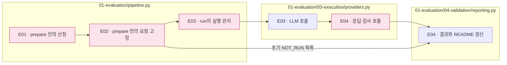

# 01 Evaluation — 요청·풀이·응답 수집

[상위: 실험 전체](../README.md) · [이전: Input](../00_input/README.md) · [다음: Analysis](../02_analysis/README.md)

## 사용법

다음 명령은 프로젝트 루트에서 실행합니다. `RUN_PATH`는 `prepare`가 출력한 실험 폴더입니다. 이미 생성한 실험을 이어갈 때는 같은 경로를 사용합니다.

```sh
RUN_PATH=reports/experiments-run/20261003-exp-004-tatqa-luna
PYTHONPATH=src .venv/bin/python -u -B -m finarch.experiments.pipeline run --evaluation-only --run "$RUN_PATH"
tail -f "$RUN_PATH/pipeline.log"
```

이 명령은 E03 Batch 제출·조회·수집과 E04 검사를 이어가며 Analysis 전에 끝납니다. `evaluation --run "$RUN_PATH"`는 한 번의 제출/조회/수집 사이클만 수행하므로, 완료까지 계속 확인할 때는 위 `run --evaluation-only`를 사용합니다. 이미 같은 pipeline이 실행 중이면 추가로 띄우지 않습니다.

API Evaluation은 Native Batch입니다. 기존 Batch ID가 있으면 그 ID로 조회·수집합니다. 새 실험을 만들려는 경우에만 `prepare`를 사용합니다. 준비한 원본·변형 입력 × 풀이 지시 2종 × 추론 설정 2종이 계획 요청 수이며 이번 실행은 291 × 8 × 4 = 9,312건입니다.

이 영역의 목표는 **같은 입력을 정한 조건으로 풀게 하고, 응답과 정해진 기준의 평가 결과를 빠짐없이 남기는 것**입니다. Analysis는 이 결과들을 연결해 조건별·유형별 관계를 해석합니다. 독립 문항 검증을 Analysis의 다음 절차로 요구하지 않습니다.

|순서|단계와 실제 진입점|입력 → 산출물|
|---|---|---|
|E01|[01_preparation](01_preparation/README.md) · `pipeline.prepare()` → `dataset.select()`|data/generated 합본·요건 → 대상 목록·public/private·config|
|E02|[02_request](02_request/README.md) · 같은 `pipeline.prepare()`의 요청 작성 부분|대상·정의·조건 → 동결 prompt/schema·요청 manifest·계획·해시|
|E03|[03_execution](03_execution/README.md) · `pipeline.run()` → `providers.call()`|고정 요청 → 제공자 요청·원응답·호출 상태·비용 기록|
|E04|[04_validation](04_validation/README.md) · `response_errors()` → `reporting.build()`|원응답·run의 schema → 형식 상태·전체 결과·README. 기존 정답과의 숫자 비교도 이 단계에서 수행|



분홍색은 상세 README 연결입니다. subgraph는 실제 소스 파일입니다. E01~E04는 사람이 읽는 작업 순서이며 각각 별도 실행 파일이라는 뜻은 아닙니다. 실제로는 E03의 각 응답을 받자마자 E04를 처리하고 집계를 갱신합니다.

## 실행 경계

[pipeline.py](../../../src/finarch/experiments/01-evaluation/pipeline.py)의 `prepare`는 요청을 만들고 초기 결과를 저장합니다. `run`이 모델 호출을 시작합니다. 제한 실행 경로는 [improvement_run.py](../../../src/finarch/experiments/02-analysis/legacy/comparison/improvement_run.py)의 `prepare`·`run_wave`이며 코드 사본과 회차 기록을 추가합니다.

호출 전에는 모델·추론·캐시 지원, 요청 수·비용 추정, 출력 제한을 config와 plan으로 확인합니다. 이 문서 정리 작업은 실험 준비 명령이나 모델 호출을 실행하지 않습니다.

현재 `layout_version=2`에서 `reporting.build()`는 형식·실행 상태를 집계하고 `numeric_validation.build()`는 기존 규칙으로 숫자 비교를 수행합니다. **두 결과는 E04에 저장하고 A01은 저장된 결과를 취합합니다.** 과거 run의 평가 결과는 보존합니다. 문항 자체의 답변 가능성을 다시 검증하는 LLM 절차를 추가하는 것이 아닙니다.
