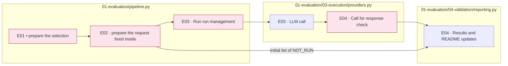

# 01 Evaluation  Request  Requests  Requirements  Collect

[Top: The whole experiment.](../README.md) · [Previous: Input](../00_input/README.md) · [Next: Analysis](../02_analysis/README.md)

## Usage

The next command runs from the project root. `RUN_PATH` `prepare`It's an experimental folder that G.O.A. has created, and it uses the same path as the experiment that he's already created.

```sh
RUN_PATH=reports/experiments-run/20261003-exp-004-tatqa-luna
PYTHONPATH=src .venv/bin/python -u -B -m finarch.experiments.pipeline run --evaluation-only --run "$RUN_PATH"
tail -f "$RUN_PATH/pipeline.log"
```

This command is E0.3 Batch submission, assembly, collection and E04 We're going to move the test and finish it before the analysis. `evaluation --run "$RUN_PATH"`The only way to do this is to run a single submission/review/request cycle, so keep checking until you're done. `run --evaluation-only`If the same pipeline is already running, it doesn't bounce.

API Evaluation is Native Batch, and if you have an existing Batch ID, you can use that ID to search and recruit, and only if you want to create a new experiment. `prepare`Use the prepared source, variable input x directed set 2Type x the set of the inference 2You can request a paper plan, and this execution is 291 × 8 × 4 = 9,312entries.

The goal of this area is to **And then we're going to have to release the same input with the same set of conditions, and then we'll have to leave the results of the evaluation of the response and the set of criteria unchanged.**Analysis connects these results and interprets the relationship between conditions and types, and doesn't require independent case verification as the next procedure in Analysis.

|In order.|The steps and the actual entrance points.|Input → output|
|---|---|---|
|E01|[01_preparation](01_preparation/README.md) · `pipeline.prepare()` → `dataset.select()`|Data/generated copy. Requirements → Subject list. Public/Private.config|
|E02|[02_request](02_request/README.md) · Same `pipeline.prepare()`The requesting part|Subject: Justice: Conditions → Conclusion prompt/schema: request manifest: plan: explanation|
|E03|[03_execution](03_execution/README.md) · `pipeline.run()` → `providers.call()`|Fixed requests → provider requests; raw response ·output status; cost record|
|E04|[04_validation](04_validation/README.md) · `response_errors()` → `reporting.build()`|The raw response of the run → schema → form state; overall result; readme. Numerical comparisons with existing answers are also performed at this stage|



The pink color is the detailed README connection. The subgraph is the actual source file.1~E04It's not a sequence of work that people read, and it doesn't mean that each of them is an executable file.3As soon as we get each response of E04I'm going to process it and update the statistics.

## Running boundaries

[pipeline.py](../../../src/finarch/experiments/01-evaluation/pipeline.py) `prepare`And then you create a request and you save the initial results. `run`This model starts calling. Restricted run path is at [improvement_run.py](../../../src/finarch/experiments/02-analysis/legacy/comparison/improvement_run.py) `prepare`·`run_wave`And then you add a copy of the code and a record of the reversal.

Before the call, model, report, cache support, request number, cost estimate, output limit are verified as config and plan. This document sorting task does not execute the experimental preparation command or model call.

Current `layout_version=2`in `reporting.build()`It's a form-and-action calculation. `numeric_validation.build()`And then we're going to do a numerical comparison with the existing rules. **So both results are E04Save to A01It's going to sum the stored results.** It preserves the evaluation results of past runs, not adding an LLM procedure that re-validates the answering possibilities of the case itself.
