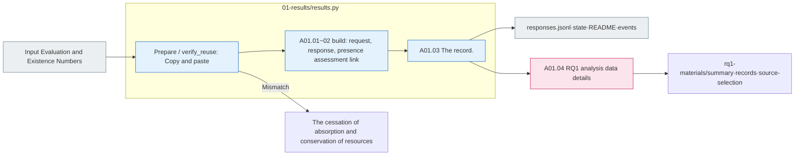

# A01 The results of the experiment were accumulated.

[Analysis of the top](../README.md) · [formerly E04](../../01_evaluation/04_validation/README.md) · [Next A0]2](../02_comparison/README.md)

## Usage

A01Silver upper `pipeline.py analysis --run "$RUN_PATH"` Or `run --run "$RUN_PATH"`So this is the first Python set to do this.2/A03 So you can call the model, so A0 is the1It's not just a command to execute.

The input is E0.2 The model manifest, E03 Save raw response, E04 The numerical evaluation, `00_input/private.jsonl`And that's the result. `responses.jsonl` → `state.json` It reads in plain language, connects the request to the response ID, the condition, the source/modifier metadata, the reason for the failure.1 `COLLECTED`is the data collection completed and a02/A03 It's not a complete or meaningful judgment.

**The goal:** Each request is linked to a single row of what conditions it's responded to, what evaluation results it's already stored, not re-open the source code or re-evaluate the answer.

For example, the same `test-0283`If the original/variant, model, condition, and reference settings are different, it's not a response. `answer=null`and `classification=UNRESOLVED`They're left with the values and classifications that each model returned, and they're not replaced with a numerical error.

## RQ1 analysis data

A01 After the absorption,](01-rq1-materials.md)So we're going to do this by sorting the OV-OVS-OVS_all-OR-OE by the matching of the original numbers and the submission of the variations, and the inverse is TBD. `pipeline.py rq1-materials --run`I use it.

## The final human PASS cohort is storing the results.

`final_cohort.py`The final public ID is linked to the source run by the existing Evaluation; the latest A02The only readings are the local admissions entry. 1,354 The G/R sequence of the case NSNU AS AU, D/F, the original number of correct/false answers, IC-v→IC-s is reconstructed to maintain the rate.1~FC04 The flow.](../../../../src/finarch/experiments/02-analysis/01-results/README.md)And [Real copy](../../../../reports/analysis/20261008-finject-1354/README.md)Read it.

Existing OV/OVS are submission classification-based data, distinguishing them from the NS/AS basis support ratio of the final copy. Failure, mischecking, and misrepresentation conditions are not deleted from the plan denominator.

## The source of the detail step.

[01-results/results.py](../../../../src/finarch/experiments/02-analysis/01-results/results.py) `prepare()` 005The input of the evaluation 006It's a copy of the new run and it's a manifest. `build()`is the same run E04 You read the numerical comparison, and the reuse run reads the source of the recorded data. `build()`And then we read the results. `verify_reuse()`Go check the conservation status on both sides.

|Step by step|Input → process → output|The real source function|
|---|---|---|
|A01.01 collect_saved_results|Model manifest·results·raw → Same request link → Full plan response|01-results/results.py `build()`|
|A01.02 attach_existing_context|Public/private. Registered E04 The number of comparisons → source, source, variable link → comparison line|01-results/results.py `build()`|
|A01.04 rq1_materials|Fixed request.4 → Classification submission four-dimensional source group sub-disclosure rq1-materials|01-results/rq1_materials.py `build()`|
|A01.03 record_response_rows|Reproduction: raw response link confirmation: responses: status: readme log|01-results/results.py `unique()`·`render()`·`verify_reuse()`|

The next step is to compile the total responses in this response row, which of the multiple attempts you wrote as a representative result, and record the existing selection rules and the actual path, not counting the additional attempts as a new independent case.

## Input and output

|The data.|Role|
|---|---|
|Model by model request manifest|case, variable, model, full, claim, actual request connection criteria|
|results·raw|The state of execution/form and the answer·classification·explanation·evidence principle|
|public|Problem Q/C·precision. See the item link without storing the content duplicate|
|private|Reference to source/transformation relationship; production information; existence assessment. Subject pool not transferred to LLM|
|The current evaluation output|Recorded original number matches/dismatches/under-rated and criteria/sources|
|`02_analysis/01_results/responses.jsonl`|Or a modified copy of the raw response.|

One row leaves run·request·item·source ID·variant·model·prompt·reasoning·attempt, run/form state, four response fields of the model, the existing valuation value and its source, the actual raw response path. The analyst does not fill any model classification in the Unguided response, where the classification is null.2And we're left with observations of the stars.

The pink RQ1 node represents the connected details flow. The gray is the file, the blue is the local processing, the dotline is the connection that needs to be agreed on in the future. If there are no files to connect, it is marked as missing and not reported in the denominator of the comparison. If the raw material is not read, it records the assembly error and does not re-record the object model. ReadME → response line → raw response sequence, and the viewer A01In the current new statistic, the condition-by-condition 1It supports the response and explicitly stops the repeat response before the key is defined.
