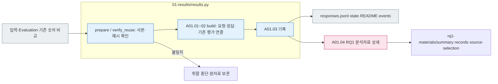

# A01 — 실험 결과 취합

[상위 Analysis](../README.md) · [이전 E04](../../01_evaluation/04_validation/README.md) · [다음 A02](../02_comparison/README.md)

## 사용법

A01은 상위 `pipeline.py analysis --run "$RUN_PATH"` 또는 `run --run "$RUN_PATH"`가 먼저 수행하는 Python 취합입니다. 이 명령들은 이어서 A02/A03 모델을 호출할 수 있으므로 A01만 수행하는 명령으로 사용하지 않습니다.

입력은 E02 모델별 manifest, E03 저장 원응답, E04 숫자 평가, `00_input/private.jsonl`입니다. 결과는 `responses.jsonl` → `state.json` 순으로 읽습니다. 계획된 요청과 응답 ID, 조건, 원본/변형 메타, 누락/실패 이유를 연결합니다. A01의 `COLLECTED`는 자료 취합 완료이며 A02/A03 완료나 의미 정답 판정이 아닙니다.

**목표:** 각 요청이 어떤 조건에서 어떤 응답을 냈는지, 이미 어떤 평가 결과가 저장되어 있는지를 한 행으로 연결합니다. 원본을 새로 풀거나 답변 가능성을 재판정하지 않습니다. LLM 호출은 없습니다.

예를 들어 같은 `test-0283`이라도 원본/변형·모델·풀이 조건·추론 설정이 다르면 별도 응답입니다. `answer=null`과 `classification=UNRESOLVED`는 각각 모델이 반환한 값과 분류로 남기며 숫자 오답으로 바꿔 쓰지 않습니다.

## RQ1 분석자료

A01 취합 후 [RQ1 분석자료](01-rq1-materials.md)를 저장합니다. 원본 수치 일치와 변형의 제출 분류로 OV·OVS·OVS_all·OR·OE를 집계하며, 역산은 TBD입니다. 저장 응답만 재집계하려면 `pipeline.py rq1-materials --run`을 사용합니다.

## 최종 human PASS 코호트의 저장 결과

`final_cohort.py`는 최종 공개 ID와 원천 run을 연결하여 기존 Evaluation·최신 A02만 읽는 별도 로컬 취합 입구입니다. LLM 호출과 source run 상태 변경은 없습니다. 최종 1,354 문항군의 G/R별 NS·NU·AS·AU, D/F, 원본 숫자 정답/오답 집단, IC-v→IC-s 유지율을 재집계합니다. [파일 책임·FC01~FC04 흐름](../../../../src/finarch/experiments/02-analysis/01-results/README.md)과 [실제 합본](../../../../reports/analysis/20261008-finject-1354/README.md)을 읽으세요.

기존 OV/OVS는 제출 분류 기반 자료이며, 최종 합본의 NS/AS 근거 지원 비율과 구분합니다. 실패·미검토·미설정 조건은 계획 분모에서 삭제하지 않습니다. 문항의 독립적인 답변가능성 gold를 재판정하지 않습니다.

## 세부 스텝·담당 소스

[01-results/results.py](../../../../src/finarch/experiments/02-analysis/01-results/results.py)의 `prepare()`는 005의 입력·Evaluation을 006에 복사하고 manifest로 동결합니다. 새 run의 `build()`는 같은 run E04 숫자 비교를 읽고, 재사용 run은 기록된 원출처를 읽습니다. `build()`는 기존 결과를 읽으며 `verify_reuse()`가 양쪽 보존 상태를 확인합니다.

|스텝|입력 → 처리 → 출력|실제 소스·함수|
|---|---|---|
|A01.01 collect_saved_results|모델 manifest·results·raw → 동일 요청 연결 → 전체 계획 응답|01-results/results.py `build()`|
|A01.02 attach_existing_context|public/private·기록된 E04 숫자 비교 → 출처·원본·변형 연결 → 비교 행|01-results/results.py `build()`|
|A01.04 rq1_materials|고정 요청·E04 → 분류 제출 사분면·source 집단·미배치 → rq1-materials|01-results/rq1_materials.py `build()`|
|A01.03 record_response_rows|중복·원응답 연결 확인 → responses·상태·README·로그|01-results/results.py `unique()`·`render()`·`verify_reuse()`|

다음 단계는 이 응답 행으로 전체 응답 양상을 집계합니다. 여러 attempt 중 어느 것을 대표 결과로 썼는지는 기존 선택 규칙과 실제 경로를 기록합니다. 추가 시도를 새 독립 문항처럼 세지 않습니다.

## 입력과 출력

|자료|역할|
|---|---|
|모델별 요청 manifest|문항·변형·모델·풀이·추론·실제 요청 연결의 기준|
|results·raw|실행/형식 상태와 answer·classification·explanation·evidence 원문|
|public|문제 Q/C·precision 참조. 내용을 중복 저장하지 않고 item 연결로 조회|
|private|원본/변형 관계·제작 정보·기존 평가 참조. 대상 풀이 LLM에 전달하지 않음|
|기존 평가 산출물|기록된 원본 숫자 일치/불일치·미평가와 기준/출처|
|`02_analysis/01_results/responses.jsonl`|위 자료를 연결한 분석 행. 원응답의 수정본이 아님|

한 행에는 run·request·item·원본 ID·variant·model·prompt·reasoning·attempt, 실행/형식 상태, 모델의 네 응답 필드, 기존 평가값과 그 출처, 실제 원응답 경로를 둡니다. classification이 null인 Unguided 응답에 분석자가 임의의 모델 분류를 채우지 않습니다. 새 해석은 A02의 별도 관찰로 남깁니다.

분홍색 RQ1 노드는 연결된 상세 흐름을 뜻합니다. 회색은 파일, 파랑은 로컬 처리, 점선은 향후 합의가 필요한 연결입니다. 연결할 파일이 없으면 누락으로 표시하고 해당 비교의 분모에서 별도 보고합니다. 원자료가 읽히지 않으면 취합 오류를 기록하며 대상 모델을 재호출하지 않습니다. README → 응답 행 → 원응답 순으로 확인하고, 뷰어 A01에서 전체 상태·숫자/null·분류 분포와 상세 응답을 연결합니다. 현재 새 집계는 조건별 1응답을 지원하며 반복 응답은 별도 키 정의 전 명시적으로 중단합니다.
