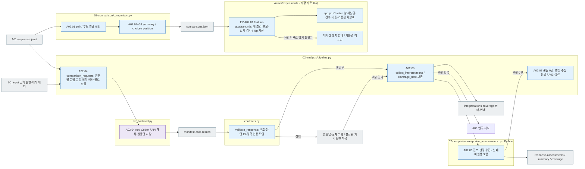

# A02 — 관계 비교와 응답 근거 해석

[상위 Analysis](../README.md) · [이전 A01](../01_results/README.md) · [다음 A03](../03_research/README.md)

## 사용법

A02는 상위 Analysis pipeline이 A01 뒤에 수행합니다. 원본별 요청에는 해당 원본과 변형의 실제 응답·조건·private 제작 메타가 함께 들어갑니다. 풀이 모델을 다시 호출하는 단계가 아니라 선택한 분석 모델의 관계 해석입니다.

`comparisons.json` → `coverage.json` → `interpretations.jsonl` → `manifest.jsonl`·`calls/`·`results.jsonl`·`state.json` 순으로 집계, 해석 범위, 근거와 원응답을 확인합니다. 요청 prompt는 단계의 `prompt.md`, 응답 스키마는 `schema.json`에 저장됩니다.

저장된 수치 집계만 갱신하려면 다음 명령을 사용합니다.

```sh
RUN_PATH=reports/experiments-run/20261003-exp-004-tatqa-luna
PYTHONPATH=src .venv/bin/python -u -B -m finarch.experiments.pipeline analysis --aggregate-only --run "$RUN_PATH"
```

이 경로는 원천 해시를 확인하고 기존 집계를 보존하며 새 모델 호출 0건입니다. A03를 시작하거나 기존 해석의 완료 상태를 바꾸지 않습니다. 일반 `analysis` 명령은 모델을 호출할 수 있으므로 구별하십시오.

[RQ1 분석 기준 — 원본·변형 대응 결과의 네 사분면](01-rq1-pair-outcomes.md): ①~④ 전체의 의미, 유형별 비교, 실패·미판정과 분모, null/classification, 의미 판정 범위를 정리한 분석 자료입니다. 실제 사분면 집계·judge 실행·E01/E02 구현 결과와 구별합니다.

[응답 근거 검토 — 설명과 evidence가 답변 결정을 뒷받침하는가](02-response-grounding-review.md): **2026-10-03 출력 계약·수집 구현**입니다. 원본을 제외한 각 응답에 충돌 설명·정보 부족 주장·evidence·최종 결정의 타당성을 기록하고 7유형별로 집계합니다. A03은 고정된 판정과 근거를 사용합니다. 응답별 두 판정의 계약·검사·수집·집계를 구현했으며 실제 모델 검토는 실행하지 않았습니다.

**목표:** 실험에서 무엇이 달라졌는지 수치로 비교하고, 모델이 반환한 답·분류·이유·근거에서 그 관계를 설명할 자료를 찾습니다. 개별 문항을 다시 검증한 뒤 통과분만 분석하는 단계가 아닙니다.

예를 들어 원본 정답 집단과 오답 집단이 IC-value에서 CONFLICT를 반환한 비율을 각각 보여주고, 대표 응답과 반례의 explanation·evidence를 함께 읽습니다. classification의 분포와 기존 기준에 대한 적절성은 구분합니다.

원본 제작의 외부지식 사용 분류가 private에 있으면 `external_knowledge_groups()`가 이를 `VERIFIED_USE`와 `CRITERIA_NOT_MET`로 나눠 기술 집계하고, `comparison_requests()`가 원본별 분석 LLM 요청에 분류와 적용 범위를 포함합니다. 이 분류는 풀이 모델의 실제 지식 사용이나 변형 자체의 재검증 결과가 아닙니다. `CRITERIA_NOT_MET`는 비사용의 증명이 아닙니다.

## 세부 스텝·담당 소스

[02-comparison/comparison.py](../../../../src/finarch/experiments/02-analysis/02-comparison/comparison.py)의 `build()`가 집계합니다. `pair()`·`group_pairs()`는 고정 조건의 대응을 만들고 `choice()`·`position()`은 기존 후보 숫자/위치와 일치하는지 기록합니다. [pipeline.py](../../../../src/finarch/experiments/02-analysis/pipeline.py)의 `comparison_requests()`는 원본별 실제 응답과 제작 메타를 묶어 선택된 Codex/API에 전달합니다. 모델 하나·8유형·4조건이면 한 묶음은 32응답입니다. `collect_interpretations()`는 반환 해석의 형식·정확 인용을 확인하고 `interpretations.jsonl`·`coverage.json`을 저장합니다. A03의 `finish()`는 이후 최종 보고 시 연결을 다시 확인합니다.

모델 요청은 [Analysis 공통 지시](../../../../src/finarch/experiments/prompts/shared.02-analysis.02-comparison.common.md)와 [A02 관계 해석 지시](../../../../src/finarch/experiments/prompts/02-analysis.02-comparison.response-patterns.md)를 결합하고 [A02 응답 스키마](../../../../src/finarch/experiments/schemas/json/02-analysis.02-comparison.response.schema.json)를 붙입니다. 저장된 해석 행은 별도 [A02 기록 스키마](../../../../src/finarch/experiments/schemas/json/02-analysis.02-comparison.interpretations.schema.json)로 확인합니다. 실제 전송 정의는 각 run의 `02_analysis/02_comparison/manifest.jsonl`과 요청 기록을 읽습니다.

|스텝|입력 → 처리 → 출력|실제 소스·함수|
|---|---|---|
|A02.01 pair_conditions|A01 행 → 모델·문항·조건 고정 → 대응쌍·누락|02-comparison/comparison.py `pair()`·`group_pairs()`|
|A02.02 aggregate_relations|대응쌍·전체 행·원본 외부사용 분류 → 분포·전이·원본군·외부사용 확인 범위 → comparisons|02-comparison/comparison.py `summary()`·`external_knowledge_groups()`·`build()`|
|A02.03 compare_variant_patterns|후보 A/B·SOURCE 부모 → 값·위치·EA 삭제 쌍 비교|02-comparison/comparison.py `choice()`·`position()`·`build()`|
|A02.04 LLM_interpret_patterns|원본별 실제 응답·공개 문항·제작 메타·필드 설명 → 선택 분석 모델의 패턴·반례 해석 → 원응답·검사 결과|pipeline.py `comparison_requests()` → llm_backend.py `run()`|
|A02.05 record_comparisons|저장 해석·인용 → 구조/정확한 인용 참조 확인 → interpretations·coverage·상태·안내|pipeline.py `collect_interpretations()` → contracts.py `validate_response()`; pipeline.py `update()`|
|A02.06 collect_response_assessments|모든 비원본 응답 ID → 판정 적용 범위·정확 인용·중복/누락 검사 → response-assessments·summary·coverage|contracts.py `validate_assessments()` → response_assessments.py `collect()`|
|A02.07 finish_without_patterns|유효 판정 + 관찰 0건 → 판정 보존·A03 미실행 종료|pipeline.py `finish_without_patterns()`; 전체 pipeline은 COMPLETE_NO_PATTERN_FINDINGS|
|EV.A02.01 view_ic_value_quadrant|저장된 `comparisons.json`의 IC-value 앞 4조건·후보 A/B/다른 숫자/null/실패 건수 → 조건별 분모·비율 및 Unguided·OFF 대비 %p 차이 → 분석 화면 사분면·화살표|`viewer/experiments/feature-quadrant.mjs` `buildFeatureQuadrant()` → `app.js` `renderFeatureQuadrantSample()`; 표시 전용 Python/LLM 호출 없음|
|EV23 cross_run_quadrants|여러 회차의 실제 A02·입력·출처 → 동일 입력·7조건별 문항·후보·응답 해시·분모 확인 → 추가 사분면 비교 메뉴|`viewer/quadrants.py` → `documentation/research_ic_value_quadrant.py` → 공통 사분면 템플릿; 저장 자료 조회용 Python, LLM 호출·재채점 없음. [파일별 상세 흐름](../../../../log/viewer-experiments-quadrants-20261003/README.md)|

## 비교할 내용과 얻을 수 있는 정보

|카테고리|묻는 관계|표시할 결과|
|---|---|---|
|① 전체 응답 양상|어떤 유형·조건에서 숫자/null·분류가 얼마나 나오는가?|전체/수집/형식 실패, 값 유무, 5분류 및 분류 미제공, 기존 숫자 비교 분포|
|② 원본과 변형|같은 조건에서 원본을 맞힌 모델은 변형에서 어떻게 반응하는가?|원본 일치/불일치/미평가 집단별 변형 답·분류·이유 패턴, 반대 사례|
|③ 조건·모델 효과|풀이 지시·추론·모델 하나를 바꾸면 무엇이 바뀌는가?|Unguided↔Criteria-Guided, OFF↔ON, 모델 간 대응 전이표·차이와 표본 수|
|④ 유형별 패턴|위치·출처·관계·삭제 변화가 선택한 결과/설명과 어떻게 연결되는가?|아래 유형별 비교와 설명 근거|
|⑤ 응답 네 요소의 관계|숫자를 내면서 충돌을 설명하는가, 분류와 근거는 어떻게 엇갈리는가?|답·분류·explanation·evidence 조합 빈도, 명시된 조건·선택 이유·무근거 선택 관찰|
|⑥ 반례·특이 사례|주된 경향과 반대되는 응답은 어떤 공통점이 있는가?|응답 ID, 비교군, 실제 인용, 기존 평가·제작 메타와의 관계|

집계만으로 해석을 채우지 않습니다. 해석이 아직 없으면 수치만 제시하고 해석 미기록을 표시합니다. 대상 모델의 classification과 분석자의 관찰 태그는 별도 필드입니다.

모델에게는 내부 단계 번호 대신 실제 필드의 의미를 설명합니다. `numeric_comparison.matches`는 원본 응답과 저장된 기준 답의 숫자 비교이며, `VALID`는 형식 검사 통과입니다. `original_result=NOT_ORIGINAL`인 변형은 같은 모델·풀이 지시·추론 설정의 원본 행에 연결합니다. 공통 프롬프트에는 풀이 조건과 여덟 문항 유형의 정의가, 비교 프롬프트에는 후보 A/B·위치·부모 연결·누락의 의미가 들어갑니다.

## 유형별 비교의 구체적인 기준

|유형|대응 비교|관찰과 해석의 경계|
|---|---|---|
|IC-value|같은 원본의 BEFORE/AFTER. 원래 주장 A와 추가 주장 B, 앞/뒤 위치를 각각 연결|반환값이 A/B 어느 결과와 일치하는지와 explanation에서 무엇을 선택했는지 구분. 두 결과가 같거나 어느 쪽도 아니거나 null이면 별도 표시|
|IC-source|SOURCE_A는 VALUE BEFORE, SOURCE_B는 VALUE AFTER를 부모로 연결해 출처 추가 전후 비교|같은 부모에서 A/B 선택이 바뀌는지 관찰. 실제 문맥과 편집 내역으로 출처 위치를 확인한 경우에만 위치와 출처의 혼재를 해석함. 이름만으로 위치를 확정하지 않음|
|IC-relation|명시된 값의 결과와 추가 관계를 적용한 결과, 그리고 해당 설명/인용 비교|값 일치만으로 수식/값 선호를 확정하지 않음. 위치·표/문장 형식·관계 난도도 대안 설명에 포함|
|EA|원본 대비 EA_01과 EA_02를 각각 비교. 삭제된 fact의 순서와 계산에서의 역할 연결|두 변형은 원본의 첫째/둘째 fact를 각각 삭제한 자료이며 누적 삭제가 아님. 응답에서 직접 남은 답 인용·대체 근거·역산·가정·중단을 구분|

EA의 gold 숫자 일치만으로 역산이라고 부르지 않습니다. 모델이 실제로 적은 복원식과 사용한 근거가 있어야 **응답에 드러난 역산**으로 기록합니다. 복원에 성공했으나 이후 계산에서 틀린 사례도 별도로 분석합니다. 삭제값의 역할·대체 근거는 기존 제작 메타와 응답에서 확인되는 범위만 사용하며, 새 문항 답변 가능성 판정을 선행하지 않습니다.

## 분모와 비교 단위

- `comparisons.json`의 각 비교는 전체 대상 수, 양쪽 수집 수, 비교 가능한 쌍 수, 누락/실패/미평가 사유와 응답 참조를 함께 가집니다.
- 원본 정답 집단은 **동일 model × prompt × reasoning × 반복 조건**의 원본 평가로 정합니다. 다른 조건에서 맞힌 원본을 섞지 않습니다.
- 정답률은 저장된 평가 기준이 있는 범위에서만 표시합니다. 변형 숫자가 원본 gold와 같다는 것은 원본 숫자 일치이며 변형 정답이라는 뜻이 아닙니다.
- Unguided의 classification null은 계약에 따른 미제공입니다. Guided 분류 누락과 같은 실패로 세지 않습니다. 답과 설명은 두 조건 모두 비교합니다.
- 같은 원본의 7변형·4조건은 서로 연결되어 있습니다. 이들을 독립 표본처럼 늘려 유의성을 주장하지 않습니다. 반복 자료가 없으면 재현 안정성을 계산하지 않습니다.



회색은 파일, 파랑은 로컬 처리, 보라는 분석 모델 해석, 점선은 향후 합의가 필요한 연결입니다. 해석 요청에는 prompt와 응답 schema를 함께 저장합니다. 인용 ID·출력 형식 검사 실패는 해석 처리 실패이지 문항 실패가 아닙니다. 재시도는 원요청·원응답을 보존하고 명시된 분석 실행 설정 안에서만 합니다. 실패 시 자동으로 대상 모델을 재실험하거나 다른 유료 분석 모델로 전환하지 않습니다.

006 뷰어는 유형×4조건 히트맵, 대응 전이표, 원본 결과와 변형 반응의 산점도/표, 클릭한 셀의 실제 답·분류·설명·근거 연결입니다. 차트와 표는 실행 전체의 같은 분모·응답 참조를 사용합니다. 왼쪽 검색은 문항 탐색에만 적용되며 고정된 비교 집계를 바꾸지 않습니다.

IC-value 앞 사분면은 현재 **표시 샘플**입니다. 각 조건의 저장된 계획·수집 건수가 같고 답 형태의 합계가 계획 건수와 같을 때만 그립니다. 각 칸은 A/B 숫자 일치, 다른 숫자, null, 형식·실행 실패를 건수와 비율로 보여줍니다. 화살표의 수치는 Unguided·Reasoning OFF 대비 **퍼센트포인트(%p)** 차이이며 10·25·50%p 경계에서 굵고 진해집니다. 가장 큰 전체 차이와 설정 하나만 바꾼 비교의 최대 차이를 구분합니다. 오른쪽 위 대각선은 풀이 지시와 추론을 동시에 바꾼 비교입니다. 후보 숫자 일치는 정답이나 근거 사용의 확인이 아니며, null의 적절성도 이 그림에서 판정하지 않습니다. 단일 HTML Export에는 `export-html.mjs`가 같은 계산 모듈을 포함합니다.

## 관찰 0건·호출 크기·동결 호환

새 A02 V2는 관찰의 최소 개수나 최대 12개 제한을 두지 않습니다. 관찰이 없어도 비원본 응답 판정은 전수 반환해야 하고 `coverage_note`는 비어 있으면 안 됩니다. 수집기는 이 설명과 관찰 건수를 `coverage.json`에 보존합니다. 호출 VALID는 구조·인용 검사의 통과이며 모든 비교의 의미 검토 완료를 보증하지 않습니다.

관찰 0건이면 `ASSESSMENTS_COLLECTED_NO_PATTERNS`로 판정 수집을 마치고 A03은 `SKIPPED_NO_PATTERN_OBSERVATIONS`로 기록합니다. 전체 실행은 `COMPLETE_NO_PATTERN_FINDINGS`로 종료합니다. A03의 근거 ID를 억지로 만들거나 연구 결과가 완료됐다고 표시하지 않습니다. 기존 V1 요청은 동결된 스키마의 12개 제한과 관찰 필수 검사를 유지합니다. 저장된 manifest는 재생성하지 않습니다.

위치는 공개 원문과 현재 문맥, 해시가 연결된 편집을 재적용하여 확인 가능한 경계 삽입에만 FRONT/BACK을 부여합니다. 중간 삽입·누락·불일치·확인 불가는 UNKNOWN입니다. 실제 출처의 우선성은 이 위치 코드만으로 판정하지 않습니다.

현재 A02는 원본별 비교 범위를 유지합니다. prompt·schema·전체 payload를 포함한 요청이 500,000 UTF-8 bytes를 초과하면 호출 전에 `A02_PARTITION_REQUIRED`로 중단합니다. A03은 동일한 전체 요청 크기 기준으로 관찰을 분할하며, 단일 관찰도 초과하면 명시적으로 중단합니다. 이 값은 모델의 token/context 한도 보장이 아닌 로컬 입력 크기 가드입니다. 관찰·응답을 잘라 크기에 맞추지 않습니다.

**A02 자동 분할은 아직 설계입니다.** 입력 토큰과 예상 판정 출력량이 모델 한도를 넘으면 응답별 판정 요청과 대응쌍 관찰 요청을 분리하고, 판정 response_id는 정확히 한 번만 배정합니다. 관찰 요청에는 양쪽 원본/변형·조건을 함께 유지하고 공통 근거 응답은 읽기 전용으로 공유합니다. 전체 계획 ID와 수집 ID가 일치한 뒤 합칩니다. 기존 수집기의 중복 판정 방지 규칙을 우회하지 않습니다. 출력 잘림이나 판정 누락은 유효 완료로 처리하지 않고 원응답·실패를 남깁니다. 관찰 상한을 없앴다는 이유로 출력이 항상 충분하다고 보장하지 않습니다.
