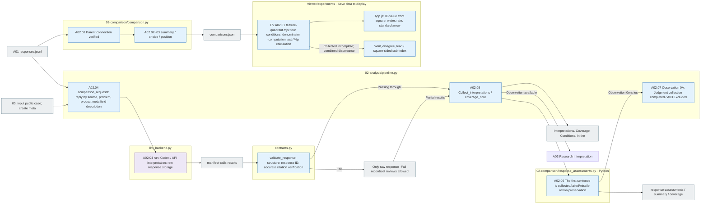

# A02 Relation comparison and response based interpretation

[Analysis of the top](../README.md) · [formerly A0]1](../01_results/README.md) · [Next A0]3](../03_research/README.md)

## Usage

A02The top analysis pipeline is a01 The original request is accompanied by the actual response, condition, and private production metadata of the original and variation, not the step of the pool recalling the model, but the relationship interpretation of the selected analytical model.

`comparisons.json` → `coverage.json` → `interpretations.jsonl` → `manifest.jsonl`·`calls/`·`results.jsonl`·`state.json` The order of the estimates, the interpretation range, the basis and the raw response. `prompt.md`And the answer is, `schema.json`It's stored in.

To update only the stored statistics, we use the following command:

```sh
RUN_PATH=reports/experiments-run/20261003-exp-004-tatqa-luna
PYTHONPATH=src .venv/bin/python -u -B -m finarch.experiments.pipeline analysis --aggregate-only --run "$RUN_PATH"
```

This path identifies the source map and preserves the existing statistics and calls the new model 0So this is A.3It does not start or change the state of completion of the existing interpretation. `analysis` The command can call the model so distinguish.

[RQ1 analysis criteria, Q, origin, variation, and four-quadrant response results](01-rq1-pair-outcomes.md)It's a whole-scale analysis of the meaning of 1 to 4, type comparison, failure, misjudgment and denominator, null/classification, semantic assessment, real quadratic computation, judge execution, E0.1/E02 It's a difference between the results of the implementation.

[Review of the evidence for the answer](02-response-grounding-review.md): **2026-10-03 Implementation of the contract of production and procurement**The first is to record the validity of each response except the original, the explanation of the conflict, the lack of information, the evidence, the final decision, and the final decision. 7So I'm going to do this by type.3It uses fixed judgments and bases, and it implemented a contract, analysis, and collection of two judgments per response, and it didn't run a real model review.

**The goal:** We compare what's different in the experiment to the numbers, and we look for data to explain the relationship in the model's return answers, breakdowns, and e-mails, not just the process of re-verifying individual cases and then analyzing the passing moment.

For example, we show the ratio of the original right answer group and the wrong answer group returning the CONFLICT from the IC-value, and we read together the explanation-evidence of the representative response and the countermeasures, distinguishing the distribution of the classification from the appropriateness of the existing criteria.

If the external knowledge classification of the original is private, `external_knowledge_groups()`Get it out of here. `VERIFIED_USE`and `CRITERIA_NOT_MET`And then we're going to divide the technology into two, `comparison_requests()`The original analysis of the LLM requests includes the classification and scope of application, which is not the result of re-evaluation of actual knowledge use or modification of the grass model itself. `CRITERIA_NOT_MET`It's not evidence of misuse.

## The source of the detail step.

[02-comparison/comparison.py](../../../../src/finarch/experiments/02-analysis/02-comparison/comparison.py) `build()`So we're going to calculate. `pair()`·`group_pairs()`And we're going to create a fixed-condition response. `choice()`·`position()`It records whether the candidate matches the existing number/level.](../../../../src/finarch/experiments/02-analysis/pipeline.py) `comparison_requests()`The codex/API is then sent to the selected codex/API by bundling the actual response and production metadata per copy.8Types:4If the condition is that a set is 32response. `collect_interpretations()`The form and accuracy of the interpretation of the return is verified and the `interpretations.jsonl`·`coverage.json`Save the A0.3 `finish()`The final report will then be re-verified when the connection is made.

The model request is [Analysis common instructions](../../../../src/finarch/experiments/prompts/shared.02-analysis.02-comparison.common.md)Come on, A02 Interpretation of the relationship](../../../../src/finarch/experiments/prompts/02-analysis.02-comparison.response-patterns.md)And then we're going to combine the2 Response schema](../../../../src/finarch/experiments/schemas/json/02-analysis.02-comparison.response.schema.json)The stored line of interpretation is not a star.2 The recording scheme.](../../../../src/finarch/experiments/schemas/json/02-analysis.02-comparison.interpretations.schema.json)The actual transmission definition is that of each run. `02_analysis/02_comparison/manifest.jsonl`And read the request log.

|Step by step|Input → process → output|The real source function|
|---|---|---|
|A02.01 pair_conditions|A01 Line → Model → Problem → Condition fixed → corresponding pair → node|02-comparison/comparison.py `pair()`·`group_pairs()`|
|A02.02 aggregate_relations|Related pair; whole chain; source external use classification → distribution; machine; source group; external use verification scope → comparisons|02-comparison/comparison.py `summary()`·`external_knowledge_groups()`·`build()`|
|A02.03 compare_variant_patterns|Candidate A/B·SOURCE parent → value value EA deleted pair comparison|02-comparison/comparison.py `choice()`·`position()`·`build()`|
|A02.04 LLM_interpret_patterns|Original response, open phrase, manufactured meta field description, pattern analysis, and comparative interpretation of the model|pipeline.py `comparison_requests()` → llm_backend.py `run()`|
|A02.05 record_comparisons|Storage interpretation use → structure/accurate citation see references → interpretations·coverage·condition·inside|pipeline.py `collect_interpretations()` → contracts.py `validate_response()`; pipeline.py `update()`|
|A02.06 collect_response_assessments|All non-original response IDs → Judgment Application Scope; Accurate citation; Duplication/disapproval testing → response-assessments; summary; coverage|contracts.py `validate_assessments()` → response_assessments.py `collect()`|
|A02.07 finish_without_patterns|Valid judgment + observation 0The first sentence is preserved.3 End of the mishap|pipeline.py `finish_without_patterns()`The whole pipeline is COMPLETE_NO_PATTERN_FINDINGS.|
|EV.A02.01 view_ic_value_quadrant|Saved `comparisons.json`The IC-value is ahead of the 4Conditions: Conditions: A/B/Other Numbers: Null/Failure: Dry → Conditions: denominator: Rate and Unuided;OFF: %p difference: Analysis: Screens: Square: Killer|`viewer/experiments/feature-quadrant.mjs` `buildFeatureQuadrant()` → `app.js` `renderFeatureQuadrantSample()`No call for Python/LLM for display|
|EV23 cross_run_quadrants|The real A0 of the multiple circuits2· input; source → same input;7Conditional case, profile, response, denominator check → Additional four-sided comparison menu|`viewer/quadrants.py` → `documentation/research_ic_value_quadrant.py` → Common quadrant template; store data for consultation Python, LLM call-in; no deposit point. [file by file detailed flow](../../../../log/viewer-experiments-quadrants-20261003/README.md)|

## What information can be obtained from comparing content

|Categories|Relationship you ask|The result of the display|
|---|---|---|
|1 is the total response pattern|What type/condition does the numerical/null distribution come out of?|Complete/sum/form failure, value loss, 5Classification and classification subfields, existing numerical comparison distribution|
|Two original and modified|How does a model that matches the original under the same conditions react to the transformation?|Original match/disagreement/disappointment group-by-group variation response/differentiation/sample pattern, contrast case|
|3 Conditions and Model Effects|What changes if we change a grass-directional model?|Unguided Criteria-Guided, OFFON, model-to-model correspondence pre-ticketed tickets and sample numbers|
|Four types of patterns.|How do the changes in location, source, relationship, and delete link to the chosen result/description?|Comparison and explanatory basis for each type below|
|5 Responses to The Relationship of the Four Elements|How do you explain the conflict by giving numbers, how do you differentiate between classification and reasoning?|Answer: classification: explanation: evidence combination frequency, specified conditions: reason for choice: uncertainty of choice observation|
|6 half-life and special cases|What do the opposite responses to the mainstream tendencies have in common?|Response ID, comparison team, actual citation, existing evaluation and relationship to the meta.|

It doesn't just fill in the interpretation, it just presents the figures and shows the interpretation logs, the classification of the target model and the analyst's observation tag is a field of nowhere.

For the model, instead of the internal step number, it explains the meaning of the real field. `numeric_comparison.matches`So the number of responses to the original and the number of reference responses to be stored is the number of comparisons. `VALID`is a format validation pass. `original_result=NOT_ORIGINAL`The variation connects to the original row of the same model-fold instruction-reference setting. The common prompt includes the definition of the root condition and eight case type, and the comparison prompt includes the meaning of the candidate A/B; key; parent connection-reference.

## Specific criteria for comparison by type

|Type|Compare the correspondence|The boundaries of observation and interpretation|
|---|---|---|
|IC-value|BEFORE/AFTER of the same original. The original claim A and additional claim B, linking the forward/back position respectively|Distinguish between which result A/B matches and which one is selected in the explanation.|
|IC-source|SoURCE_A is VALUE BEFORE, and SOURCE_B is connecting VALUE AFTER to the parent and comparing the source additional before and after.|Observe whether A/B selection changes in the same parent. Interpret location and confusion of source only if the source location is verified in real context and edited in-between. Not confirmation of location by name|
|IC-relation|The result of applying the result of the specified value to the additional relationship, and the corresponding description/use comparison|The convergence of values alone does not confirm the preference of the formula/value. Position, chart/port form and correlation variance are also included in alternative descriptions|
|EA|EA_0 for the original.1And EA_02Compare the deleted fact sequence with the role in the calculation|The two variations are data that deleted the first or second fact of the original, and are not cumulative deletions.|

It's not just the gold number match of EA that's called a reversal. **The reversal in the response**It records the success of the recovery, but then analyzes the wrong cases in the calculations separately. The role and replacement basis for the deletion values is only the range that is verified in the existing production metadata and responses, and it doesn't prejudge the likelihood of a new case being answered.

## The denominator and the comparison unit

- `comparisons.json`Each comparison is accompanied by the total number of subjects, the number of both collected, the comparable number of pairs, the missing/failed/underrated factors and the response reference.
- The original answer group is **Same model × prompt × reasoning × repeating condition**It's not mixing the original that fits the other conditions.
- The correctness ratio is only shown in the range of the values stored. The fact that the transform number is equal to the original gold does not mean that the transform is correct.
- The classification null of Unguided is a contractual mismatch, not a failure like the Guided classification gap. The answer and explanation compare both conditions.
- The same original. 7Modification4The conditions are interconnected, so we don't increase them like independent samples and claim flexibility, and we don' t calculate reproducibility without repeating data.



The grey is the file, the blue is the local processing, the brown is the analytical model interpretation, the dotline is the connection that will require future consensus. The interpretation request stores the prompt and response schema together. Citation ID-output format validation failure is not an interpretation failure, or a case failure. The reset only preserves the request; raw response and is only within the specified analytical execution setting. The failed test does not automatically re-create the target model or convert to another paid analytical model.

006 The Viewer is type x.4The condition hitmap, the corresponding pre-chart, the score/chart of the original results and the modification responses, the actual answer, classification, statement, and approximation of the cells clicked. The chart and the chart use the same denominator-response reference of the entire run.

The IC-value square front is the current **The sample is displayed**It's only drawn when the sum of the saved plan-sum of each condition is the same and the sum of its response forms is the same as the plan-sum. Each can shows the A/B number matching, different numbers, null, form-to-action failure in proportion to the number of touches. **Percentage points of p** And the difference is, 10·25·50%The top right corner of the equation is the equation that changes the direction and the inference at the same time. The number of candidate units is not a validation of the correct answer or the validation of a validation, and the validity of the null is not determined in this diagram. `export-html.mjs`It's got the same calculation module.

## Observation 0G.E.R. size and coherence

The new A02 V2 is the minimum number of observations or the maximum number of observational values. 12No items restrictions. Even if there's no observation, the non-original response judgment has to return the current. `coverage_note`The collector can't touch this description and the observation. `coverage.json`Call VALID is a pass of the Rescue and Utilization Test and does not guarantee completion of any meaning review of comparisons.

Observation 0If it does. `ASSESSMENTS_COLLECTED_NO_PATTERNS`So, we're going to finish the judgment collection and then we're gonna go to A0.3 `SKIPPED_NO_PATTERN_OBSERVATIONS`The entire execution is `COMPLETE_NO_PATTERN_FINDINGS`So we end with A0.3The existing V1 request is that the schematic is not a validated and validated test. 12Keeping items restrictions and observation check required.

The location retrieves the open source and current context, hashed edits, and assigns FRONT/BACK only to verifiable boundary inserts. The intermediate inserts, nouns, inconsistencies, and unverified are UNKNOWN. The priority of the actual source is not determined by the location code alone.

Current A02The request includes prompt, schema, and whole payload. 500,000 UTF-8 If you exceed bytes, you'll call before you do it. `A02_PARTITION_REQUIRED`Stop at A0.3It divides the observation by the same total request size, and when a single observation exceeds it explicitly stops. This value is a local input size guard, not a token/context limit of the model.

**A02 The automated partition is still a design.** If the input token and the expected judgment output exceed the model limit, separate the response judgment request from the corresponding pair observation request, and the judgment response_id is assigned exactly once. The observation request keeps both original/variant conditions together and shares the common basis response for reading only. The entire plan ID and the collected ID are combined after matching. The rules against duplication of the existing collector do not override the rule.
