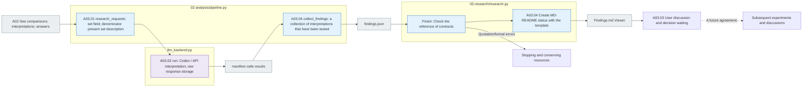
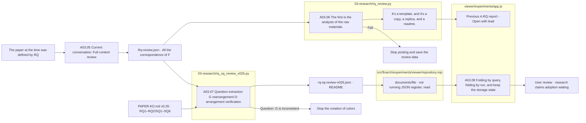

# A03 The study of the interpretation and improvement of the

[Analysis of the top](../README.md) · [formerly A0]2](../02_comparison/README.md)

## Usage

A03is A02 `COLLECTED`And when there's a real interpretation basis, the top analysis pipeline goes on, and it doesn't directly generate results with any Python function or Codex call.

`manifest.jsonl`The subject is the actual LLM request and the `prompt.md`·`schema.json` → `calls/` raw response `results.jsonl` The test `findings.json`·`findings.md` So, we're going to connect it in a row.2 It depends on the distribution of the subject of the observation and the input size, so we check it as the corresponding manifest row count.

`findings.json`The F is the study finding, the discussion is the follow-up argument, the observation/response ID is the raw response basis. `analysis.status=COMPLETE`And if you use a coordinator, `full_pipeline.status=COMPLETE`Check it together. `USER_DISCUSSION_PENDING`The results of the study are stored in the after-hours vacuum and not approved for subsequent experimental run.

**The goal:** We connect the relationships we observe in the experiment to the research questions, and we organize the scope and other explanations that we can tell from the data, not the process of re-explaining the subject line or creating a new standard of correct answers.

**2026-10-03 Additional requirements and equipment:** [A02 Reviewing the evidence](../02_comparison/02-response-grounding-review.md)In the original except for the answer judgment by reason judgment by standard version type estimate, save A03And I'm going to use this to quote it.3The bias leaves no meaningful re-examination of the present. `research_requests()`There's no new identifier entry, and here's an explanation of the existing implementation.

## The source of the detail step.

[pipeline.py](../../../../src/finarch/experiments/02-analysis/pipeline.py) `research_requests()`Go to A0.2 The set and the interpretation are the study interpretation inputs. `collect_findings()`The results of the tests were `findings.json`And then we're going to have to do this.03-research/research.py](../../../../src/finarch/experiments/02-analysis/03-research/research.py) `finish()`The MD-README status log generates the link between the already stored findings and the actual response.](../../../../src/finarch/experiments/02-analysis/contracts.py)It only checks the file format and citation and doesn't re-check the case.

The model request is [Analysis common instructions](../../../../src/finarch/experiments/prompts/shared.02-analysis.02-03.common.md)Come on, A03 The research interpretation instruction](../../../../src/finarch/experiments/prompts/02-analysis.03-research.findings.md)And then we're going to combine the3 Response schema](../../../../src/finarch/experiments/schemas/json/02-analysis.03-research.findings.response.schema.json)The definition used when running is verified in the run's request record.

|Step by step|What to do → input → output|The real source function|
|---|---|---|
|A03.01 assemble_evidence|A02 Reference to raw response → category basis → group denominator → input bundle range description → study interpretation input|pipeline.py `research_requests()`|
|A03.02 LLM_synthesize_findings|Linked data → observation; possible explanation; change; limitation; secondary minimum comparison → interpretation raw response · survey results|llm_backend.py `run()`|
|A03.03 discuss_improvements|Drafting: Unresolved Relationship → User basis and proposed changes → Commenting: Unrealized status|Not automatically deciding whether to adopt the code|
|A03.04 publish_findings|The searched interpretation of the text → findings.json summary → Korean language findings.md·level README·viewer|pipeline.py `collect_findings()` → 03-research/research.py `finish()`|

A03.03The whole thing is `findings.json` `discussion`And I'm going to save it to the A0 before the user comment ends.3.04And then we generate a verification report, and the status is `USER_DISCUSSION_PENDING`We're going to tell you the difference between making and adopting improvements.

006 `analysis.backend=codex`, `execution_mode=current_session`There's no implementation of any analytics API-CLI. It records the basis, analysis, and conclusions used even when the current Codex dialogue analyzes it directly. It doesn't preempt automatic API re-recognition.

## The composition of the items that have been studied

|Content|It's a connection.|
|---|---|
|Research Questions|So what do you want to know about the relationship between the capabilities of the original root and the transformative response?|
|Observation|Model, model, condition, denominator, and match|
|Explanation of the answer|The actual response ID and citation of the answer/classification/explanation/evidence|
|Representative cases and counterparts|The case of trend and vice versa, the reason for choice.|
|Alternative explanation: the limit|Confusion of location and source, single run variable, sample, drop, prompt difference etc.|
|The scope of the paper.|Direct observation, analysis hypothesis, and the separation of the unreported|
|Improvements and comparisons|One element to change, conditions to maintain, expected distinction and determination status|

For example, in a group with a random sample, where there were more clash classifications, the clash is the observation of that group, which alone improves the clash awareness, but it doesn't confirm the correlation between the increase in response classification and the difference between what was recognized in the actual description of the clash.

The source/backward positioning effect of IC-source leaves the limit that it is not isolated by the current design alone. EA interprets it on the basis of whether the explanation and the correct answer match that it says is a reversal appear together, or whether there were other calculation errors after the restoration.

Prompt is the `aggregates`It describes the total, conditionally, and originally derived set of the corresponding pair denominator. `complete_pairs`And that means there's a record on both sides. `comparable_pairs`This means that both responses have passed format validation. `partition`It is a set of presently provided interpretations, which states that we should not add the same set of repeated sets to multiple sets. Subsequent comparisons unravel the goal and present it as a proposed proposition that has not yet been implemented.

## The output log viewer

`02_analysis/03_research/findings.json`And I'm going to use it as a basis for interpretation, for judgment, for judgment. `findings.md`And the viewer displays the same content. Markdown doesn't modify separately as a separate conclusion. `events.jsonl`The analysis version, the formulation, the use of the data, the geyser status.](../README.md)And then we follow.

The gray is the file, the blue is the local processing, the interpretation of the analytical model of the board, the dotted line is the connection that needs to be agreed on in the future. Even without interpretation, the collection and dispute results remain. Failure to quote and formatting failures preserve the output and leave it in analytical state. The reset follows the analytical settings and the authorized range, and does not automatically change the conclusion of subsequent experiments and discussions before the user decides.

The Viewer A03If you select the argument candidate from the figure → representative case/contrast → actual response, the analytical file storage, viewer view verification, and user study conclusion adoption will show different states.

A0 of the new run3.01 `pipeline.py research_requests()`, A03.02 `llm_backend.py run()`, A03.04 `pipeline.py collect_findings()` → `03-research/research.py finish()`It connects all the observations by category, requiring them to be split in the original order without any size-by-size, and preserves the raw response, use, failure. If the incomplete, failure request remains, it doesn't finalize the process.

## Complete review of the stored findings and RQ-specific integration

When a user requests a recount of the entire discovery, they read the arguments, other explanations, and limits of each discovery in the current conversation. `rq-review.json`It records the reasons for the main group, the support group, the decision. It also preserves the RQ definition of the current paper draft along with the raw material hash. The F number is assigned to exactly one main group, allowing for the auxiliary connection of complex topics. `findings.json`And the model raw response remains the same.

|Responsibility|Input → output|Responsibility|
|---|---|---|
|A03.05 Full content review|All F·RQ definitions → unified claims, ratios, boundaries, whole F correspondence|The current editing judgment of the conversation, rq-review.json|
|A03.06 The response verification and documentation|The JSON source code is written as: rq-review.md·rq-review-audit.md·rrc-review|03-research/rq_review.py build()|
|A03.07 v0.26 The question color.|The paper v0.26 §3.3–3.4·Existing integrated copy → RQ1·RQ2·SQ1SQ6 questions, G connection·my inspection status·source hash·README|03-research/rq_sq_review_v026.py build()|
|A03.08 Showing|Run by run rq-sq-review-v026The integrated review, which is folded and unfolded for each .json → question, the existing rq-review.md and the original F are kept at the power-down.|viewer/experiments/app.js renderRQSqReview()·renderResultResearch(), repository.mjs documents()|

This pathway does not perform external LLM calls or new Evaluation. Python verification verifies the integrity of the entire F assignment and source/participation, and does not automatically determine the meaningful validity of the editing content. If there is no basis for directly answering RQ, it specifies the deficiency status in the report.

v0.26 The colored person is the former. 4- The RQ integrated copy. 9G's a new question. **One at a time.** So, we're going to connect.4–G07So, RQ2 is G0.2–G03So, SQ1 is G0.1So, SQ3 is G0.8–G09SQ2, SQ4, SQ5, and there's no direct response to this integrated copy, and SQ6 is the backup before independent repeat verification.1The old RQ1/H1 limiting phrase shows only the color in the edit key that matches the new question, which is the order in which the existing findings are read again v0.26 [Picture: The test results](../../../../log/viewer-experiments-rq-sq-v026/README.md)You can read the file role and verification range.

## RQ of the Viewer's answer comparison

[Experimental Viewer A03](http://127.0.0.1:8894/?run=20260927-exp-007-luna&tab=reports)The RQ1/RQ2 comparison is stored at A01 It's a screen that re-links the response.0.2 File flow and responsibility table](../../../../viewer/experiments/README.md#%EC%97%B0%EA%B5%AC-%EC%A7%88%EB%AC%B8%EC%9C%BC%EB%A1%9C-%EC%A0%80%EC%9E%A5%EB%90%9C-%EB%8B%B5-%EC%9D%BD%EA%B8%B0--ev202)I'll see the first one, then I'll go to [Exam Record](../../../../log/viewer-experiments-rq-view/README.md)RQ1 is the root of the original. 1The line. 7The original line shows the exact match, inconsistency, undervaluation, and the transformation line shows the same/other value and null changes to the original.3It doesn't replace the stored research interpretation or the final judgment of the user. If you open the case, you can find the explanation and evidence of the original and the variation in raw response.
