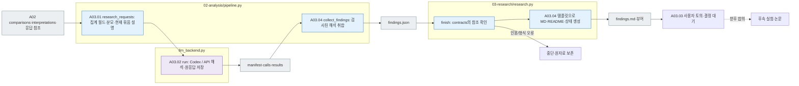
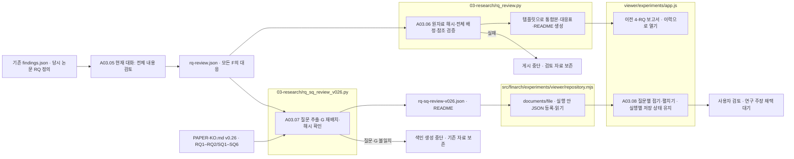

# A03 — 연구 해석과 개선안 토의

[상위 Analysis](../README.md) · [이전 A02](../02_comparison/README.md)

## 사용법

A03는 A02가 `COLLECTED`이고 실제 해석 근거가 있을 때 상위 Analysis pipeline이 진행합니다. 별도 Python 함수나 Codex 호출로 결과를 직접 만들지 않습니다.

`manifest.jsonl`은 주제·분할별 실제 LLM 요청이며 `prompt.md`·`schema.json` → `calls/` 원응답 → `results.jsonl` 검사 → `findings.json`·`findings.md` 순으로 연결합니다. 요청 수는 A02 관찰의 주제 분포와 입력 크기에 따라 달라지므로 해당 manifest 행 수로 확인합니다.

`findings.json`의 F는 연구 발견, discussion은 후속 토의 안건, observation/response ID는 원응답 근거입니다. 완료는 루트 `analysis.status=COMPLETE`와 coordinator를 사용한 경우 `full_pipeline.status=COMPLETE`를 함께 확인합니다. `USER_DISCUSSION_PENDING`은 연구 결과 저장 후 토의 대기이며 후속 실험 실행 승인이 아닙니다.

**목표:** 실험에서 관찰한 관계를 연구 질문에 연결하고, 자료로 말할 수 있는 범위와 다른 설명을 정리합니다. 대상 문항을 다시 풀거나 새로운 정답 기준을 만드는 단계가 아닙니다.

**2026-10-03 추가 요구·설계:** [A02 응답 근거 검토](../02_comparison/02-response-grounding-review.md)에서 원본 제외 응답별 판정·판정 이유·기준 버전·유형별 집계를 저장하고, A03은 이를 그대로 인용하도록 설계했습니다. A03에서 다시 의미 채점을 하거나 관찰 문장으로부터 판정을 추정하지 않습니다. 이견은 별도 재검토 안건으로 남깁니다. 현재 `research_requests()`에는 이 새 판정표 입력이 없으며, 아래는 기존 구현 설명입니다.

## 세부 스텝·담당 소스

[pipeline.py](../../../../src/finarch/experiments/02-analysis/pipeline.py)의 `research_requests()`가 A02 집계와 해석을 연구 해석 입력으로 구성합니다. 선택한 backend가 응답하면 `collect_findings()`가 검사된 결과를 `findings.json`으로 취합합니다. [03-research/research.py](../../../../src/finarch/experiments/02-analysis/03-research/research.py)의 `finish()`는 이미 저장된 findings와 실제 응답 연결을 확인하고 MD·README·상태·로그를 생성합니다. [contracts.py](../../../../src/finarch/experiments/02-analysis/contracts.py)는 파일 형식과 인용만 확인하며 문항을 재검증하지 않습니다.

모델 요청은 [Analysis 공통 지시](../../../../src/finarch/experiments/prompts/shared.02-analysis.02-03.common.md)와 [A03 연구 해석 지시](../../../../src/finarch/experiments/prompts/02-analysis.03-research.findings.md)를 결합하고 [A03 응답 스키마](../../../../src/finarch/experiments/schemas/json/02-analysis.03-research.findings.response.schema.json)를 붙입니다. 실행 시 사용한 정의는 run의 요청 기록에서 확인합니다.

|스텝|입력 → 해야 할 일 → 출력|실제 소스·함수|
|---|---|---|
|A03.01 assemble_evidence|A02 집계·해석·원응답 참조 → 카테고리별 근거·집계 분모·입력 묶음 범위 설명 → 연구 해석 입력|pipeline.py `research_requests()`|
|A03.02 LLM_synthesize_findings|연결된 근거 → 관찰·가능한 설명·대안·한계·후속 최소 비교 → 해석 원응답·검사 결과|llm_backend.py `run()`|
|A03.03 discuss_improvements|초안·미해결 관계 → 사용자에게 근거와 변경안을 제시 → 토의 안건·미결정 상태|사용자와 토의. 코드가 채택 여부를 자동 결정하지 않음|
|A03.04 publish_findings|검사된 해석·토의 안건 → findings.json 취합 → 한국어 findings.md·단계 README·뷰어 자료|pipeline.py `collect_findings()` → 03-research/research.py `finish()`|

A03.03의 안건은 `findings.json`의 `discussion`에 보존합니다. 사용자 토의가 끝나기 전에도 A03.04가 확인용 보고를 생성하며, 상태는 `USER_DISCUSSION_PENDING`으로 남깁니다. 보고 생성과 개선안 채택을 구분합니다.

006은 `analysis.backend=codex`, `execution_mode=current_session`으로 현재 대화에서 분석했습니다. 별도 분석 API·CLI 실행이 없습니다. 현재 Codex 대화가 직접 분석한 경우에도 사용한 근거·해석·결정을 기록합니다. 자동 API 재호출을 전제로 하지 않습니다.

## 연구 해석 한 항목의 구성

|내용|반드시 연결할 근거|
|---|---|
|연구 질문|원본 풀이 능력과 변형 대응의 관계 등, 무엇을 알고 싶은지|
|관찰|모델·유형·조건·분모·수치·대응 비교|
|응답에 나타난 설명|answer/classification/explanation/evidence의 실제 응답 ID와 인용|
|대표 사례와 반례|경향에 맞는 사례와 반대 사례, 선택 이유|
|대안 설명·한계|위치와 출처의 혼재, 단일 실행 변동, 표본·누락·프롬프트 차이 등|
|논문에 쓸 범위|직접 관찰·해석 가설·아직 주장할 수 없는 내용을 분리|
|개선안·최소 후속 비교|변경할 하나의 요소, 유지할 조건, 기대되는 구별과 결정 상태|

예를 들어 “원본을 맞힌 집단에서 충돌 분류가 더 많았다”는 해당 집단의 관찰입니다. 그것만으로 “풀이 능력이 충돌 인식을 향상시킨다”는 인과관계를 확정하지 않습니다. 응답 분류의 증감과 실제 설명에서 충돌을 인식한 내용도 구분해 보여줍니다.

IC-source의 출처/뒤쪽 위치 효과는 현행 설계만으로 분리되지 않는다는 한계를 남깁니다. EA에서 역산이라고 적힌 설명과 정답 일치가 함께 나타나는지, 복원 후 다른 계산 오류가 있었는지도 관계로 해석합니다. 관찰이 부족하면 보류하며 새 verification을 분석의 선행 조건으로 추가하지 않습니다.

프롬프트는 `aggregates`의 전체·조건별·원본 결과별 집계와 대응쌍의 분모를 설명합니다. `complete_pairs`는 양쪽 기록이 있다는 뜻이고, `comparable_pairs`는 양쪽 응답이 형식 검사를 통과했다는 뜻입니다. `partition`은 현재 제공한 해석 묶음이며, 여러 묶음에 반복된 동일 집계를 더하지 않도록 명시합니다. 후속 비교는 목적을 풀어 쓰고 아직 실행되지 않은 토의 제안으로 다룹니다.

## 출력·로그·뷰어

`02_analysis/03_research/findings.json`을 해석·근거·결정의 기준으로 삼고, `findings.md`와 뷰어는 같은 내용을 표시합니다. Markdown을 별도의 결론으로 따로 수정하지 않습니다. 단계 README는 읽는 순서와 파일 역할을 안내하고, run의 `events.jsonl`은 분석 버전·설정·인용 자료·게시 상태를 남깁니다. LLM 실행 기록은 [공통 규칙](../README.md)을 따릅니다.

회색은 파일, 파랑은 로컬 처리, 보라는 분석 모델 해석, 점선은 향후 합의가 필요한 연결입니다. 해석이 없어도 수집·비교 결과는 유지합니다. 인용 실패·형식 실패는 원출력을 보존하고 분석 상태에 남깁니다. 재시도는 분석 설정과 승인된 범위에 따르며 사용자 결정 전에는 후속 실험·논문 결론을 자동으로 바꾸지 않습니다.

뷰어 A03에서 주장 후보를 선택하면 수치 → 대표 사례/반례 → 실제 응답으로 내려갑니다. 분석 파일 저장, 뷰어 표시 확인, 사용자의 연구 결론 채택은 서로 다른 상태로 표시합니다.

신규 실행의 A03.01은 `pipeline.py research_requests()`, A03.02는 `llm_backend.py run()`, A03.04는 `pipeline.py collect_findings()` → `03-research/research.py finish()`로 연결합니다. 카테고리별 모든 관찰을 크기순 분할 없이 원래 순서로 나눠 요청하며, 원응답·인용·실패를 보존합니다. 미완료·실패 요청이 남아 있으면 최종 완료 처리를 하지 않습니다.

## 저장된 발견의 전체 검토와 RQ별 통합

사용자가 전체 발견의 재정리를 요청하면 현재 대화에서 각 발견의 주장·다른 설명·한계를 읽고 `rq-review.json`에 주 그룹·보조 그룹·판단 이유를 기록합니다. 현행 논문 초안의 RQ 정의와 원자료 해시도 함께 보존합니다. F 번호는 정확히 한 주 그룹에 배정하며 복합 주제의 보조 연결은 허용합니다. 원본 `findings.json`과 모델 원응답은 그대로 유지합니다.

|책임|입력 → 출력|담당|
|---|---|---|
|A03.05 전체 내용 검토|모든 F·RQ 정의 → 통합 주장·반례·한계·전체 F 대응표|현재 대화의 편집 판단, rq-review.json|
|A03.06 대응 검증·문서 생성|작성된 검토 JSON·원자료 → rq-review.md·rq-review-audit.md·rq-review-README.md·rq-review-validation.json|03-research/rq_review.py build()|
|A03.07 v0.26 질문 색인|논문 v0.26 §3.3–3.4·기존 통합본 → RQ1·RQ2·SQ1–SQ6 질문, G 연결·미검토 상태·출처 해시·README|03-research/rq_sq_review_v026.py build()|
|A03.08 표시|실행별 rq-sq-review-v026.json → 질문마다 접고 펼치는 통합검토, 기존 rq-review.md와 원본 F는 이력·하단에 유지|viewer/experiments/app.js renderRQSqReview()·renderResultResearch(), repository.mjs documents()|

이 경로는 외부 LLM 호출이나 신규 Evaluation을 수행하지 않습니다. Python 검증은 전체 F 배정과 출처·참조의 무결성을 확인하며 편집 내용의 의미적 타당성을 자동 판정하지 않습니다. RQ에 직접 답할 근거가 부족하면 부족 상태를 보고서에 명시합니다.

v0.26 색인은 이전 4-RQ 통합본의 9개 G를 새 질문에 **각각 한 번** 연결합니다. RQ1에는 G04–G07, RQ2에는 G02–G03, SQ1에는 G01, SQ3에는 G08–G09를 연결합니다. SQ2·SQ4·SQ5는 이 통합본에 직접 대응하는 발견이 없고 SQ6은 독립 반복 확인 전 보류입니다. 저장된 F와 원응답은 바꾸지 않으며, G01의 옛 RQ1/H1 한계 문구는 새 질문에 맞는 편집 주석으로 색인에만 표시합니다. 이는 기존 발견을 다시 읽는 순서이지 v0.26 가설의 검증 결과가 아닙니다. [구현·검사 기록](../../../../log/viewer-experiments-rq-sq-v026/README.md)에서 파일 역할과 확인 범위를 읽을 수 있습니다.

## 뷰어의 RQ 답 비교

[실험 뷰어 A03](http://127.0.0.1:8894/?run=20260927-exp-007-luna&tab=reports)의 RQ1/RQ2 비교는 저장된 A01 응답을 다시 묶어 읽는 화면입니다. [EV20.2 파일별 흐름과 책임 표](../../../../viewer/experiments/README.md#연구-질문으로-저장된-답-읽기--ev202)를 먼저 보고, 이어서 [검사 기록](../../../../log/viewer-experiments-rq-view/README.md)을 읽습니다. RQ1은 원본 풀이 1행과 7개 근거 변경 유형을 네 풀이 조건에 맞춰 보여 줍니다. 원본 행은 정답 일치·불일치·미평가, 변형 행은 원본 대비 같은/다른 수치와 null 변화를 표시합니다. 이 표시가 A03의 저장된 연구 해석이나 사용자의 최종 판단을 대체하지 않습니다. 문항을 펼치면 원본과 변형의 explanation·evidence를 원응답에서 확인할 수 있습니다.
