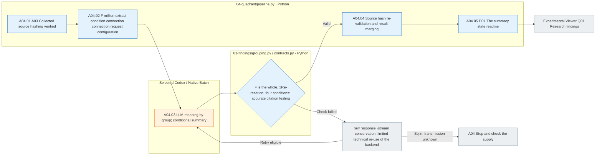

# A04 So, we're going to do this.

[Analysis](../README.md) · [Code of the employee](../../../../src/finarch/experiments/02-analysis/04-quadrant/README.md)

## Input and sequence

A03 Completed collection → Research discovery → grouping by meaning of F → Python F correspondence; use test → experiment viewer **03 Quadrant → Q01 Research findings**It's the same level. **Q02 Type-model comparison**Comparing the data set-by-set storage results.

The grouping object is just research findings. The input and the observation are not in the model input and the group entry. Python only checks the actual response conditions based on the observation of the quotation of F. `cited_conditions`Each F should be in one of the main groups, and the list of conditions should match the actual connection.

## File and run

`02_analysis/04_quadrant/manifest.jsonl`·`prompt.md`·`schema.json`The request for a settlement, `calls/`The raw response and test results, `01_findings/summary.json`So the group, the four conditions, the original F record, the answer is the base link.4The next step is to `04-quadrant/pipeline.py` `STEPS`Add in the order of execution.

Standards `pipeline run` / `analysis`is A03 Next is A0.4Continue to A0.3A04When you add one, you use the following command.

```sh
PYTHONPATH=src .venv/bin/python -u -B -m finarch.experiments.pipeline analysis-postprocess --run reports/experiments-run/20261003-exp-004-tatqa-luna-sol-low
```

The actual model-effort uses the Analysis inference setting of the run. Success responses are reused. The raw response ·gold·score does not change, and the F misses, duplicates, condition inconsistencies, non-citations do not pass to the next step.4It also follows the technical error retrieval and archival preservation of the existing backend.

## Running flow



Blue is Python, orange is the real LLM call, gray is the output and the flow record, and success/failure is not a form-and-participation test, but a test that confirms the meaningful truth of a research claim.
