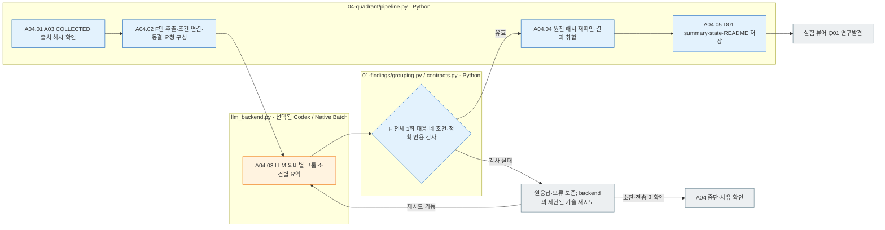

# A04 사분면 정리

[Analysis](../README.md) · [담당 코드](../../../../src/finarch/experiments/02-analysis/04-quadrant/README.md)

## 입력과 순서

A03 수집 완료 → 연구 발견 F의 의미별 그룹화 → Python F 대응·인용 검사 → 실험 뷰어 **03 Quadrant → Q01 연구발견**. 같은 단계의 **Q02 유형·모델 비교**에서 데이터셋별 저장 결과를 비교합니다.

그룹화 대상은 연구 발견만입니다. 토의 안건과 관찰은 모델 입력·그룹 항목에 넣지 않습니다. Python은 F의 인용 관찰을 따라 실제 응답 조건만 확인하고 `cited_conditions`로 전달합니다. 각 F는 주 그룹 하나에 포함되어야 하고 조건별 목록은 실제 연결과 일치해야 합니다. 비교 발견은 여러 칸에 나타날 수 있습니다.

## 파일과 실행

`02_analysis/04_quadrant/manifest.jsonl`·`prompt.md`·`schema.json`은 동결 요청, `calls/`는 원응답과 검사 결과, `01_findings/summary.json`은 그룹·네 조건 요약·원래 F 기록·응답 근거 연결입니다. A04의 후속 스텝은 `04-quadrant/pipeline.py`의 `STEPS`에 실행 순서대로 추가합니다.

표준 `pipeline run` / `analysis`는 A03 다음 A04를 진행합니다. 완료된 A03에 A04만 추가할 때는 다음 명령을 사용합니다.

```sh
PYTHONPATH=src .venv/bin/python -u -B -m finarch.experiments.pipeline analysis-postprocess --run reports/experiments-run/20261003-exp-004-tatqa-luna-sol-low
```

실제 모델·effort는 해당 run의 Analysis 동결 설정을 사용합니다. 성공 응답은 재사용합니다. 원응답·gold·점수를 바꾸지 않으며 F 누락·중복·조건 불일치·없는 인용은 다음 단계에 넘기지 않습니다. 전송 상태 미확인은 자동 중복 호출하지 않습니다. A04도 기존 backend의 기술 오류 재시도와 원기록 보존을 따릅니다.

## 실행 흐름



파랑은 Python, 주황은 실제 LLM 호출, 회색은 산출물·오류 기록입니다. 성공/실패 조건은 형식·참조 검사이며 연구 주장의 의미적 진위를 확정하는 검사는 아닙니다.
