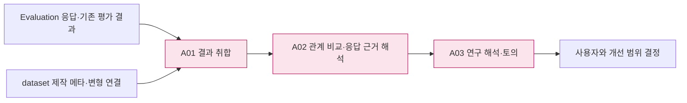
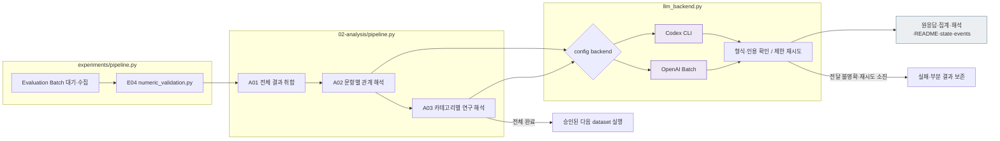
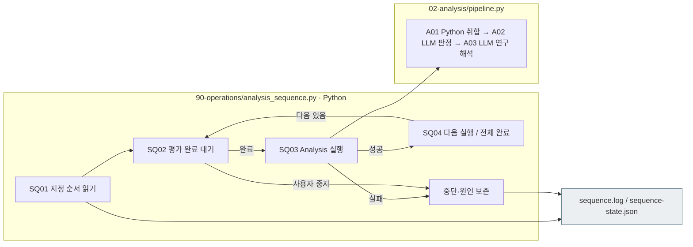

# 02 Analysis — 결과 취합 → 관계 비교 → 연구 해석

[실험 전체](../README.md) · [이전 Evaluation](../01_evaluation/README.md) · [소스 구성](../../../src/finarch/experiments/README.md)

## 사용법

다음 명령은 프로젝트 루트에서 실행합니다. `RUN_PATH`는 `prepare`가 출력한 실험 폴더입니다. 이미 생성한 실험을 이어갈 때는 같은 경로를 사용합니다.

```sh
RUN_PATH=reports/experiments-run/20261003-exp-004-tatqa-luna
PYTHONPATH=src .venv/bin/python -u -B -m finarch.experiments.pipeline configure-analysis --run "$RUN_PATH" --config config/experiments/config.toml
PYTHONPATH=src .venv/bin/python -u -B -m finarch.experiments.pipeline run --run "$RUN_PATH"
```

분석을 실행하기로 정한 뒤 사용합니다. 첫 명령은 Analysis 설정만 동결하며 모델 호출 0건입니다. 두 번째 명령은 Evaluation 완료를 확인한 뒤 A01 → A02 → A03를 이어갑니다. `analysis --run "$RUN_PATH"`는 분석 한 사이클을 수행하고 API Batch 대기는 반환할 수 있으므로 지속적인 재개에는 상위 `run`을 사용합니다.

분석 모델은 `analysis.run.backend`와 해당 프로필로 선택합니다. 이번 TOML 기본값은 Codex `gpt-6.1-sol` / `low`이며 과거 실행의 `gpt-6-sol` / `max`와 구별합니다. 실제 실행은 `02_analysis/config.json` 또는 루트의 동결 설정을 읽습니다. A01은 모델 호출이 없고, A02는 원본별 요청, A03는 관찰 주제별·입력 크기별 분할 요청입니다. A03 호출 수는 고정 26건이 아닙니다.

먼저 `00_input/selection.json`의 분석용 메타 누락을 확인합니다. 이번 TAT-QA 준비에서 기록된 누락이 해결되기 전에는 Evaluation 완료만으로 Analysis 준비 완료라고 판단하지 않습니다. 진행은 단계별 `state.json`·`scheduler.json`, 시간은 `timing.json`·`timing.md`에서 확인합니다. 일시 중지된 run은 명령만 다시 입력해도 해제되지 않으며, `configure-analysis`는 중지 해제 명령이 아닙니다.

처음 읽으시면 [Analysis 쉽게 이해하기 — 모으고, 비교하고, 설명하기](00-overview.md)에서 전체 그림과 실제 응답 사례를 먼저 확인해 주세요.

RQ1의 분석 방향은 [원본·변형 대응 결과의 네 사분면](02_comparison/01-rq1-pair-outcomes.md)에 정리했습니다. 공동 성공률 하나와 함께 나머지 세 사분면, 유형별 차이, 실패·미판정의 분모를 읽습니다. 이 자료는 분석 기준이며 실제 집계·의미 채점 완료 보고가 아닙니다.

**2026-10-03 추가 요구·설계:** [응답 근거 검토](02_comparison/02-response-grounding-review.md)는 원본을 제외한 응답의 충돌 설명·정보 부족 주장·evidence·최종 결정이 타당한지 A02에서 기록하고, A03에서 같은 판정을 사용하도록 정리한 자료입니다. 현행 관찰 해석에는 이 전수 판정값이 없으며, 새 계약 구현·실제 검토는 아직 수행하지 않았습니다. 문항을 선별하는 사전 검증을 추가하는 것이 아니라 저장된 응답의 타당성을 분석하는 요구입니다.

**Analysis는 실험 응답들을 모아 조건과 결과 사이의 관계를 설명하는 단계입니다.** 데이터셋에서 확정한 문항·유형·제작 정보를 입력으로 사용합니다. 문항 자체의 답변 가능성을 다시 판정하거나, 그 검증을 통과해야 분석을 시작하도록 만들지 않습니다.

예를 들어 원본을 맞힌 모델이 같은 풀이·추론 조건에서 IC-value에 어떤 답과 분류를 냈는지 비교하고, explanation과 evidence에서 그 변화의 근거를 찾습니다. 모델의 설명은 관찰된 응답이며 숨은 사고 과정의 증거로 단정하지 않습니다.

**적용 상태:** `20260927-exp-006`에 구현·적용했습니다. 005의 입력·Evaluation을 바이트 동일 사본으로 보존하고 A01~A03만 새로 수행했습니다. 006의 실행 방식은 Codex 대화 직접 분석이며 별도 API 호출은 없습니다. 신규 실행은 `02-analysis/pipeline.py`에서 설정된 Codex CLI 또는 OpenAI Batch로 A02/A03을 실행합니다. 과거 독립 문항 판정 흐름은 새 분석에서 사용하지 않습니다.

## 전체 단계와 7개 분석 카테고리

|단계|받는 것 → 하는 일 → 넘기는 것|분석 카테고리|LLM 사용|
|---|---|---|---|
|[A01 결과 취합](01_results/README.md)|실행 목록·원응답·기존 평가 결과 → 동일한 응답 행으로 연결 → `responses.jsonl`|① 전체 응답 양상|없음|
|[A02 관계 비교](02_comparison/README.md)|응답 행·실험 조건·제작 메타 → 대응 비교와 응답 근거 해석 → `comparisons.json`, `interpretations.jsonl`|② 원본과 변형 ③ 조건·모델 효과 ④ 유형별 선택·풀이 방식 ⑤ 답·분류·이유·근거 관계 ⑥ 반례·특이 사례|A02.04 `LLM_interpret_patterns`|
|[A03 연구 해석](03_research/README.md)|집계·대표 사례·반례 → 가능한 설명·한계·주장 범위 → `findings.json`, `findings.md`|⑦ 연구 해석|A03.02 `LLM_synthesize_findings`|

7개 카테고리는 분석 주제입니다. 폴더는 실제 진행 순서의 세 단계만 둡니다. 각 README 안에 세부 스텝과 담당 소스를 연결합니다.



분홍색은 상세 문서가 있는 단계입니다. 상세도의 회색은 파일, 파랑은 로컬 처리, 보라는 선택한 Codex/API의 응답 해석입니다.

## 실제 006의 run 형태

```text
reports/experiments-run/<실험ID>/
├── config.json, manifest.json, state.json, events.jsonl, README.md
├── 00_input/public.jsonl, private.jsonl
├── 01_evaluation/                         풀이 요청·원응답·평가 결과
└── 02_analysis/
    ├── README.md
    ├── 01_results/
    │   ├── README.md
    │   └── responses.jsonl                전체 계획 요청의 응답·기존 평가 연결
    ├── 02_comparison/
    │   ├── README.md
    │   ├── comparisons.json               대응 관계·분포·분모·응답 참조
    │   ├── interpretations.jsonl          응답 근거에 따른 패턴·반례 해석
    │   ├── prompt.md, schema.json         LLM 해석을 실행할 때 저장
    │   ├── manifest.jsonl                 해석 요청·근거 연결
    │   └── calls/                         실제 요청·원응답·상태
    └── 03_research/
        ├── README.md
        ├── findings.json                  수치·근거·대안·한계·결정의 기준 데이터
        ├── findings.md                    위 데이터에서 생성하는 한국어 안내
        ├── prompt.md, schema.json         LLM 해석을 실행할 때 저장
        ├── manifest.jsonl                 해석 요청·근거 연결
        └── calls/                         실제 요청·원응답·상태
```

현재 Codex에서 분석하면 해당 단계에 `prompt.md`, `schema.json`, `manifest.jsonl`, `calls/`를 남깁니다. manifest는 사용한 응답·집계 참조와 분석 설정을 기록하고, 006의 `calls/current-session.json`은 현재 대화의 작성 결과를 기록합니다. 별도 모델 호출 원응답이 아닙니다. Codex 대화에서 분석하면 그 저장 내용을 Codex 분석으로 표시하며 API 원응답처럼 꾸미지 않습니다. 별도 input-selection이나 같은 연결 정보를 가진 관리 파일을 추가하지 않습니다. `events.jsonl`은 run 공통 이력을 사용합니다.

## 현재 자료를 새 구조에서 읽는 방법

|현재 파일·코드|새 구조의 역할|처리 방침|
|---|---|---|
|Evaluation의 모델별 manifest·results·raw|A01의 원자료|참조로 연결하고 원응답은 보존|
|기존 `01_response_review/response-diagnostics.jsonl`|이미 계산된 숫자 비교 등 관찰|기록된 기준·출처와 함께 읽음. 없는 평가는 미기록|
|기존 독립 문항/응답 판정|과거 해석 자료|새 분석의 필수 입력·통과 조건으로 쓰지 않음|
|기존 `02_comparison/rows.jsonl`, `summary.json`, `paired.json`|집계·짝짓기 재사용 후보|원본 조건과 분모를 확인해 이관. 새 산출물과 혼합하지 않음|
|기존 `03_research/findings.md`|당시 해석 이력|새 분석의 결론으로 소급 대체하지 않음|

005의 원자료는 그대로 두고 006에 동일 Evaluation 사본과 새 Analysis를 생성했습니다. 006의 `evaluation_reuse`와 manifest 해시는 출처와 동일성을 기록합니다. 006은 독립 재실험이 아니며 005와 중복 합산하지 않습니다.

## 설정·분모·확인 경계

- 대상 풀이 모델은 `evaluation`, 분석 방식은 `analysis` 설정을 사용합니다. 분석은 Codex 또는 명시적으로 선택한 API이며, 풀이 모델을 자동 재호출하지 않습니다.
- 전체 계획 수·수집 수·형식 실패·미실행·짝 없는 응답·해석 미기록을 각각 보존합니다. 숫자 답/null, 모델의 classification, 기존 정답 비교, 분석자의 설명을 한 상태로 합치지 않습니다.
- 원본 정답/오답별 분석은 같은 모델·풀이 조건·추론 설정의 원본 결과를 연결합니다. 결과를 본 뒤 전체 분모를 바꾸지 않습니다.
- 답변 가능성이나 gold의 이상이 의심되면 관련 사례를 재검토 안건으로 남깁니다. Analysis 전체의 사전 verification으로 바꾸지 않습니다.
- 뷰어는 **A01 결과 취합 → A02 관계 비교 → A03 연구 해석** 메뉴에서 같은 집계와 원응답을 연결합니다. 006에서 새 메뉴·산점도·대응 전이·실제 응답 링크를 제공합니다. 후속 실험과 논문 주장은 사용자와 논의한 범위에서 반영합니다.

## 006 읽기와 실행 경계

- [006 README](../../../reports/experiments-run/20260927-exp-006/README.md): 320응답 취합·출처·파일 순서.
- [연구 해석](../../../reports/experiments-run/20260927-exp-006/02_analysis/03_research/findings.md): 19개 관찰·6개 연구 해석·미실행 토의 안건.
- [실험 뷰어](http://127.0.0.1:8894/?run=20260927-exp-006&tab=analysis): A01 → A02 → A03.

`analysis.method=results-focused-v1`, `backend=codex`, `execution_mode=current_session`입니다. 실제 현재 세션 모델 ID는 이 실행기에서 확인하지 못해 null로 기록합니다. 기존 API 분석 경로를 자동 사용하지 않습니다. 신규 E04 숫자 평가는 numeric_validation.py로 연결했습니다. 소스도 `00-input`, `01-evaluation`, `02-analysis`와 내부 단계 폴더로 재배치했습니다.

## 신규 실행과 재개

프로젝트 [config.toml 안내](../../../config/experiments/README.md)를 사용합니다. 첫 요청 전에 `configure-analysis`로 `02_analysis/config.json`을 동결할 수 있습니다. 기존 요청 manifest가 있으면 설정 교체를 막고, 실행 중 TOML 변경을 소급 적용하지 않습니다. 설정 동결 명령에는 모델 호출이 없고 일시 중지 해제도 하지 않습니다.

`analysis.run.backend`는 `codex` 또는 `api`입니다. 모델·추론은 같은 설정의 프로필을 읽습니다. Codex는 현재 gpt-6-sol/max이며 시작 동시 호출 수는 `analysis.schedule.concurrency=20`입니다. `analysis.schedule.adaptive`에 따라 60초마다 전체 CPU 평균이 60% 이하이면 한도를 10%씩 정수 올림하여 증가합니다. CPU 초과·측정 실패 시 한도를 유지하고 남은 요청 수까지만 증가합니다. Evaluation Batch의 제공자 동시 처리 수와 별개입니다. API 분석과 API Evaluation은 Native Batch를 사용합니다.

```text
PYTHONPATH=src .venv/bin/python -m finarch.experiments.pipeline configure-analysis --run <실험경로> --config config/experiments/config.toml
PYTHONPATH=src .venv/bin/python -m finarch.experiments.pipeline analysis --run <실험경로>
```

사용자가 분석 중지를 요청하면 run의 `state.json`에 `execution_control.analysis.paused=true`를 기록합니다. Analysis 진입점은 이 값을 먼저 확인해 호출 없이 `PAUSED_BY_USER`를 반환합니다. `finarch.experiments.pipeline run --evaluation-only --run ...`은 기존 Batch 수집·E04까지만 처리하고 Analysis나 다음 데이터셋을 시작하지 않습니다. 분석 재개는 사용자 지시 후 중지 상태를 해제하고 위 진입점을 실행합니다.

`20260927-exp-007-luna`은 소스 정리 중 분석을 보류한 뒤, 2026-09-27 사용자 지시로 기존 Batch 수집과 Analysis를 재개했습니다. 이후 사용자 지시로 동시 호출 운영 설정을 20건·CPU 조건부 증가로 변경했습니다. `configure-schedule`은 동결 자료를 보존하고 `02_analysis/runtime-schedule.json`에 운영 설정만 기록합니다. 현재 한도·CPU·진행 건수는 `scheduler.json`·자동 생성 `scheduler.md`·실험 뷰어에서 확인합니다.

후속 사용자 지시로 Luna Analysis가 완료되면 준비된 `20260927-exp-008-haiku`의 Evaluation을 Anthropic Batch로 실행합니다. Haiku Analysis는 중지 상태를 유지합니다. 실제 상태는 run의 `state.json`·단계별 `state.json`·`events.jsonl`을 기준으로 확인합니다.

## 처리 시간과 병목 확인

[timing.py](../../../src/finarch/experiments/02-analysis/timing.py)가 T01 시작·종료·실패 기록 → T02 중복 시간 제외·보고를 담당합니다. `pipeline.py`는 무결성 확인, 숫자 비교, A01 취합, A02 집계·요청 준비·모델 해석·결과 취합, A03 요청 준비·모델 해석·보고 생성을 측정합니다. `llm_backend.py`는 개별 Codex 호출, 인증 확인, 분석 상태 저장 시간도 기록합니다.

run의 `02_analysis/timing-events.jsonl`이 시간 원기록이고 `timing.json`·자동 생성 `timing.md`가 집계입니다. 실험 뷰어 A01의 **Analysis 처리 시간**에서 같은 파일을 읽습니다. 진행 중인 단계의 병목 비율은 잠정 값이며, 완료 기록이 없는 중단은 소요 시간을 확정하지 않습니다.

기존 Evaluation 수집 시간은 별도로 표시합니다. 상위 단계와 내부 처리, 동시에 실행한 호출은 시간이 겹치므로 모두 더하지 않습니다. 호출 시간에는 CLI·네트워크·제공자 처리가 포함됩니다. 제공자 내부 대기와 추론 시간을 분리한 측정은 아닙니다. API Batch의 원격 대기 시간은 개별 Codex 호출 통계로 해석하지 않습니다.

- A01: E04 `numeric-comparisons.jsonl`과 전체 요청·원응답을 읽습니다. 같은 run 및 과거 Evaluation 재사용을 구별합니다.
- A02: 원본별 원본/7변형×4조건 응답을 한 묶음으로 전달합니다. prompt/schema, manifest, calls/요청ID/attempt-번호, results, coverage, state를 저장합니다. 전체 응답을 제시한 범위와 실제 인용된 범위를 구분합니다.
- A03: 모든 A02 관찰을 카테고리별로 취합하며, 입력이 500,000바이트를 넘기기 전에 분할합니다. 각 묶음의 해석을 합본으로 기록하고 관찰 수를 독립 표본 수로 세지 않습니다.
- 응답 계약·정확 인용 실패 및 잘림 등 기록된 기술적 실패만 지정 횟수 재시도합니다. 전달 여부가 불명확하면 자동 재호출하지 않고 기록을 보존합니다. Codex 실패 시 API로 전환하지 않습니다.
- 전체 연결은 `experiments/pipeline.py`입니다. Batch 진행을 조회하고 완료 후 E04→A01→A02→A03으로 넘어갑니다. 해당 분석 완료 후에만 승인된 다음 데이터셋을 시작합니다. 상태·연결 run은 루트 `state.json`의 `full_pipeline`, 로그는 `events.jsonl`에서 확인합니다.



회색은 저장 파일, 보라는 LLM 호출입니다. 이 그림의 자동 실행은 구현·로컬 검사 완료이며 실제 각 run 완료는 해당 상태와 원응답으로 확인합니다.

## 여러 실행의 Analysis 순차 진행

`90-operations/analysis_sequence.py`는 `--run`으로 나열한 순서를 지킵니다. Evaluation을 새로 호출하지 않고 저장된 평가 완료 상태를 기다린 뒤 `02-analysis/pipeline.py`를 실행합니다. 분석 실패·사용자 중지는 뒤 실행으로 넘어가지 않고 기록합니다.

|역할|소스|출력|
|---|---|---|
|실행 순서·완료 대기·중단 관리|`90-operations/analysis_sequence.py`|첫 실행의 `02_analysis/sequence.log`, `sequence-state.json`|
|실행별 분석·오류 기록|`02-analysis/pipeline.py`|각 실행의 `pipeline.log`, `02_analysis/execution.log`|
|동시 실행과 CPU 기록|`02-analysis/scheduler.py`|각 실행의 `02_analysis/scheduler.json`, `scheduler.md`, `events.jsonl`|



회색은 파일이며 SQ 단계는 Python 제어입니다. 개별 호출의 재시도·미평가 처리는 기존 Analysis 계약을 따릅니다.
