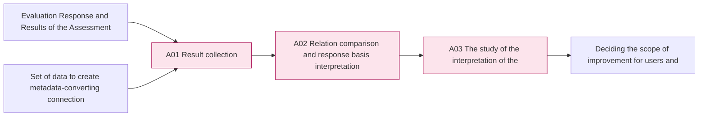
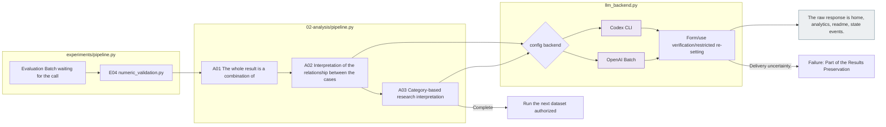
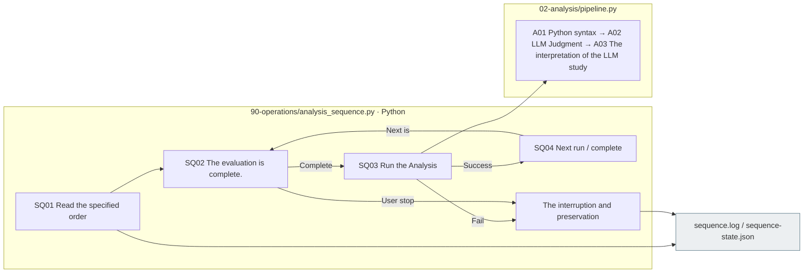

# 02 Analysis  results of the synthesis → relationship comparison → study interpretation

[The whole experiment](../README.md) · [Previous Evaluation](../01_evaluation/README.md) · [Source configuration](../../../src/finarch/experiments/README.md)

## Usage

The next command runs from the project root. `RUN_PATH` `prepare`It's an experimental folder that G.O.A. has created, and it uses the same path as the experiment that he's already created.

```sh
RUN_PATH=reports/experiments-run/20261003-exp-004-tatqa-luna
PYTHONPATH=src .venv/bin/python -u -B -m finarch.experiments.pipeline configure-analysis --run "$RUN_PATH" --config config/experiments/config.toml
PYTHONPATH=src .venv/bin/python -u -B -m finarch.experiments.pipeline run --run "$RUN_PATH"
```

The first command is to unlock the Analysis setting and call the model. 0The second command is A0 after verifying the evaluation is complete.1 → A02 → A03And then we go on. `analysis --run "$RUN_PATH"`The API Batch can be returned to the air so that the continuous reopening is at the top of the `run`I use it.

The analytical model is `analysis.run.backend`And then you select the profile. `gpt-6.1-sol` / `low`And the past execution `gpt-6-sol` / `max`And the real execution is `02_analysis/config.json` Or read the root's conjugate setting.1There's no model call, and A02The request for a copy, A03is the request to divide by the subject of observation and the input size.3 Called number fixed 26It's not that.

First of all. `00_input/selection.json`The meta gaps for analysis are verified. The gaps recorded in this TAT-QA preparation are not resolved until the evaluation is completed. `state.json`·`scheduler.json`Time is the time. `timing.json`·`timing.md`The suspended run is not deleted if you re-enter the command, and the command is not deactivated. `configure-analysis`It's not a stop-and-demolition order.

When you first read it, [Analysis is easy to understand, collect, compare, explain, and compare](00-overview.md)Please check the full picture and the actual response first.

The analysis direction of RQ1 is the four-dimensional aspect of the original and variable response results.](02_comparison/01-rq1-pair-outcomes.md)So we're going to read the other three quarters, along with one common success rate, the denominator of type differences, failure and misjudgment, which is the analytical basis, not the actual statistical and purposeful completion report.

**2026-10-03 Additional requirements and equipment:** [Review of the answer](02_comparison/02-response-grounding-review.md)The answer is a non-original explanation of the conflict.2Recorded in, A03It's the same data that's designed to be used in the current observational interpretation, which doesn't have these prime values, and the implementation and actual review of the new contract hasn't been done yet. It's not a requirement to add pre-verification to select cases, but to analyze the validity of the stored responses.

**Analysis is the process of gathering experimental responses and explaining the relationship between conditions and outcomes.** It uses the data set to input the fixed case, model, and output information, not to re-determine the answering potential of the case itself, or to make it pass that verification and start the analysis.

For example, we compare what answers and classifications the model matched the original gave to the IC-value under the same set of reference conditions, and we look for the basis for that change in the explanation and evidence. The model's explanation is an observed response and not an evidence of a hidden thought process.

**The state of application:** `20260927-exp-006`I've been implementing and using it. 005Save the input evaluation byte to the same copy and A01~A03And we've done a million new ones. 006The execution method is to directly analyze the Codex dialogue and there is no API call. `02-analysis/pipeline.py`Set to a codec cli or openai batch from a02/A03The past independent case judgment flow is not used in the new analysis.

## And the whole stage. 7Categories of items

|Stage|What you get → what you do → what you get|The analysis of the categories|Use of LLM|
|---|---|---|---|
|[A01 Result collection](01_results/README.md)|Running list: raw response: Existence evaluation results: Link to the same response line: `responses.jsonl`|1 is the total response pattern|None|
|[A02 Relationship comparison](02_comparison/README.md)|Answer line, test conditions, output metadata, correspondence comparison and response basis interpretation `comparisons.json`, `interpretations.jsonl`|2 origin and transformation 3 conditions; model effect 4 types by type selection; flowering method 5 answers; classification; e.g. neighborhood relations 6 half-dimensional; special case|A02.04 `LLM_interpret_patterns`|
|[A03 Research interpretation](03_research/README.md)|Statistics, statistics, cases, and half → possible explanations, limits, scope of the main article → `findings.json`, `findings.md`|7 Interpretation of the study|A03.02 `LLM_synthesize_findings`|

7The items category is an analytical topic, and the folder only leaves three steps in the actual sequence of progress, connecting the detailed steps to the source responsible within each README.



The pink is the step where the detailed document is, the gray is the file, the blue is the response interpretation of the selected Codex/API, the local processing.

## Actual 006The form of run

```text
The first is the "experimental ID".
├── config.json, manifest.json, state.json, events.jsonl, README.md
├── 00_input/public.jsonl, private.jsonl
├── 01_evaluation/ raw response
└── 02_analysis/
    ├── README.md
    ├── 01_results/
    │   ├── README.md
    │ ── responses.jsonl Full plan response to request
    ├── 02_comparison/
    │   ├── README.md
    │ ── comparisons.json correspondence relationship distribution denominator · see reply
    │ ── interpretations.jsonl pattern-contrast interpretation based on the response basis
    │ ── prompt.md, schema.json save when executing the LLM interpretation
    │ ── manifest.jsonl interpretation request; close connection
    │ ── calls/ actual request  raw response  status
    └── 03_research/
        ├── README.md
        ── findings.json figures, circles, variables, boundaries, and base data for the decision
        ── Korean language guide generated from the data at findings.md
        ── prompt.md, schema.json save when running an LLM interpretation
        ── manifest.jsonl interpretation request; close connection
        ── calls/ actual requests  raw response  status
```

And if you analyze it in the current Codex, you're going to get that step. `prompt.md`, `schema.json`, `manifest.jsonl`, `calls/`The manifest records the response and the analysis settings used, and the results are presented in a way that is consistent with the results. 006 `calls/current-session.json`It records the actual outcomes of a conversation. It's not a raw response to a model call. When you analyze it in a Codex conversation, you show the stored content as a Codex analysis, and it doesn't look like an API raw response. It doesn't add any input-selection or management files with the same connection information. `events.jsonl`The run uses the common gravity.

## How to read current data in a new structure

|Current file code|The role of the new structure|The way we handle it.|
|---|---|---|
|Models of evaluation by manifest; results;raw|A01The raw materials of|Link to reference and save the raw response|
|Existing `01_response_review/response-diagnostics.jsonl`|And the numbers that have been calculated, the comparisons, the observations.|Reading with recorded criteria, sources.|
|The existing independent case/response judgment|The data from the past interpretation|Not using it as a condition of the new input and output.|
|Existing `02_comparison/rows.jsonl`, `summary.json`, `paired.json`|The candidate for reuse of the statistics|Check the original condition and denominator.|
|Existing `03_research/findings.md`|The interpretation of the time|The new analysis concludes that there is no substitute for the minority.|

005And we're going to keep the raw materials. 006I created the same evaluation copy and new analysis. 006 `evaluation_reuse`And the manifest hash records the source and the identity. 006It's not an independent retrospective. 005And it doesn't add up.

## Set the denominator and verify the boundary.

- The targeted grass model is `evaluation`And the way we analyze it, `analysis` It uses a setup. The analysis is a Codex or an API that's explicitly chosen, and the grass doesn't automatically re-code the model.
- It preserves the entire plan, the sum of the numbers, the formulation failure, the mismatch, the unpaired response, the analytic metadata, the numerical answer/null, the classification of the model, the comparison of the existing correct answers, the analyst's description in a single state.
- The original right-to-negative analysis connects the original results of the same model, full condition, and reference setting, without changing the entire denominator after seeing the results.
- If the probability of an answer or the gold's value is in doubt, we leave the relevant case to be re-examined, not to be replaced by a pre-verification of the entire analysis.
- The viewer **A01 The result is a 02 Relation comparison → A03 Research interpretation** Link the same statistics to the raw response in the menu. 006In the new menu, the score also provides a link to the response before the response. Subsequent experiments and paper claims reflect the scope discussed with the user.

## 006 Read and run boundaries

- [006 README](../../../reports/experiments-run/20260927-exp-006/README.md): 320Answer sequence, source and file order.
- [Research Interpretation](../../../reports/experiments-run/20260927-exp-006/02_analysis/03_research/findings.md): 19observations ·6items research interpretation and missile testing.
- [Experimental Viewer](http://127.0.0.1:8894/?run=20260927-exp-006&tab=analysis): A01 → A02 → A03.

`analysis.method=results-focused-v1`, `backend=codex`, `execution_mode=current_session`The actual current session model ID is not verified by this runner, and it's written to null.4 The numerical evaluation is linked to numeric_validation.py. `00-input`, `01-evaluation`, `02-analysis`And then rearranged it into the internal stages folder.

## New execution and reopening

Project [config.toml guide](../../../config/experiments/README.md)I'm using it. `configure-analysis`What is it? `02_analysis/config.json`If there's an existing request manifest, it blocks the set change, and it doesn't apply the TOML change to the running prompt.

`analysis.run.backend` `codex` Or `api`The model-reference reads the profile of the same setting.6-sol/max and start the simultaneous call number `analysis.schedule.concurrency=20`. `analysis.schedule.adaptive`According to 60The average CPU per second is 60% If you're below the limit, 10%It increases with time. It keeps the limit of CPU over-computing and measurement failures until you have the remaining requests. It's separate from the number of concurrent processing by the providers of the Evaluation Batch. API analysis and API Evaluation use Native Batch.

```text
PYTHONPATH=src .venv/bin/python -m finarch.experiments.pipeline configure-analysis --run <experiment circle> --config config/experiments/config.toml
PYTHONPATH=src .venv/bin/python -m finarch.experiments.pipeline analysis --run <experimental circle>
```

When a user asks for an analysis center, the run is `state.json`in `execution_control.analysis.paused=true`The entry point of the analysis is to first check this value and call it without `PAUSED_BY_USER`I'm going to return it. `finarch.experiments.pipeline run --evaluation-only --run ...`The existing batch collected E04The processor does not process and start the next data set, or the Analysis, which is restarted after the user instructs it to undo the stop and run the top entry point.

`20260927-exp-007-luna`So we're going to have to keep the analysis in the source array. 2026-09-27 We resumed the existing Batch collection and analysis with user instructions, and then we started to set up the concurrent call operation with user instructions. 20And then I changed the CPU condition to an increase. `configure-schedule`And we're going to preserve the data. `02_analysis/runtime-schedule.json`It's only recording the operating settings. `scheduler.json`· Automated generation `scheduler.md`· Check it in the experiment viewer.

The next user's instructions are that when Luna Analysis is complete, the `20260927-exp-008-haiku`The Haiku Analysis keeps the actual state of the run at a standstill. `state.json`• Stage by stage `state.json`·`events.jsonl`I'll check it out by the standards.

## Processing time and check the cannon

[timing.py](../../../src/finarch/experiments/02-analysis/timing.py)Go to T01 Start, finish, fail record → T02 I'm in charge of reporting except for the time of the transition. `pipeline.py`is the integrity check, the number comparison, the A01 A0 is the sum of the squares.2 Summary: Preparation of the request: Model interpretation: Conclusion summation, A03 Request preparation, model interpretation, and reporting and measuring the creation. `llm_backend.py`The codex also records individual call, authentication, and analytical storage time.

Run of the `02_analysis/timing-events.jsonl`This is the time record. `timing.json`· Automated generation `timing.md`So this is the approximation.1 **Analysis processing time**The particle ratio of the in-progress step is a default value, and interruptions without a completed record do not confirm the time taken.

The existing Evaluation collection time is shown separately. The top-level and internal processing, and simultaneously executed calls are overlapping, so no more time. Call time includes CLI-network-producer processing. It is not a measurement that separates the data from the inference time inside the provider. The remote waiting time of the API Batch is not interpreted as individual Codex call statistics.

- A01: E04 `numeric-comparisons.jsonl`And read the whole request: raw response.
- A02The original.7Differentiation x4It sends out the condition response in a bunch: prompt/schema, manifest, calls/request ID/attempt number, results, coverage, state, and distinguishes the scope of the entire response from the actual cited range.
- A03All A0s:2 And we're going to sort the observations into categories, and then we're gonna have to sort the input into the input. 500,000Before you go over the byte, you divide the interpretation of each set into a copy, and you don't count the observed number as an independent sample number.
- It also reviews only the number of technical failures recorded, such as response contracts, accurate citation failures, and cuts. If the delivery or delivery is unclear, it automatically re-records and preserves the record without re-recording it. When Codex fails, it doesn't switch to API.
- The whole connection is `experiments/pipeline.py`E0 after the batch progress is monitored and completed4→A01→A02→A03It's only after the analysis is approved that the data set starts. `state.json` `full_pipeline`Log, you know. `events.jsonl`Check it out.



The gray is the LLM call for the saved file, the bo. The automatic execution of this image is the implementation-local check completed and the actual completion of each run is verified as the corresponding state and raw response.

## Analysis of several executions progressed in sequence

`90-operations/analysis_sequence.py` `--run`It keeps the order listed as: `02-analysis/pipeline.py`It's not going to go beyond the execution, it's going to be written down after the failures of the analysis and the user-centred.

|Role|The source.|Output|
|---|---|---|
|Running sequence, completed air conditioning, and center stage management|`90-operations/analysis_sequence.py`|The first run of the `02_analysis/sequence.log`, `sequence-state.json`|
|Performance analysis and flow recording|`02-analysis/pipeline.py`|Each run is `pipeline.log`, `02_analysis/execution.log`|
|Simultaneous execution and CPU recording|`02-analysis/scheduler.py`|Each run is `02_analysis/scheduler.json`, `scheduler.md`, `events.jsonl`|



The gray is the file, and the SQ step is the Python control, which is the re-evaluation and re-evolution of individual calls under the existing Analysis agreement.
