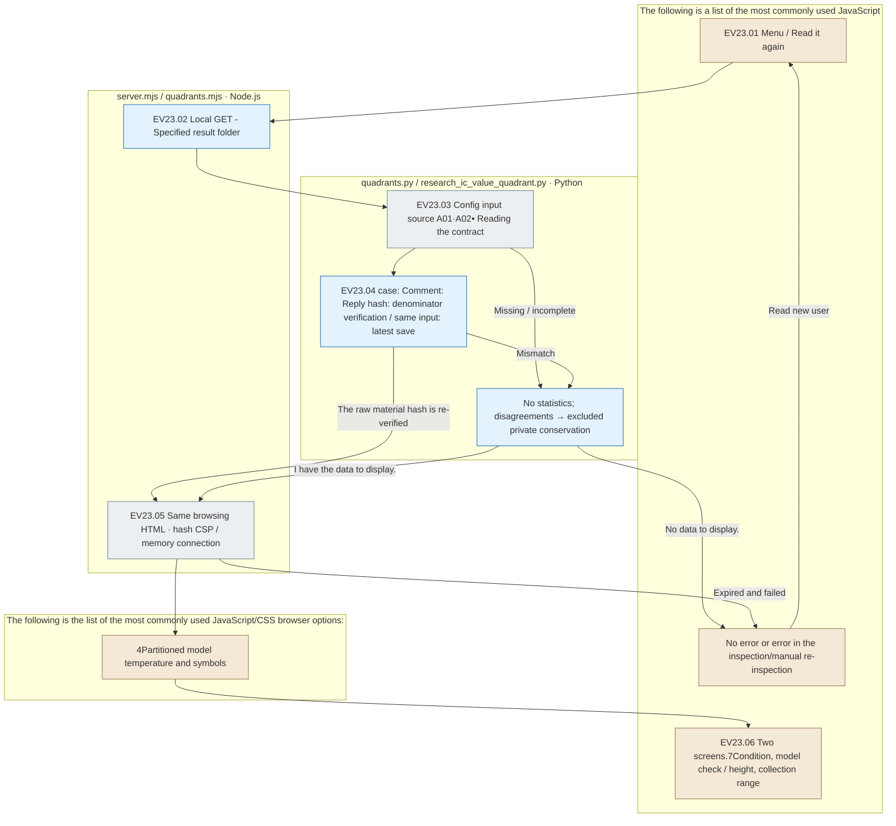

# Experiment Viewer · Quadratic comparison menu · EV23

[Figure opens](http://127.0.0.1:8894/?tab=quadrants) · [Use of the viewer](../../viewer/experiments/README.md) · [independent HTML guide](../../outputs/research/20260930-ic-value-quadrant/README.md)

Input / Evaluation / Analysis next to the **Quadrant comparison**is the storage of multiple circuits A02 And then there's an additional menu where you can add the results to the data set and then you can add them to the data sets and then you add the data sets to the dataets and then you put them in the data sets.7Conditions, model selection and keep the model check below. 4.5 → Qwen3 14B → Qwen3 8BIt's not an experimental stage or an LLM analysis, and it doesn't use raw response, experimental files, independent HTML.

## Reading order

1. [verification.json](verification.json)It's the actual survey, the conservation and the verification of resources.
2. [tests.log](tests.log), [python-tests.log](python-tests.log)The results of the search are: server boundaries, frame connections, CSP reviews, common aggregates, failure denominator, and also the resulting change of folder resources.
3. [browser-verification.json](browser-verification.json), [screenshot.png](screenshot.png): Real menu entry; two screens;7It's a condition, model check, revision, reverse screen record, and it's a distinction between completing a final review by a user.
4. [server.log](server.log): Check the server's read-only visiting record.
5. [documentation-validation.json](documentation-validation.json): This is a document linking test after the template update.

## File-specific responsibilities and browsing flow

|File|Input → process → output|
|---|---|
|[server.mjs](../../src/finarch/experiments/viewer/server.mjs), [quadrants.mjs](../../src/finarch/experiments/viewer/quadrants.mjs)|Local GET: Current results folder → Python 3 See also: synchronized reading synchronization → same-scale HTML; hash CSP; collection range|
|[quadrants.py](../../src/finarch/experiments/viewer/quadrants.py)|Data storage → common generators running; resource hashing re-verification → file not writing HTML; collection range|
|[research_ic_value_quadrant.py](../../src/finarch/documentation/research_ic_value_quadrant.py)|config·public·private·A01·A02• Contract; source of production → same input;7Condition: Question: Problem: Answer: Chart: denominator verification → Dataset set; Recently saved copy selection|
|[app.js](../../viewer/experiments/app.js), [styles.css](../../viewer/experiments/styles.css)|Select menu → rotation filter; problem list hiding → full width; fit to the height; collection range; read fresh|
|[Template is now](../../src/finarch/documentation/templates/research/ic-value-quadrant.fragment.html)|Check the set → two screens;7Conditions, model checks, and registration categories;9Step increase background; state of selection recovery|

The gray is the file review and screen data, the blue is the server/Python processing, the brown is the screen, there's no detailed extension node, no pink node, no Python processing, and no LLM processing, and if the raw material hash changes during the reading, it's an error, and then it's re-read. 0Or not change it into a correct answer.

The option is read again. The menu is restored after iteration. The denominator includes output cuts, formatting, and execution failures. `src/finarch/documentation/templates/viewer-experiments-quadrants.md`It's generated automatically.
