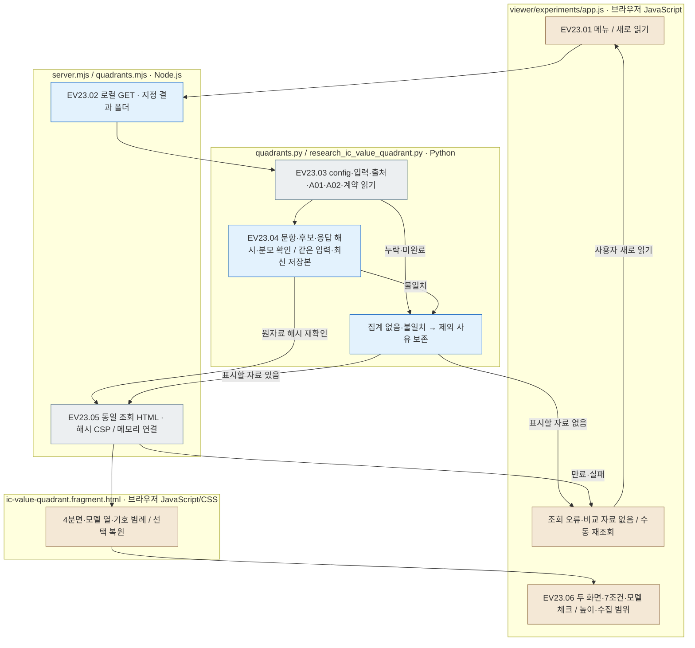

# 실험 뷰어 · 사분면 비교 메뉴 · EV23

[화면 열기](http://127.0.0.1:8894/?tab=quadrants) · [뷰어 사용법](../../viewer/experiments/README.md) · [독립 HTML 안내](../../outputs/research/20260930-ic-value-quadrant/README.md)

Input / Evaluation / Analysis 옆의 **사분면 비교**는 여러 회차의 저장 A02 결과를 데이터셋·동일 입력별로 모아 보는 추가 메뉴입니다. 두 화면의 데이터셋·문항 묶음·7조건·모델 선택과 아래 모델 체크를 유지합니다. 순서는 Luna → Haiku 4.5 → Qwen3 14B → Qwen3 8B입니다. 별도 실험 단계나 LLM 분석이 아니며, 원응답·실험 파일·독립 HTML을 쓰지 않습니다.

## 읽는 순서

1. [verification.json](verification.json): 실제 조회·원자료 보존·검사 결과입니다.
2. [tests.log](tests.log), [python-tests.log](python-tests.log): 서버 경계·프레임 연결·CSP·재조회, 공통 집계·실패 분모·별도 결과 폴더·원자료 변경 검사입니다.
3. [browser-verification.json](browser-verification.json), [screenshot.png](screenshot.png): 실제 메뉴 진입·두 화면·7조건·모델 체크·재조회·회차 화면 복귀 기록입니다. 사용자의 최종 검토 완료와 구분합니다.
4. [server.log](server.log): 확인 서버의 읽기 전용 조회 기록입니다.
5. [documentation-validation.json](documentation-validation.json): 템플릿 갱신 후 문서 연결 검사 결과입니다.

## 파일별 책임과 조회 흐름

|파일|입력 → 처리 → 출력|
|---|---|
|[server.mjs](../../src/finarch/experiments/viewer/server.mjs), [quadrants.mjs](../../src/finarch/experiments/viewer/quadrants.mjs)|로컬 GET·현재 결과 폴더 → Python 3 조회·동시 읽기 병합 → 같은 조회의 HTML·해시 CSP·수집 범위|
|[quadrants.py](../../src/finarch/experiments/viewer/quadrants.py)|저장 자료 → 공통 생성기 실행·원자료 해시 재확인 → 파일 쓰기 없는 HTML·수집 범위|
|[research_ic_value_quadrant.py](../../src/finarch/documentation/research_ic_value_quadrant.py)|config·public·private·A01·A02·계약·제작 출처 → 동일 입력·7조건·문항·후보·응답 해시·분모 확인 → 데이터셋 묶음·최신 저장본 선택|
|[app.js](../../viewer/experiments/app.js), [styles.css](../../viewer/experiments/styles.css)|메뉴 선택 → 회차 필터·문항 목록 숨김 → 전체 폭·내용에 맞는 높이·수집 범위·새로 읽기|
|[사분면 템플릿](../../src/finarch/documentation/templates/research/ic-value-quadrant.fragment.html)|확인한 집계 → 두 화면·7조건·모델 체크·기호 범례·9단계 증가 배경·선택 상태 복원|

회색은 파일 조회·화면 자료, 파랑은 서버/Python 처리, 갈색은 화면입니다. 별도 상세 확장 노드가 없어 분홍색 노드를 쓰지 않습니다. 저장 자료를 읽는 Python 처리이며 LLM 처리는 없습니다. 읽는 중 원자료 해시가 바뀌면 오류를 표시하고 새로 읽기로 다시 확인합니다. 미완료를 0이나 정답으로 바꾸지 않습니다.

선택은 새로 읽기·메뉴 왕복 후 복원됩니다. 분모에는 출력 잘림·형식·실행 실패도 포함합니다. 회차 Export에는 여러 회차 비교 메뉴를 넣지 않습니다. 이 README는 `src/finarch/documentation/templates/viewer-experiments-quadrants.md`에서 자동 생성합니다.
