> `20260927-exp-006`에서는 Analysis를 A01 결과 취합 → A02 관계 비교 → A03 연구 해석 순서로 읽습니다. 독립 문항 답변 가능성 검증을 시작 조건으로 두지 않습니다. `20260927-exp-005`와 이전 회차의 기존 분석 메뉴와 기록은 그대로 구분해 표시합니다. [단계·run·src 설계](../../docs/02-experiments/02_analysis/README.md)를 함께 읽으세요.

# 실험 결과 전용 뷰어 · viewer-exp

## FInject 최종 PASS 비교 · FC04

ANSWERABLE의 **모델별 저장 결과 취합**에서 `FInject 최종 PASS · 1,354 문항군`을 선택합니다. FinanceReasoning 1,071개 + TAT-QA 283개를 한 코호트로 표시합니다. G/R별 주요 5개 변형의 지원 비율·검토 범위, 원본 숫자 정답/오답 집단, IC-v→IC-s 기권 유지율을 확인하고 원천 run으로 이동할 수 있습니다. `원천별 기존 집계`는 이전 범위를 보존합니다.

|파일|입력 → 처리 → 출력|
|---|---|
|`server.mjs`|GET의 scope/cohort → 공통 reader → 조회 JSON|
|`outcome-comparison.mjs`|최종 summary·manifest·release → 해시 확인 → 고정 PASS 집계; 원천 run 재실행 없음|
|`viewer/experiments/semantic-outcomes.mjs`|저장 건수·비율 → 표·조건·미완료·원천 링크|

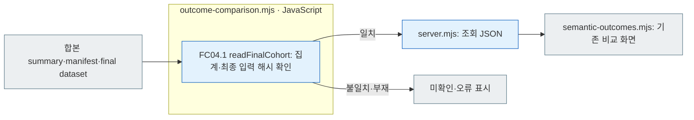

회색은 파일·화면, 파랑은 로컬 JavaScript입니다. 지원율의 분모는 S+U이며 D/F도 계획·검토 범위에 남습니다. Gemini의 R-OFF는 조건 미실행, R-ON은 유효 응답 부재·A02 미실행입니다. [합본 파일 안내](../../reports/analysis/20261008-finject-1354/README.md)를 확인하세요.

> 2026-09-27 재검토: 사용자 지시로 동일 Luna API의 과거 내용 판정·개선 결론을 보류했습니다. `USER_REVIEW_RESET` 기록이 있는 실행은 상단에서 이 상태를 표시합니다. 006은 005의 Evaluation 320응답을 새 호출 없이 재분석한 회차입니다. 과거 판정을 새 분석의 결과로 사용하지 않고 기존 수치·원기록은 보존합니다.

[브라우저에서 열기](http://127.0.0.1:8894/) · [기준선 종합 대시보드](http://127.0.0.1:8895/dashboard/01-overview/) · [기준선 문항 대시보드](http://127.0.0.1:8895/dashboard/02-explorer/) · [상세 동작·파일별 흐름](../../docs/02-experiments/README.md)

표시명은 Unguided Solving, Criteria-Guided Solving, Reasoning OFF, Reasoning ON입니다. 필터·버튼·표·답변 제목에 내부 약칭을 덧붙이지 않습니다. 내부 조건 값과 저장된 요청 파일명은 그대로 유지합니다. [표시·동작 확인 기록](../../log/viewer-experiments-official-names.json).

브라운 테마의 실험 전용 화면입니다. `reports/experiments-run`의 실제 저장 파일을 읽으며 데이터셋 뷰어와 별도로 실행합니다. 결과 폴더마다 HTML을 자동 생성하지 않습니다.

상단 **한국어 / English**는 버튼·필터·안내와 저장된 연구 해석의 표시 언어를 바꿉니다. A03 등의 `display_ko`는 한국어에서, 영어 원문은 English에서 표시합니다. 없는 번역은 원문으로 남기며 원응답·Q/C·주석은 변경하지 않습니다. **실행 HTML Export**에는 [같은 전환 코드와 사전](../shared/README.md)이 직접 포함됩니다. 언어 선택과 오프라인 자료 조회는 별도 API 호출을 하지 않습니다. [검사 기록](../../log/viewer-i18n-20261002/README.md).

## 응답 근거 검토 · A02 V2

**조건별 비교**는 `02_analysis/02_comparison/response-assessments.jsonl`, `response-assessment-summary.json`, `response-assessment-coverage.json`의 저장 판정을 읽습니다. [현행 두 판정 계약](../../docs/02-experiments/02_analysis/02_comparison/02-response-grounding-review.md)에 따라 모델 × 7변형 × 풀이·추론 조건별 검토 상태와 기권 이유/최종 답변 근거의 분포를 n/N·%로 표시합니다. 원본은 대상에서 제외하며 숫자 응답의 기권 이유는 해당 없음입니다.

**문항 비교**에서 정확한 response_id에 연결된 판정·영어 이유·인용을 확인합니다. 인용을 펼치면 해당 모델 요청의 question/context 또는 응답의 explanation/evidence 원문에 인용 구간을 강조합니다. HTML Export도 같은 저장 자료를 사용합니다. 파일이 없는 V1 결과는 판정 자료 없음으로 표시하며 0%를 만들지 않습니다. 검토 실패·검토 불가·입력 원문 부재·미검토를 구분합니다. 실제 V2 검토가 저장된 회차는 해당 response-assessment-coverage.json으로 검토 완료·불가 건수를 확인합니다. 문항별 이유·인용은 해당 응답에 연결된 저장 기록을 사용합니다. 후보 A/B 사분면이나 adaptation_success만으로 최종 RQ1 결과를 만들지 않습니다.

## 진행 대시보드 · EV19

[진행 대시보드](http://127.0.0.1:8894/?tab=progress)를 열거나 실험 화면의 **진행 대시보드 ↗**를 누릅니다. 실행과 A02 문항별 관계 분석 / A03 연구 해석 단계를 선택하면 **5초마다** 실제 저장 기록을 읽습니다. 자동 갱신을 끄거나 새로 읽을 수 있습니다.

1. **전체·완료·실행 중·대기·오류·남은 건수**: `전체 = 완료 + 실행 중 + 대기 + 오류`입니다. 남은 건수는 완료만 뺀 값으로 오류도 포함합니다. 전체 수가 없으면 미기록으로 표시합니다.
2. **건당 처리시간**: 점은 요청별 마지막 종료 호출, 선은 최근 검사 통과 20건의 평균입니다. 평균·중앙값·95백분위는 요청별 마지막 검사 통과 호출만 사용합니다. 진행 중 호출과 이전 실패 시도는 제외합니다.
3. **동시 호출 수**: 현재 실행 수를 한도 대비 막대로 표시합니다. 아래 계단형 그래프의 파란 영역은 실제 실행 수, 갈색 점선은 저장된 호출 한도입니다. 재시작으로 한도가 다시 설정된 시점도 반영합니다.
4. **CPU 사용률**: 0~100% 고정 축과 60% 증설 기준선을 사용합니다. 동시 호출 그래프와 같은 시간축으로 비교합니다. 현재 값은 최근 기록된 전체 컴퓨터 CPU 평균이며 측정 시각을 함께 표시합니다. 측정 실패는 0%로 채우지 않습니다.
5. **완료 누적·최근 종료 목록**: 시간 기록이 있는 완료 건수와 개별 요청의 종료 시각·처리시간·상태를 확인합니다.
6. **현재 작업 경과**: 실제 프로세스가 살아 있는 Python 준비 작업은 “준비 전” 대신 작업 이름과 경과 시간으로 표시합니다. 현재 Codex 실행은 첫 1건을 기다리지 않고 설정한 동시 한도로 시작합니다. 과거 실행의 첫 응답 대기 기록은 당시 상태로 표시하며 실제 실행 건수와 한도를 구별합니다.

한도는 동시에 실행할 수 있는 최대 수입니다. 남은 대기 요청이 없으면 실제 호출 수는 한도보다 작아집니다. 시간은 CLI·네트워크·제공자 처리를 모두 포함하며 제공자 내부 대기·추론 시간을 나누어 측정한 값이 아닙니다. 완료는 분석 응답 검사 통과이며 의미 정답 확정을 뜻하지 않습니다. Evaluation 응답 수와 분석 요청 수, A02와 A03은 각각 표시합니다.

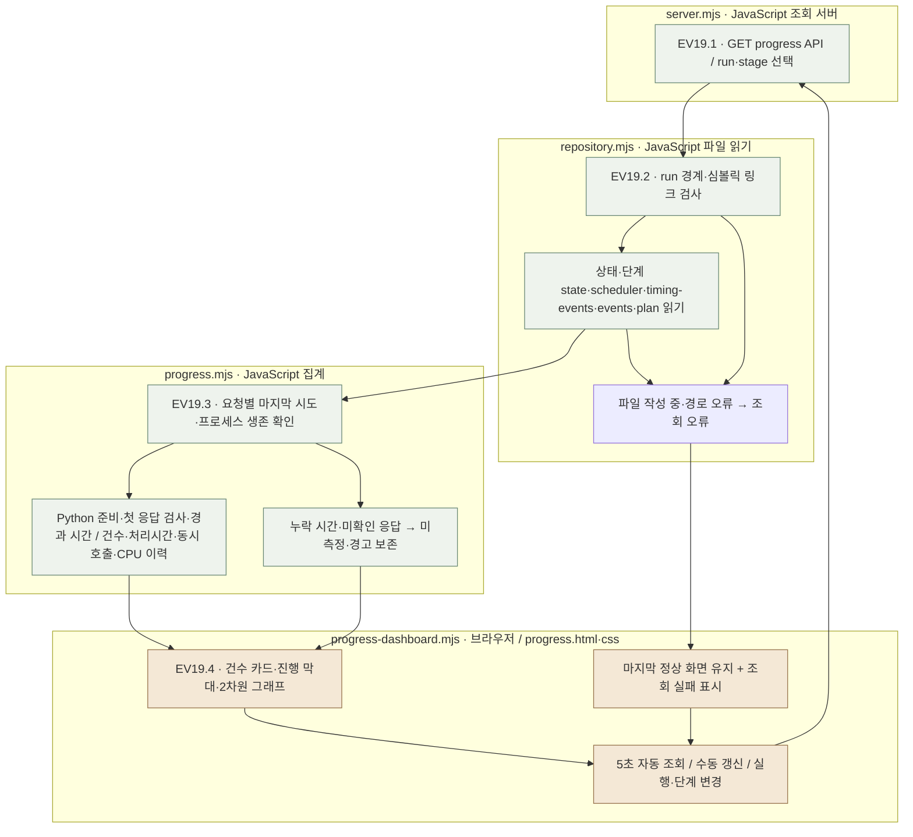

연녹색 박스는 서버의 기록 조회·집계, 갈색 박스는 브라우저 표시입니다. 이 상세도에는 추가 확장 노드가 없으므로 분홍색 노드를 쓰지 않습니다. 모든 처리는 JavaScript이며 Python 실행·LLM 호출·자동 재시도를 하지 않습니다. 실행기가 종료된 미종료 호출의 시간은 임의로 확정하지 않습니다. 쓰기 중 오류는 다음 조회에서 다시 읽으며 실험을 재실행하지 않습니다.

[검사 로그·실제 API·화면 확인](../../reports/run/20260927-experiment-source-layout/README.md)에서 검증 자료를 읽을 수 있습니다.

## 실행

macOS에서는 [start.command](start.command)를 실행하세요. **서버 준비가 끝나면 기본 브라우저가 바로 열립니다.** 같은 포트에 같은 결과 폴더를 읽는 실험 뷰어가 이미 실행 중이면 기존 서버의 화면을 엽니다. 다른 프로그램이나 다른 결과 폴더의 뷰어가 포트를 사용하면 오류를 알립니다.

터미널에서는 프로젝트 루트에서 실행합니다. Node.js 20 이상이며 추가 패키지는 필요 없습니다.

메뉴 막대 위젯에서 실행해도 일반 PATH와 Homebrew 기본 설치 경로에서 Node.js를 찾습니다. 두 위치 모두 설치가 없을 때만 시작이 중단되며, 오류는 `log/server-widget/experiments.log`에 남습니다.

```bash
./viewer/experiments/start.command
```

기본 주소는 `http://127.0.0.1:8894`입니다. 다른 포트는 `--port 8904`, 별도 결과 폴더는 `--root /absolute/experiments-run`으로 지정합니다. 브라우저 없이 서버만 시작하려면 `node src/finarch/experiments/viewer/server.mjs`, 시작 스크립트의 자동 열기를 끄려면 `./viewer/experiments/start.command --no-open`을 사용합니다. 브라우저 실행이 실패해도 서버는 유지되며 터미널에 표시한 주소로 직접 접속할 수 있습니다.

## 읽는 순서

상단은 데이터셋 뷰어처럼 큰 단계 **00 Input → 01 Evaluation → 02 Analysis**와 그 단계의 세부 메뉴로 나뉩니다. 동일 100원문 개발 실험에서는 **1·2·3차 버튼**으로 실행을 바꿉니다. 각 버튼의 풀이 완료와 내용 분석 저장 상태를 구분합니다.

**03 Quadrant** 메뉴는 **Q01 Pair Matrix**만 표시합니다. 이전 연구발견·유형/모델 비교 메뉴는 일시 제거했으며, 이전 `discoveries`·`quadrants` 주소는 Pair Matrix로 연결됩니다. 저장된 분석 산출물과 집계 기능은 보존합니다.

같은 줄의 **[사분면 비교](http://127.0.0.1:8894/?tab=quadrants)**는 메뉴에서 일시 제거한 기존 조회 기능으로, 여러 회차를 데이터셋·동일 입력별로 모아 보는 추가 메뉴입니다. 두 화면의 데이터셋·입력 묶음·7조건·모델을 따로 선택하며, 아래 비교는 모델 체크박스로 구성합니다. 순서는 Luna → Haiku 4.5 → Qwen3 14B → Qwen3 8B입니다. 기존 개별 모델 사분면·A/B/≠/∅/! 범례·9단계 증가 배경·좁은 칸의 건수와 증감 표시를 유지합니다. **새로 읽기**는 선택 상태를 복원하며 현재 저장된 A02 파일을 다시 읽습니다. [수집 범위·검사·화면 기록](../../log/viewer-experiments-quadrants-20261003/README.md).

이 메뉴는 별도 실험 단계가 아닙니다. 회차 필터와 문항 목록을 숨기고 화면 안의 데이터셋·조건 선택으로 비교합니다. 동일 입력·후보·문항 집합이 다른 회차는 합치지 않으며, 같은 설정의 재실행은 최신 저장본 하나를 사용합니다. 집계 없음·출처나 분모 불일치는 **수집 범위**에서 사유를 확인합니다. Python 3으로 저장 자료를 읽을 뿐 LLM 호출·재채점·실험 폴더 쓰기를 하지 않습니다. 단일 회차 HTML Export에는 이 여러 회차 메뉴를 넣지 않습니다.

|큰 단계|세부 화면|읽을 자료|
|---|---|---|
|00 Input|입력과 전달 경로|실험 목적, 원천 → public/private → 지시·스키마 → 모델별 manifest → 호출·검사의 실제 경로|
|01 Evaluation|E01 전체 결과 → E02 문항 비교 → E03 비용·실행 → E04 실패 분석|동결 입력·요청·원응답·형식 검사|
|02 Analysis · 006|A01 결과 취합 → A02 관계 비교 → A03 연구 해석|320응답 집계, 같은 문항의 조건 대응, 근거·반례·한계·개선 토의|
|02 Analysis · 이전 회차|A01 내용 분석 → A02 조건·모델 비교 → A03 보고서·이력|저장된 과거 내용 분석·보고서 이력|

새 결과 중심 회차도 Analysis의 A01→A02→A03 메뉴를 사용합니다. 분석 백엔드 계획만 있고 A01 파일이 아직 없는 실행은 세 메뉴를 대기 상태로 표시합니다. 006의 320응답·40원본 응답·005 재사용·Codex 현재 대화 작성은 **006에 저장된 사실**이며 다른 회차에 적용하지 않습니다. 화면 제목·단계 상태·호출 수·근거 수는 선택한 회차의 저장 파일에서 읽고, 기록되지 않은 값은 미기록 또는 아직 저장되지 않음으로 표시합니다.

1. **Input / 전체 결과**: 실험 목적은 Input의 필터 바로 아래에서 기본 접힘으로 읽고, 이후 사용자가 정한 펼침 상태를 유지합니다. Evaluation은 원문·변형·요청 수와 반환 상태를 보여줍니다. Evaluation 또는 전체 결과 메뉴를 다시 누르면 선택 실행의 조회 필터를 초기화합니다.
2. **006 결과 취합**: 전체 320응답의 형식·숫자/null과 원본 40응답의 기존 숫자 일치·불일치·미평가를 분리해 봅니다. 모델 반환 classification 표는 Unguided 숫자 → Unguided null → ANSWERABLE → CONFLICT → INSUFFICIENT_EVIDENCE → UNRESOLVED 순서로 보여 줍니다. 005와 006을 독립 표본으로 합산하지 않습니다. 이전 회차의 **내용 분석**은 과거 저장 판정과 미평가 분모를 그대로 보여 줍니다. [판정 경계](../../docs/02-experiments/02_analysis/01_results/README.md)를 참조합니다.
3. **006 관계 비교**: 8유형×4조건 표, 원본 숫자 상태와 변형 null 수 산점도, 동일 문항의 풀이·추론·위치·출처·EA 대응 비교를 봅니다. 8×4 표에서 숫자/null·모델 분류의 %는 해당 칸의 계획 응답 수를 분모로 표시합니다. ‘원본 결과별로 변형 응답을 묶어 보기’에서는 각 풀이·추론 조건의 원본 일치·불일치·미평가 3행을 한 묶음으로 표시하고, 원본 수는 같은 조건의 전체 문항 수 대비 %, 변형 숫자/null은 해당 행의 변형 전체 대비 %를 붙입니다. 교대 배경색과 경계선으로 조건을 구분합니다. 추가 숫자 위치·출처·EA 비교의 고정 조건은 **Unguided Reasoning OFF → Unguided Reasoning ON → Criteria-Guided Reasoning OFF → Criteria-Guided Reasoning ON** 순서입니다. Unguided → Guided와 **Reasoning OFF → Reasoning ON**은 유형 00–07 순서로 정렬합니다. 가로로 긴 대응 표 대신 조건별 카드를 두고, 각 카드에 바꾼 입력·고정 조건·비교 가능한 문항 수와 같은 숫자/다른 숫자/숫자→null/null→숫자/둘 다 null의 건수와 %를 표시합니다. %의 분모는 양쪽 응답이 형식을 통과한 비교 가능 쌍이며 응답 없음·형식 실패는 제외 건수로 남깁니다. 같은 단위 숫자끼리만 값이 같은지 또는 상승·하락했는지 비교하고 scale을 곱하지 않습니다. 모델 분류와 저장된 기준값의 일치는 답의 타당성 판정으로 사용하지 않으며, Unguided에서는 요청하지 않은 분류를 전후 변화로 표시하지 않습니다. 세부 목록을 펼치면 각 문항의 양쪽 반환값과 원응답 링크를 볼 수 있습니다. 이전 회차의 **조건별 비교**는 저장된 기존 집계를 보여 줍니다. [실제 007 회차의 화면·분모 확인 기록](../../log/viewer-experiments-a02-readable-percent.json)을 참조하세요.
4. **두 모델 나란히 · 이전 회차**: 같은 문항·유형·프롬프트·추론 조건을 한 행에 묶습니다. 006은 한 모델만 있어 이 탭을 숨기고 A02에서 모델 간 비교 불가를 밝힙니다. 이전 회차에서 두 모델의 반환 상태·답·gold 숫자 판정을 동시에 봅니다.
5. **문항 비교**: 4조건×8유형 히트맵 → 모델별 답과 classification → Explanation → Evidence → 실험 원본/현재 입력 문자열 차이 → 모델에 전달한 입력 순서로 확인합니다. 히트맵 셀을 선택하면 유형·풀이·추론 조건이 바뀝니다. 입력 패널은 **Q/C → prompt → JSON schema → 추가 입력 → 요청 설정** 순서로 표시합니다. Q/C는 맨 위에서 기본 펼침, 나머지는 기본 접힘이며 사용자가 바꾼 상태를 저장합니다. JSON은 접기·펼치기와 원문 보기가 가능한 공통 JSON 뷰어에서 엽니다.
6. **실패 분석**: 먼저 형식 문제 / 원본풀이 정답 불일치 / 원본 미평가 / 전체 응답 중 확인 목적을 선택합니다. 위쪽 결과 필터에는 링크로 적용한 확인 기준·공통 요청·진단 사유도 표시하고 개별 해제할 수 있습니다. 진단 사유는 건수 많은 순이 기본이며 이름순도 제공합니다. 버튼을 다시 누르거나 진단 선택 해제로 사유만 해제합니다. 여러 사유를 모두 포함할지, 하나라도 포함할지 선택할 수 있습니다.
7. **비용·실행 / 연구 해석**: 006의 비용 화면은 005에서 재사용한 Evaluation 사용량만 보여 주고 새 API 호출 0회를 밝힙니다. A03은 6개 연구 발견, 4개 개선 토의 안건, 19개 관찰과 실제 응답 근거를 연결합니다. 결과 중심 회차의 A03은 **연구 발견 → 개선 토의 안건 → 연결한 관찰**을 각각 건수와 요약이 있는 대표 블록으로 표시하며 세 블록은 기본 접힘입니다. 사용자가 펼친 상태는 회차별로 저장합니다. 발견의 근거 버튼은 관찰 블록을 열고 해당 항목으로 이동합니다. 많은 관찰은 블록을 펼칠 때 화면에 그립니다. 이전 회차의 보고서·이력은 기존 메뉴에서 엽니다. [A03 실제 화면·접힘 확인 기록](../../log/viewer-experiments-a03-groups.json)을 참조하세요.

`20260927-exp-007-luna`의 A03 통합검토는 [논문 초안 v0.26](../../reports/run/20260924-paper-draft/PAPER-KO.md) §3.3–3.4의 RQ1·RQ2·SQ1–SQ6을 순서대로 보여 줍니다. 각 질문은 기본 접힘이고 사용자가 정한 열림 상태는 회차·질문별로 저장합니다. 기존 4-RQ 통합본의 G01–G09를 새 질문에 한 번씩 연결한 편집 색인으로, 기존 발견과 원응답은 보존합니다. SQ2·SQ4·SQ5는 해당 통합본에 직접 연결된 발견이 없으며 SQ6은 독립 반복을 확인할 때까지 보류로 표시합니다. 기존 `rq-review.md`는 당시 질문 번호를 담은 이력으로 파일 읽기에서 엽니다. [파일·검사 기록](../../log/viewer-experiments-rq-sq-v026/README.md)을 함께 확인하세요.

### 연구 질문으로 저장된 답 읽기 · EV20.2

결과 중심 회차의 A03에는 **RQ1 · 근거를 바꾸면?**과 **RQ2 · 풀이 조건을 바꾸면?**을 별도 화면으로 둡니다. RQ1은 한 풀이 조건을 고정해 **00 원본 풀이 → 7개 변경 유형**을 읽고, **한번에 보기**에서는 이 8개 행 × 4개 풀이 조건을 화면 너비에 맞춘 대화상자에서 함께 봅니다. 변경 유형은 IC-value 앞/뒤 → IC-source 앞/뒤 → IC-relation → EA 앞/뒤, 열은 Unguided Solving Reasoning OFF/ON → Criteria-Guided Solving Reasoning OFF/ON 순서입니다. RQ2는 같은 순서의 변경 유형 하나를 고르고 네 조건의 원본 상태와 변형 답을 함께 봅니다.

**00 원본 풀이** 행은 저장된 원본풀이 정답 일치(파랑)·불일치(빨강)·미평가(노랑)·형식 실패·기록 확인 불가를 분리합니다. 원본 null은 미평가와 중복될 수 있는 보조 수치여서 막대 분모에 다시 더하지 않습니다. 이 행을 누르면 원본 상태별 문항을 펼쳐 반환 답·classification·explanation·evidence로 내려갑니다. 그 아래 변경 행의 색상은 원본과 변형의 **같은 수치 / 다른 수치 / 수치→null / null→수치 / 둘 다 null / 비교 불가** 여섯 가지 저장 응답 형태입니다. 강조 범례를 바꾸면 변경 행의 비율과 건수가 같이 바뀌며 원본 행의 정답 기준에는 영향을 주지 않습니다. 분모는 해당 유형·모델·풀이 조건의 계획 요청 수이고, 기록 누락·형식 실패·숫자 scale 불일치는 비교 불가로 남깁니다. 변경 칸을 선택한 뒤 문항을 펼치면 원본과 변형의 반환 답, classification, explanation, evidence를 실제 저장 응답에서 읽습니다. 원응답은 문항 비교 화면으로 이동해 확인합니다. 같은 숫자나 반환 분류는 정답·근거 사용의 타당성 판정이 아닙니다.

`20260928-exp-001-luna`에서는 RQ1의 **원천 유형** 선택으로 전체 1,080문항 또는 FinQA 404·TAT-QA 80·FinanceMath 31·FinanceReasoning 565문항의 같은 그래프를 봅니다. **한번에 보기**는 네 유형의 8×4 그래프를 연달아 표시하고 전체 통합 그래프로도 전환합니다. 각 유형의 분모는 그 유형의 원본 문항 수이며, 칸을 누르면 해당 유형의 저장 응답 쌍만 펼칩니다. 유형 간 비율 차이는 문항 구성도 다르므로 성능 우열이나 인과효과로 해석하지 않습니다.

|단계|입력 → 처리 → 화면/실패 표시|담당|
|---|---|---|
|EV20.2.1|A01 저장 응답·A02 계획 집계 → 원본/변형을 문항·모델·조건별로 연결 → 원본 4칸의 정답 상태와 변형 28칸의 여섯 답 형태·분모|[repository.mjs](../../src/finarch/experiments/viewer/repository.mjs), [model.mjs](model.mjs)|
|EV20.2.2|선택한 원본 상태 또는 변형 답 형태 → 30문항씩 저장 응답 조회 → 기록 누락은 연결 가능 문항과 별도 건수로 표시|[server.mjs](../../src/finarch/experiments/viewer/server.mjs), [offline.mjs](offline.mjs)|
|EV20.2.3|요약·선택 문항 → 원본 포함 8×4 화면·RQ2 4조건 화면·원본/변형 설명과 근거 → 문항 비교 이동|[app.js](app.js), [styles.css](styles.css)|
|EV20.2.4|동결된 원천 유형별 문항 ID → 기존 짝 비교 규칙을 유형별 분모에 적용 → 네 RQ1 그래프와 유형별 문항 근거. 색인·문항 목록 불일치는 오류 표시|[repository.mjs](../../src/finarch/experiments/viewer/repository.mjs), [model.mjs](model.mjs), [server.mjs](../../src/finarch/experiments/viewer/server.mjs), [offline.mjs](offline.mjs), [app.js](app.js)|

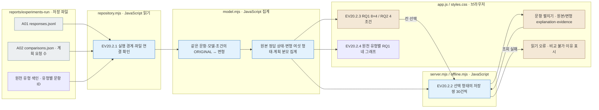

회색은 저장 파일, 파랑은 JavaScript 읽기·집계, 갈색은 사용자 화면입니다. 분홍색 확장 노드는 없습니다. 조회 오류는 화면에 표시하고 저장 파일을 바꾸지 않습니다. 새 모델 호출이나 실험 재실행도 없습니다. [검사 기록](../../log/viewer-experiments-rq-view/README.md)에서 실제 회차의 집계와 화면 확인 범위를 분리해 읽습니다.

### 큰 회차의 화면 읽기

A01은 집계와 불일치·미평가 원본만, A03은 인용된 응답만 먼저 전달합니다. A02는 전체 집계와 대응 쌍의 요약·반환값 변화 건수와 %만 먼저 표시하고, **문항별 응답**을 펼쳤을 때 선택한 표의 50쌍씩 반환값·분류·원응답 링크를 읽습니다. 8유형×4조건의 응답 링크와 산점도 원자료도 펼쳤을 때 50행씩 그립니다. 원본 조건 점이 많으면 원본 결과·변형 null 수·풀이/추론 조건별 건수를 원 안에 표시하며, 원을 선택하면 그 묶음의 문항을 50행씩 확인할 수 있습니다. 화면의 페이지 나누기는 원본 파일·집계 분모를 변경하지 않습니다. A02가 BLOCKED이면 유효 응답 수와 응답 미확인 건수를 표시하고, 아직 시작하지 않은 A03은 A02 중단에 따른 시작 대기로 표시합니다. A01/A02/A03 결과 파일이 아직 없으면 해당 단계가 **미실행·대기**로 남고, 이전 회차의 집계를 대신 보여주지 않습니다. 실행 state에 `PAUSED_BY_USER`가 기록되면 사용자 요청에 따른 중지로 따로 표시하며, 이 기록만으로 분석 결과가 생겼다고 보지 않습니다. 저장 단계에 요청·완료 수가 있으면 메뉴와 단계 표에서 `완료 / 요청`으로 진행량을 표시합니다. 모델 실행 요청이 준비 중이면 원본 정답 비교의 **미수집**을 **미평가**와 분리합니다. 이름 끝에 8자리 seed가 붙은 실행도 선택하며, 번호만 남은 예전 링크는 대응하는 새 폴더가 하나일 때 그 폴더로 연결합니다. seed 접미사 지원은 폴더명 결정·새 실행 생성과 별개입니다.

A02 관계 비교에는 **IC-value 앞 사분면 샘플**을 표시합니다. 왼쪽 아래의 Unguided·Reasoning OFF를 기준으로 네 조건의 후보 A/B 숫자 일치·다른 숫자·null·형식/실행 실패를 각 `건수/전체 · %`로 보여줍니다. 위·오른쪽·대각선 화살표는 각각 Reasoning ON, Criteria-Guided, 두 설정 모두 변경을 뜻합니다. 화살표의 수치는 기준과의 **퍼센트포인트(%p)** 차이이며 차이가 10/25/50%p 경계를 넘을수록 굵고 진해집니다. 가장 큰 전체 차이와 한 설정만 바꾼 비교의 최대 차이를 따로 보여줍니다. 대각선 비교는 단일 요인의 효과가 아닙니다. 이 그림은 저장된 답 형태를 보여주며 정답률·근거 선택·null의 적절성을 새로 판정하지 않습니다. 네 조건의 종료 상태와 분류 합계를 확인합니다. `OUTPUT_TRUNCATED`·형식 실패는 종료된 요청으로 집계하고 전체 분모에 유지합니다. 구조화된 응답이 없는 출력 잘림을 수집 대기로 취급하지 않습니다. `UNKNOWN_DELIVERY`·실행 중·미실행은 대기 안내를 유지합니다. A02 LLM 해석의 완료 여부는 사분면 표시 조건과 별도로 확인합니다. 계산·Export 확인 기록은 [IC-value 사분면 샘플](../../log/viewer-experiments-feature-quadrant/README.md)을 읽으세요.

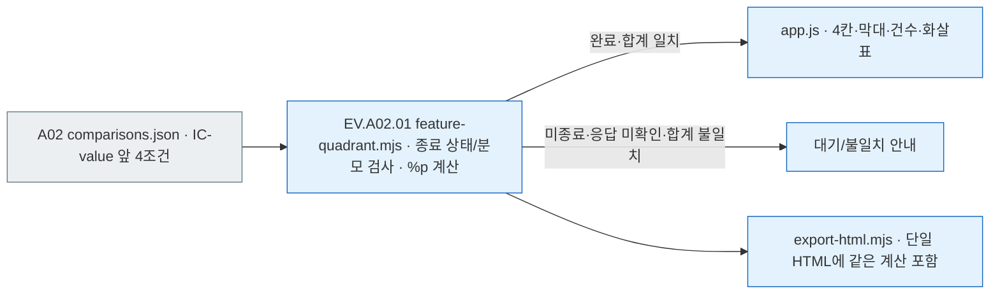

회색은 저장 파일, 파랑은 표시 계산과 화면/Export입니다. 이 경로는 LLM을 호출하지 않으며 파일을 다시 쓰지 않습니다. 집계 갱신은 `pipeline.py analysis --aggregate-only`를 통해 처리하며 실행 상태를 유지합니다. [상태 표시·재집계 확인 기록](../../log/viewer-experiments-status-verification.json)에서 두 회차의 Evaluation 완료, A02 중단, 새 모델 호출 0건을 확인합니다.

E04의 `01_evaluation/04_validation/numeric-comparisons.jsonl`이 저장되면 A01 실행 전이라도 원본 숫자 일치·불일치·미평가를 Evaluation에 표시합니다. 각 숫자 비교 기록의 모델·요청 ID·문항·유형·조건·상태가 저장 응답과 모두 일치하고 건수도 같아야 적용합니다. 파일 작성이 덜 끝났거나 연결이 다르면 마지막 정상 화면에 경고를 표시합니다. 이 E04 파일이 없으면 기존 회차의 A01 진단 기록을 읽습니다.

`20260928-exp-001-luna`의 A02 화면에서는 원천 유형을 선택해 FinQA·TAT-QA·FinanceMath·FinanceReasoning 각각의 원본 문항 수, 8변형×4조건 결과, A02 관찰 예시와 A03 발견에 연결된 관찰 수를 확인합니다. 저장된 유형별 `summary.json`에서 문항 목록을 읽으며 문항 버튼은 해당 회차의 실제 응답 화면으로 이동합니다. 유형을 선택했을 때는 전체 1,080문항의 집계를 섞어 표시하지 않습니다. 이 화면은 기존 응답을 재집계한 결과이며 점수나 원응답을 새로 만들지 않습니다.

[큰 회차 뷰어 확인 기록](../../log/viewer-experiments-large-analysis-verification.json)에는 006 회귀 확인, 007 진행·중지 화면, 로컬 E04·seed 호환 검사, 아직 실제 산출물을 확인하지 못한 범위가 나뉘어 있습니다. 숫자값 비교 검사는 정답이나 연구 해석을 새로 판정한 결과가 아닙니다.

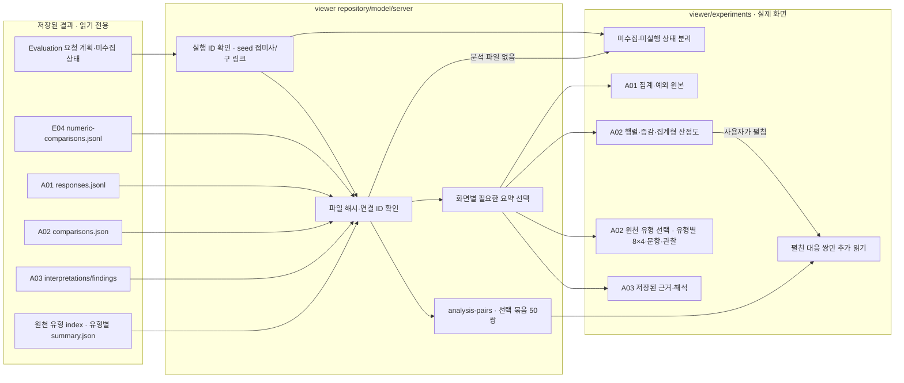

### 006 Analysis 자료를 읽는 경로

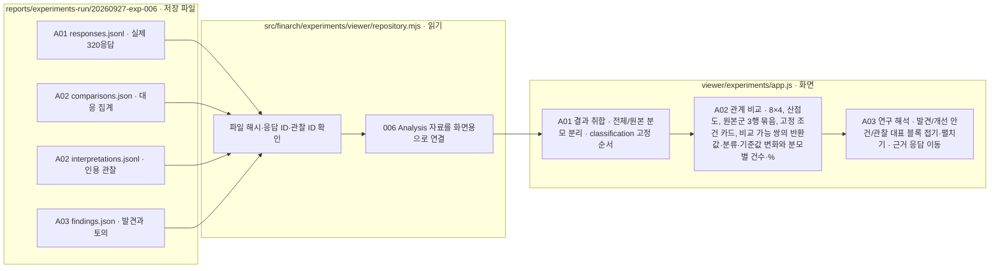

006 설정이 아닌 회차는 기존 Analysis 메뉴로 갈라집니다. 자료가 아직 저장되지 않았으면 빈 상태를 표시하고, 해시·근거 연결이 맞지 않으면 마지막 정상 자료 경고를 표시합니다. 뷰어는 분석을 다시 실행하거나 호출하지 않습니다. 원본의 숫자 미평가 2건은 불일치에 넣지 않고, 변형의 숫자 답을 새 정답 판정으로 바꾸지 않습니다. 단일 HTML 내보내기도 이 세 화면과 응답·근거 파일을 포함합니다. [전체 확인 기록](../../log/viewer-experiments-006-verification.json)과 [오프라인 대조 기록](../../log/viewer-experiments-006-offline-parity.json)을 함께 확인하세요.

실패 분석의 응답은 **문항 번호 오름차순**으로 시작합니다. 문항·유형·모델·프롬프트·추론·반환 상태·진단 사유 열 제목이나 **응답 정렬**에서 순서를 바꿉니다. 화살표가 방향을 표시하며 전체 응답을 먼저 정렬한 뒤 30건씩 보여 줍니다. 같은 값은 문항→유형→모델→프롬프트→추론→상태 순서로 정렬합니다. 반환 상태 오름차순은 출력 잘림·형식 실패를 먼저, 형식 통과를 마지막에 표시합니다. 진단 사유 정렬은 **서로 다른 사유 개수** 기준입니다.

사유 버튼의 건수는 위 결과 필터를 적용한 뒤, 진단 사유를 고르기 전의 요청 수입니다. 한 요청에 사유가 여러 개 있을 수 있으므로 버튼의 건수를 합산하지 않습니다. 실제 선택 결과의 요청 수와 문항 수는 응답 목록 위에 따로 표시합니다. 문항 번호를 누르면 그 행의 유형·프롬프트·추론 조건을 엽니다.

왼쪽 **문항 탐색**은 현재 필터의 문항 전체를 세로 스크롤로 보여주며, 이전/다음 페이지 버튼과 범위 표시는 없습니다. 응답이 저장된 회차의 각 문항은 **문항 번호 → 빨강 불일치 수 → 노랑 미평가 수**를 한 줄에 표시합니다. 예를 들어 `test-0294 [2] [0]`은 원본풀이 정답 불일치 2건·미평가 0건입니다. 두 숫자의 순서는 고정하며 0건은 연한 색으로 표시합니다. 진행 중인 회차에서 원본 요청의 응답이 없으면 회청색 **미수집 수**를 뒤에 추가하고 노랑 미평가로 세지 않습니다. 원본풀이 정답 비교 기준이며 변형을 미평가로 합산하지 않습니다. 일치 수·풀이 분류·반환 형식 등 나머지는 상세 화면에서 확인합니다. 풀이 모델의 자체 분류·형식 통과·원본 숫자 평가는 각각 다른 기준입니다.

실패 분석 표와 왼쪽 목록에는 질문 요약을 반복하지 않습니다. **문항 번호를 누르면 질문 전문과 실제 응답을 확인**하며, 문항 번호·질문 검색은 계속 사용합니다. 기존 `case_offset` 주소도 전체 목록을 표시합니다. 선택 문항과 필터를 유지하고, 같은 필터에서 문항을 열거나 **Q/K 이전 · E/J 다음**으로 이동하면 목록의 스크롤 위치를 유지하며 새 선택이 목록 밖으로 나갈 때만 필요한 만큼 이동합니다. 본문 응답 표의 30건 단위 페이지는 그대로입니다.

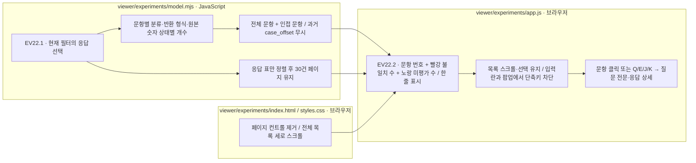

저장 결과만 읽으며 LLM 호출·재시도·원응답 변경은 없습니다. [문항 목록·스크롤 확인 기록](../../log/viewer-experiments-case-sidebar.json)과 [간결한 두 숫자 표시 확인 기록](../../log/viewer-experiments-case-sidebar-compact.json)을 참조하세요.

검색·필터·정렬·화면은 URL에 남습니다. **새로 읽기**는 저장 파일의 변경을 확인합니다. **표 내려받기**는 현재 필터의 집계와 문항 ID를 Markdown으로 저장합니다.

## 입력 경로와 Evaluation 확인 범위

Input은 **원천 데이터 → public/private → 지시·응답 형식 네 파일 → 모델별 요청 → 호출·반환 검사** 순서로 역할과 경로를 표시합니다. 경로는 짧은 **파일명·폴더명 버튼**으로 보여주며, 누르면 전체 절대 경로를 복사하고 완료를 알립니다. 마우스를 올리면 전체 경로를 확인할 수 있고 복사 실패 시 직접 복사할 경로를 제공합니다. public/private/manifest/events의 네 산출물 종류도 구분합니다. 취합 데이터의 `manifest.json`은 목록과 해시이며, 실제 문제 파일은 `00-input.json`과 변형 7개입니다. 이전 회차의 입력을 복사했다면 재선정처럼 표시하지 않고 복사 회차와 파일 경로를 먼저 보여줍니다. 문항별 제작 폴더·해시 원기록은 펼쳐서 확인합니다.

선택 실행 안의 저장 파일은 존재를 확인한 뒤 파일 보기로 연결합니다. JSON/JSONL은 JSON 뷰어를 사용합니다. 실행 밖의 출처는 저장 경로 또는 전달 파일 규약으로 연결한 경로임을 표시하고 현재 존재 확인과 구분합니다. 원천 데이터 파일을 임의 경로 API로 열지 않습니다. 경로가 없거나 파일이 사라지면 미기록·파일 없음·읽기 제한으로 남깁니다. HTML Export에도 같은 흐름을 담으며, 실행 안의 허용 파일만 기존 8MB 한도와 변경 검사를 거쳐 포함합니다.

Evaluation의 **03 숫자 비교와 분석 범위**는 모델마다 **① Unguided Solving / Reasoning OFF → ② Unguided Solving / Reasoning ON → ③ Criteria-Guided Solving / Reasoning OFF → ④ Criteria-Guided Solving / Reasoning ON** 순서로 원본풀이 정답 일치·불일치·미평가·미수집·전체 요청을 보여줍니다. 일치의 분모는 해당 조건 원본 전체 요청입니다. **일치 + 불일치 + 미평가 + 미수집 = 원본 요청**이며 미수집은 아직 응답을 평가하지 않았다는 뜻입니다. 저장 요청이 없는 과거 조건은 0점 대신 **요청 없음**입니다. 링크는 같은 모델·풀이·추론의 원본 요청만 E04로 넘깁니다. 반환 형식과 원본 정답 비교는 목록의 별도 열이며, 형식 실패와 원본 미평가는 겹칠 수 있어 목적별 건수를 합산하지 않습니다.

```mermaid
flowchart LR
 subgraph input_repo["src/finarch/experiments/viewer/repository.mjs · JavaScript"]
  IR["EV19.1 · 선택 실행의 설정·public/private·요청 목록 읽기"]
 end
 subgraph input_paths["src/finarch/experiments/viewer/input-flow.mjs · JavaScript"]
  IP["출처·복사 경로 / 취합 8파일 규약 연결"]
  IF["실행 안 파일 등록 · 없거나 제한되면 상태 보존"]
 end
 subgraph evaluation_model["viewer/experiments/model.mjs · JavaScript"]
  EM["EV20 · 원본 네 조건 집계 / 요청 없음·미평가 보존"]
  EF["원본만 일치·불일치·미평가 필터링"]
 end
 subgraph evaluation_app["viewer/experiments/app.js · 브라우저"]
  IA["EV19.2 · Input 목적 기본 접힘 + 경로 설명 뒤 파일명 버튼을 한 줄 표시 → 전체 경로 복사"]
  EA["EV20 · 네 조건 표 → 선택 조건 링크"]
  FA["EV21 · 확인 목적 선택 + 적용 필터 표시·해제 + 응답 목록"]
 end
 subgraph evaluation_export["export-html.mjs / offline.mjs · JavaScript"]
  EX["허용 파일·경로 메타데이터를 단일 HTML에 보존"]
 end
 IR --> IP --> IF --> IA
 IR --> EM --> EA --> EF --> FA
 IF --> EX --> IA
```

모두 저장 기록을 읽는 Python/LLM 실행 이후의 뷰어 처리입니다. 이 기능은 모델 호출·재시도·재평가를 하지 않습니다. [입력·Evaluation 확인 기록](../../log/viewer-experiments-input-evaluation.json)을 참조하세요.

### Q/C의 제작 편집 구간

문항 비교의 **모델에 전달한 입력 → Q/C → C**에는 실제 저장 요청의 본문을 표시합니다. private 행의 `edit_provenance`를 검증한 경우 **추가 값 주장은 초록, 출처 A는 분홍, 출처 B는 빨강**으로 강조합니다. IC-source는 원본 → IC-value 부모 → 출처 삽입 순서로 재현하여 부모 문장 안에 출처가 들어가도 `VALUE / SOURCE / VALUE` 색을 유지합니다. 관계 추가는 보라색으로 구분합니다. 범례와 마우스 설명은 제작 시 변경 구간을 뜻하며 정답 또는 분석 판정이 아닙니다.

**원본 동일 / 편집 기록 없음 / 편집 기록 검증 불가**를 구분합니다. 실제 요청이 없거나 공개 입력과 다르면 강조하지 않습니다. Unicode code point 기준 위치·편집 전 문자·색상 구간의 연결 문자·단계별 입력/출력 SHA-256·원본 및 최종 Q/C SHA-256을 확인하고, 마지막 재현 결과가 실제 저장 요청의 C와 같을 때만 색을 적용합니다. 과거 `patches`만으로 출처를 추정하거나 private 원본 파일 밖의 경로를 추가로 읽지 않습니다. `source.comparison`과 그 해시는 기록의 출처 정보이며 뷰어가 외부 제작 파일까지 재검증했다는 뜻이 아닙니다.

EA의 삭제 문자는 실제 C에 끼워 넣지 않습니다. 삭제 위치에는 **큰 빨간 `✕ 삭제` 표식과 원문 값의 취소선 미리보기**를 표시합니다. 미리보기는 CSS로만 그려져 저장된 모델 입력 문자열에 들어가지 않습니다. 긴 삭제 내용은 미리보기를 줄이고 본문 아래 **삭제된 원문 · 실제 입력에 포함되지 않음**에서 전체를 확인할 수 있습니다. 문단·표 보기는 원문 위치를 따라 색을 적용하며, 원문 그대로 보기는 줄바꿈·공백을 포함한 저장 문자열을 유지합니다. 인용문 강조도 제작 편집 색과 함께 표시합니다. 새 HTML Export에는 같은 private 메타데이터와 검증·표시 코드가 포함되며 네트워크 연결 없이 작동합니다. [EA-01 실제 문항 표시](../../log/viewer-experiments-ea-deletion-marker.png)와 [브라우저 검증 기록](../../log/viewer-experiments-ea-deletion-marker.json)에서 확인할 수 있습니다.

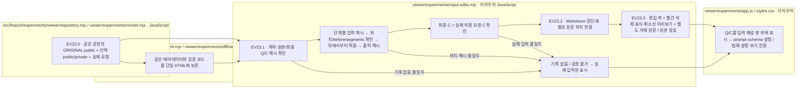

저장 결과의 표시 검증이며 Python 제작·LLM 호출·재시도·정답 재평가는 없습니다. 실패 시 임의 색상을 만들지 않고 실제 입력을 보존합니다. [편집 위치·해시·Unicode·HTML Export 검사 로그](../../log/viewer-experiments-input-edits-tests.log)를 참조하세요.

상단 **회차 HTML Export** 바로 오른쪽의 **단축키** 버튼을 누르면 키보드 배열과 색상별 안내가 팝업으로 열립니다. 본문 아래의 접이식 안내를 대체합니다. 닫기 버튼·Escape·바깥 클릭으로 닫으며 열 때 닫기 버튼, 닫은 뒤 단축키 버튼으로 초점이 이동합니다. 새로 내보낸 HTML에도 같은 안내가 포함됩니다. **S**는 아래로, **W**는 위로 화면 높이의 약 절반만큼 스크롤합니다. 각 화면에서 작동하며 입력란·선택 상자 사용 중이나 팝업이 열린 동안에는 작동하지 않습니다. [실제 동작 확인](../../log/viewer-experiments-scroll-shortcut/README.md).

[단축키 팝업 확인 기록](../../log/viewer-experiments-shortcut-dialog.json).

숫자 **1·2·3·4**는 **현재 큰 단계에 보이는 탭을 왼쪽부터** 선택합니다. Evaluation에서는 전체 결과 → 문항 비교 → 비용·실행 → 실패 분석입니다. 006 Analysis에서는 **1 결과 취합 → 2 관계 비교 → 3 연구 해석**이며, 이전 회차의 Analysis는 내용 분석 → 조건별 비교 → 두 모델 나란히 → 보고서·이력 순서입니다. Input에서는 1만 사용합니다. 다른 큰 단계로 넘어가지 않으며, 없는 번호는 동작하지 않습니다. 탭을 마우스로 눌렀을 때와 같은 동작입니다. [단계별 탭 단축키 확인 기록](../../log/viewer-experiments-stage-tab-shortcuts.json).

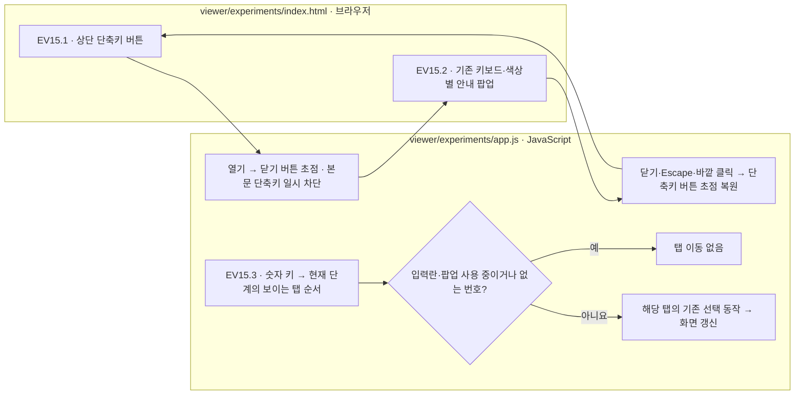

숫자 키는 현재 단계 안에서만 탭을 선택합니다. 문항·유형·조건 이동 및 스크롤 단축키는 유지합니다. 팝업과 스타일은 단일 HTML 내보내기에도 포함되며 LLM 호출은 없습니다.

## 문항 결과 히트맵

Evaluation의 **E02 문항 비교** 상단에서 모델별로 한 개의 표를 표시합니다. 행은 Unguided Solving / Criteria-Guided Solving × Reasoning OFF / ON의 네 조합, 열은 **00 원본부터 07 EA-02까지**입니다. 현재 문항과 모델 선택을 유지하며 상태·유형·풀이·추론 필터로 표의 다른 셀을 숨기지 않습니다. 선택 중인 셀은 갈색 테두리로 표시합니다.

|표시|기준|
|---|---|
|원본 파랑 / 빨강|형식 통과한 원본의 저장된 정답 숫자 비교가 일치 / 불일치일 때만 사용|
|실제 숫자 / Null / 기타|숫자 셀은 `20`, `21`, `0`처럼 응답 값과 필요한 `≠`만 표시. 답 가능·정답 일치·정답 미평가 문구는 셀 안에 반복하지 않고 색상·범례·도움말로 구분. 0은 숫자이고, Null과 응답 미기록은 구분|
|빨간 `≠`|실제 숫자가 같은 문항의 private 원본 정답과 다르면 `21 ≠`처럼 표시. 변형의 의미 정오답 판정과는 별개의 숫자 차이|
|출력 잘림 / 형식 오류|저장된 실행·형식 검사 상태를 우선 표시|
|비교 미평가 / 대기 / 미기록 / 읽기 오류|각 상태를 별도 표시하며 정답·오답이나 Null로 채우지 않음|
|빗금 `—`|해당 요청이 없는 조합. Guided 원본에 Unguided의 결과를 복사하지 않음|

숫자는 정규 숫자 값·문자열만 포함합니다. 여러 숫자가 섞인 텍스트·배열·객체 등은 기타입니다. **명시된 classification이 있으면 분류 색을, 없으면 기존 응답 형태 색을 사용합니다. 분류 색은 적절성 판정이 아닙니다.** 원본 정답을 표 위에 표시하고, 숫자 차이는 빨간 `≠`로 덧붙입니다. 셀 도움말에는 응답 값·원본 정답·숫자 일치 여부가 나옵니다. Null의 이유나 설명의 타당성은 후속 분석에서 구분합니다. 표 아래에 색상과 `≠`의 범례를 제공합니다. 셀 선택은 기존 문항 상세로 연결되며 새 모델 호출은 없습니다.

형식 통과한 숫자만 이 보조 비교에 사용합니다. 원본 정답 미기록·Null·출력 잘림·형식 오류에는 숫자 불일치를 추정하지 않습니다. V3/V4는 문자열 크기에 별도 부호를 반영하고, V5/V6/V7은 숫자 자체의 부호를 사용합니다. scale을 다시 곱하지 않으며 십진 문자열로 비교해 `20.0`과 `20`은 같게, 큰 정수 문자열의 차이는 그대로 구분합니다. 이 표시는 뷰어에서 계산하며 저장된 점수·원응답을 바꾸지 않습니다.

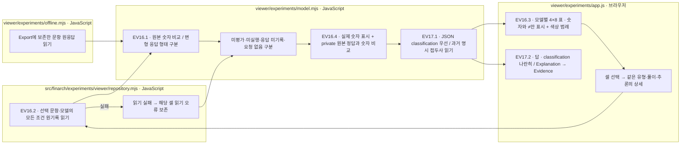

서버와 HTML Export는 같은 분류·숫자 비교 함수를 사용합니다. 결과 요약에 응답이 생략되어도 검사 원기록 → 호출 원기록 → 저장 요약 순서로 읽습니다. [히트맵 확인 기록](../../log/viewer-experiments-case-heatmap.json) · [숫자 표시·불일치 기호 확인](../../log/viewer-experiments-heatmap-values.json) · [숫자 셀 간소화 확인](../../log/viewer-experiments-heatmap-compact.json)을 함께 확인하세요.

## 분류 표시와 원본 네 조건

### E02 Pair Outcome Matrix

‘문항 결과 한눈에 보기’ 아래에서 같은 문항·모델·풀이·추론의 원본과 각 변형을 연결합니다. ① 원본 정답/대응 성공, ② 원본 오답/대응 성공, ③ 원본 오답/대응 실패, ④ 원본 정답/대응 실패의 축을 표시합니다. 현재 E04에는 변형 대응의 의미 판정 기록이 없으므로 사분면 수치는 미판정으로 둡니다. 숫자 일치·Null·분류 라벨을 의미적 성공으로 바꾸지 않습니다.

|단계|파일과 역할|
|---|---|
|EV25.1|`model.mjs`: 계획된 변형 쌍을 유지하고 원본 미판정 / 변형 미수집·형식 실패 / 대응 의미 미판정을 중복 없이 집계|
|EV25.2|`app.js`: 사분면 축, 네 조건의 전체 예정 쌍과 배치 불가 건수, 유형별 실제 실행 상태를 표시|
|EV25.3|`server.mjs`: 공통 집계 모듈 제공. `export-html.mjs`: 동일 집계를 내장해 오프라인 화면에서도 사용|

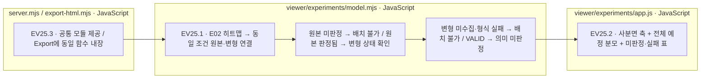

LLM 호출·재시도·원응답 변경은 없습니다. 이 표는 현재 저장 자료의 준비 상태이며 의미 채점 완료 표가 아닙니다. 전체 예정 쌍에서 미수집·실패·미판정을 제외하지 않습니다.

모델별 답변은 **모델이 반환한 답 | classification** 두 칸을 한 줄에 배치하고 아래에 **Explanation → Evidence**를 표시합니다. 분류의 짧은 정의와 출처도 붙입니다. FinancialAnswerV7의 실제 JSON 필드를 먼저 읽으며, 명시적 null은 과거 explanation으로 대체하지 않습니다. Unguided Solving의 `classification: null`은 **분류 미요구**, 필드 자체가 없는 과거 응답은 **미기록**입니다. 과거 explanation 맨 앞의 정해진 `Classification: …; Response: ….` 선언만 호환하며, `answer=null`이나 `Response: ABSTAIN`만으로 분류를 추정하지 않습니다.

|classification|뜻|히트맵·답변 카드 공통 색|
|---|---|---|
|ANSWERABLE|주어진 정보로 유일한 최종값을 구할 수 있음|민트 · 정답 미평가. 적합한 저장 원본 평가가 있으면 파랑 일치 / 빨강 불일치|
|CONFLICT|관련 정보가 충돌하며 선택 기준이 없음|주황|
|INSUFFICIENT_EVIDENCE|필수 정보가 없고 남은 정보로 복원할 수 없음|보라|
|UNRESOLVED|질문·관계의 의미가 여러 가지로 해석됨|모래색|
|ABSTAIN|입력 문제를 확정하지 못했지만 풀이·검증을 완료하지 못함|회청색|

변형의 ANSWERABLE은 원본 정답과 숫자가 같아도 **정답 미평가**입니다. 숫자가 다르면 빨간 `≠`를 유지합니다. 형식 오류·출력 잘림은 히트맵에서 우선 표시하고 원응답의 분류는 상세에서 보존합니다. Analysis는 신규 `guided_*` 집계를 우선 읽고 없는 필드만 과거 집계에서 호환합니다. 저장 분류 집계는 JSON 필드 / 과거 명시 접두사와 분류·숫자 일관성 검사를 구분합니다. 해당 집계가 없는 과거 실행은 미집계입니다.

원본도 변형과 같은 네 조합을 표시합니다. **실제로 저장된 요청이 있는 조합만 활성화**하고, 과거 Guided 원본이 없으면 **요청 없음**으로 남깁니다. 신규 조건값 `unguided/guided`와 과거 저장값을 함께 읽으며 URL·새 조회 결과는 신규 조건값을 사용합니다. 기존 요청·원응답 파일은 덮어쓰지 않습니다.

내용 분석의 원본 OFF/ON 짝은 **모델 + 문항 + 풀이 방식**마다 분리합니다. 변형은 같은 **모델 + 문항 + 풀이 방식 + 추론 설정**의 원본에만 연결합니다. Guided 원본이 없는 과거 회차에 Unguided 결과를 대신 넣지 않습니다. 저장 의미 집계에 모델 구분이 없으면 미기록으로 표시하고, 새 집계의 `ORIGINAL_CONDITION_MISSING`은 같은 조건 원본 없음으로 표시합니다. 숫자 비교와 분석자의 적절성 판정은 별도 열입니다.

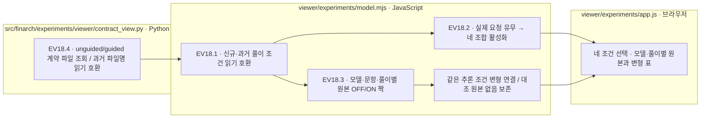

모든 단계는 저장 자료를 읽는 뷰어 처리이며 LLM 호출·자동 재시도·과거 회차 재집계는 없습니다. [분류·원본 네 조건 확인 기록](../../log/viewer-experiments-classification.json)을 참조하세요.

## 회차 HTML Export

상단 **회차 HTML Export ↓**에서 실행을 고른 뒤 **HTML 파일 만들기 ↓**를 누르세요. 회차 하나를 서버 없이 읽을 수 있는 단일 HTML로 내려받습니다. 현재 탭·필터·정렬로 시작해도 회차 전체를 포함하므로 필터를 초기화하면 모든 문항을 볼 수 있습니다. 새로 내보낸 HTML은 같은 실패 분석·정렬 기능을 포함합니다.

자료는 내보낸 시점에 고정됩니다. 분석자용 원문 정답도 포함됩니다. 최근 저장 이벤트 100개, 실행 안의 보고서·원기록을 담으며 실행 밖의 파일과 원파일 보기 한도인 8MB를 넘는 파일은 제외 사유를 표시합니다. 파일 변경·필수 요청 누락 시 미완성 HTML을 다운로드하지 않습니다. 저장 기록과 Export 팝업은 Esc 또는 바깥 클릭으로 닫습니다.

```bash
node src/finarch/experiments/viewer/scripts/export-html.mjs 20260923-exp-007 /absolute/path/20260923-exp-007-experiments.html
```

기존 출력 파일을 덮어쓰지 않습니다. [Export 확인 범위](../../log/viewer-experiments-html-export/README.md)를 함께 확인하세요.

## 파일 역할과 확인 기록

|파일|역할|
|---|---|
|[start.command](start.command), [server.mjs](../../src/finarch/experiments/viewer/server.mjs)|서버 실행·준비 확인·브라우저 열기·같은 뷰어 재사용·선택한 A02 대응 쌍 및 RQ 답 비교 쌍의 페이지 제공|
|[index.html](index.html), [styles.css](styles.css)|공통 틀·브라운 색상·단축키 팝업·상단 진단 필터·정렬 표시·진행 중인 원본의 미수집 색상·A02 조건별 묶음과 반환값 변화의 구분 색상·A03 접이식 대표 블록·RQ 원본 포함 8×4 전체 화면|
|[app.js](app.js)|Input/Evaluation/Analysis 메뉴·결과 중심 A01/A02/A03의 회차별 상태와 실제 수치·미실행/완료 수 구분·구 실행 링크의 seed 접미사 연결·classification 표시 순서·A02 원본군 조건별 묶음과 원천 유형 선택·유형별 8×4 결과/문항/관찰·고정 조건 카드 정렬·비교 목적과 고정 조건·같은 단위 답 숫자 변화·숫자/null 건수 및 분모별 %·분류와 저장 기준값 비교 설명·50행씩 실제 반환값을 펼치는 근거·A03 발견/개선 안건/관찰 접힘 상태 보존과 근거 이동·v0.26 RQ/SQ별 통합검토 접힘 상태·RQ1/RQ2 선택·원천 유형별 RQ1 네 그래프와 선택한 유형의 문항 근거·원본 포함 8×4 정답 상태/답 변화와 저장 응답 펼침·이전 회차 Analysis·탭 단축키·문항 상세|
|[feature-quadrant.mjs](feature-quadrant.mjs)|EV.A02.01: 저장된 IC-value 앞 네 조건의 종료 상태·분모·답 형태 합계를 검사하고 기준 조건 대비 비율 차이와 10/25/50%p 화살표 굵기를 계산|
|[quadrants.mjs](../../src/finarch/experiments/viewer/quadrants.mjs), [quadrants.py](../../src/finarch/experiments/viewer/quadrants.py)|EV23: 현재 서버의 결과 폴더를 읽어 여러 회차의 사분면 비교 제공, 조회 시 원자료 해시 확인, 같은 조회의 HTML 연결, 해시 CSP 및 화면 오류·새로 읽기|
|[input-edits.mjs](input-edits.mjs)|private 편집 기록의 Unicode 위치·문자·해시와 실제 요청 검증, Q/C의 값/출처 색상, EA의 빨간 삭제 위치·취소선 미리보기와 전체 원문 분리, Markdown/원문 위치 보존|
|[model.mjs](model.mjs)|동일 문항/조건의 모델 짝·공통 집계·신규·과거 조건 호환·모델/풀이별 원본 OFF/ON 짝·7종×4조건 관찰·명시 분류 읽기·히트맵 응답 형태·실제 숫자·원본 정답과 숫자 비교·미수집과 미평가 분리·실행 state의 Analysis 중지 상태 전달·필터별 전체 문항/상태 집계·응답 표 정렬 후 페이지 구분·A01/A02/A03별 필요한 결과만 선택하고 비교 가능한 대응 쌍 및 RQ 원본/변형 답의 여섯 형태를 전체·원천 유형별로 집계|
|[contract_view.py](../../src/finarch/experiments/viewer/contract_view.py)|현재·동결 계약의 unguided/guided 파일과 해시에 연결된 번역을 읽으며 과거 파일명 호환|
|[repository.mjs](../../src/finarch/experiments/viewer/repository.mjs)|실험 폴더 경계·seed 접미사 실행 발견과 유일한 구 링크 호환·E04 별도 숫자 비교의 요청 ID/건수 확인·파일 읽기·부분 저장 처리·결과 중심 응답/대응/인용/발견 연결 확인·v0.26 질문 색인과 원천 유형별 집계 파일을 문서 목록/단일 HTML에 등록·반환 숫자값 비교용 answer scale·부호 연결·선택한 A02 대응 묶음 50쌍과 RQ 답 비교 묶음 30쌍 조회·원천 유형 색인 검증과 유형별 RQ 요약·현재 문항의 모든 조건 원응답 읽기|
|[input-flow.mjs](../../src/finarch/experiments/viewer/input-flow.mjs)|원천·복사 출처와 모델 전달 파일의 실제 경로 연결·실행 안 파일 등록·미확인 경로 구분|
|[progress.mjs](../../src/finarch/experiments/viewer/progress.mjs)|EV19: 단계별 완료·실행 중·대기·오류·남은 건수, 요청 처리시간, 동시 호출·한도·CPU 시간 이력 집계|
|[progress.html](progress.html), [progress-dashboard.mjs](progress-dashboard.mjs), [progress-dashboard.css](progress-dashboard.css)|EV19: 공통 진행 대시보드·5초 조회·건수 카드·처리시간 산점도·동시 호출 계단형 그래프·CPU 0~100% 그래프·현재 값 막대|
|[json-viewer.mjs](json-viewer.mjs)|JSON/JSONL 트리·원문 보존·원문/경로 공통 복사와 오프라인 대체 복사|
|[export-html.mjs](../../src/finarch/experiments/viewer/export-html.mjs), [offline.mjs](offline.mjs)|회차 전체를 단일 HTML에 담고 같은 화면·분류·근거·정렬·A02 대응 쌍 및 유형별 RQ 답 비교 쌍 페이지 제공|
|[tests](../../src/finarch/experiments/viewer/tests)|집계·정렬·필터·시작 동작·원기록·단일 HTML 검사|

[실패 분석·자동 브라우저 열기 확인 기록](../../log/viewer-experiments-failures/README.md) · [키보드·조건 조합](../../log/viewer-experiments-keyboard/README.md) · [답변·Null·출력 잘림](../../log/viewer-experiments-answer-summary/README.md).

형식 통과와 숫자 일치를 의미 정답으로 해석하지 않습니다. 숫자 답 없음의 유보 적절성도 별도 평가가 필요합니다. 비용·실행 이력은 실행 전체이며 위 응답 필터로 비용을 다시 계산하지 않습니다. 기록이 없는 값은 미기록/미평가로 남깁니다. 에이전트의 자동 검사·화면 확인은 사용자 검토 완료와 구별합니다.

상단 대시보드 링크는 현재 별도 exp-006 기준선 저장본으로 이동합니다. 실험 뷰어에서 선택한 exp-007/008의 수치와 합쳐 같은 회차로 해석하지 않습니다. 대시보드 상단의 실험 뷰어 링크는 대시보드의 실제 출처 회차를 엽니다.

이 README의 원본은 `src/finarch/documentation/templates/viewer-experiments.md`입니다. 프로젝트 루트에서 `python3 src/finarch/documentation/manage.py refresh` 후 `validate`로 재생성·검사합니다.

## A100 회수 결과 문서 · 2026-09-30

`repository.mjs`의 보고서 목록은 실행 루트의 `RESULTS.md`·`EVALUATION.md`를 읽습니다. 문항 수만큼 있는 `remote-results/`·`_recovery/`는 문서 목록 탐색에서 제외하며, 실제 요청·원응답은 기존 문항별 파일 연결로 읽습니다. 동결한 루트 `README.md`는 보존합니다.

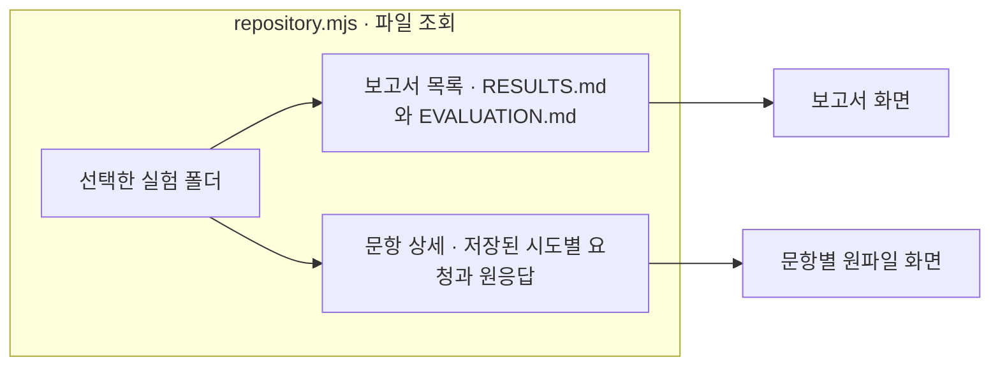

위 흐름은 저장 파일 조회이며 LLM을 호출하지 않습니다. 상자는 파일 조회와 화면 표시를 뜻합니다.

## 근거 타당성 사분면 · EV27

**02 Analysis → A03 근거 타당성**은 A04 연구 해석 앞에 표시합니다. 화면 메뉴 순서는 A01 결과 취합 → A02 관계 비교 → A03 근거 타당성 → A04 연구 해석 → A05 ANSWERABLE → A06 실패·검토 불가입니다. 화면 번호는 저장된 파이프라인 단계 번호와 구분합니다. A02의 저장된 두 판정과 기존 pair-outcomes를 읽으며, A03 모델 해석 실행 완료를 뜻하지 않습니다. [집계 기준·파일별 흐름](../../docs/02-experiments/02_analysis/02_comparison/02-response-grounding-review.md#근거-타당성-화면--ev27)을 따릅니다.

모델·데이터셋·7개 변형을 선택하면 Unguided OFF/ON, Criteria-Guided OFF/ON 사분면을 같은 순서로 봅니다. 가로축은 저장된 원본 숫자 정답 여부, 세로축은 A02의 답·유보 근거 판정입니다. classification=null도 제외하지 않습니다. 숫자 답의 유보 이유 NOT_APPLICABLE은 실패가 아니며, 원본 수치 미평가·미검토·검토 실패·검토 불가·입력 원문 부재·UNDETERMINED는 별도 상태로 보존합니다.

각 칸의 비율은 조건별 계획 전체를 분모로 유지합니다. 판정·검토 필터를 바꿔도 계획 수와 전체 배치·미배치 수는 그대로 보입니다. 칸 또는 미배치를 누르면 20문항씩 조회하고, 문항을 펼치면 정확히 같은 모델·풀이·추론 조건의 원본/변형 응답과 두 판정의 이유·인용을 봅니다. E02 링크도 해당 조건을 지정합니다. 기존 단일 HTML Export는 같은 집계·필터·원문 연결을 포함하며 별도 결과 HTML을 만들지 않습니다.

|단계|파일|책임|
|---|---|---|
|EV27.1|[grounding-reader.mjs](../../src/finarch/experiments/viewer/grounding-reader.mjs), [repository.mjs](../../src/finarch/experiments/viewer/repository.mjs)|원자료 해시·실제 부모·trial/response 연결·저장 판정·분모 확인; 누락·불일치는 읽기 상태로 표시|
|EV27.2|[grounding-model.mjs](grounding-model.mjs), [grounding-view.mjs](grounding-view.mjs), [app.js](app.js)|고정 분모·4조건 사분면·두 판정 분포·페이지·정확한 응답 상세|
|EV27.3|[export-html.mjs](../../src/finarch/experiments/viewer/export-html.mjs), [offline.mjs](offline.mjs)|pair 메타는 지연 압축 묶음, 실제 이유·인용·응답은 기존 문항 묶음으로 제공|

기존 A01 OV/OVS/OVS_all/OR/OE의 classification 제출 사분면과 Q01은 유지합니다. 이 화면의 IC-source는 유형 전체이며 기존 OVS의 OV 성공 집단을 재사용하지 않습니다. 분석 LLM의 근거 판정은 사람의 의미 정답 또는 답변 가능성 gold가 아니며 기권 TP/FP/FN/TN으로 해석하지 않습니다.

Original 정답 여부 필터는 전체/맞음/틀림을 제공합니다. 전체에는 원본 미평가도 포함하며, 맞음/틀림은 저장 수치 비교가 참/거짓인 문항만 선택합니다. 두 판정·검토 상태 분포에도 이 선택이 적용됩니다. 전체의 분포는 동일 모델·데이터셋·변형·풀이·추론 범위의 A02와 일치하며, 사분면 배치 수는 결론 미확정과 원본 미평가 때문에 검토 완료 수와 다를 수 있습니다. 비율 분모는 계획 전체로 유지하고 필터 결과의 배치·미배치 수를 별도로 표시합니다.

A03 내부의 사분면/판정 목록 탭을 전환할 수 있습니다. 두 판정·검토 상태의 건수를 누르면 같은 모델·데이터셋·유형·풀이·추론·Original 집단을 판정 목록에 전달하고, 클릭하지 않은 판정 필터는 해제하여 표시 건수와 목록 건수가 일치하게 합니다. 목록에서는 조건·판정·검토 상태 필터와 문항 검색·20건 페이지를 제공하며, 문항 선택 시 기존 두 판정의 이유·인용과 원본/변형 응답을 연결합니다.


## ANSWERABLE 응답 결과 · EV28

각 분류 카드 아래에 짧은 정의를 표시합니다. 화면 상단의 접힌 “분류 기준 펼치기”에서 N/A × S/U 사분면, ARV·DG 조합표, 독립 판정 조건 및 미분류로 남는 이유를 확인합니다. 설명은 회차 HTML Export에도 함께 포함합니다.

Analysis의 A05 ANSWERABLE 탭은 최종 Python이 저장한 `02_analysis/05_outcomes/responses.jsonl`의 `semantic_answerability`를 표시합니다. 오류 탭은 A06으로 마지막에 둡니다. 기본 범위는 원본을 포함한 모든 응답이며, 전체 변형·H1·원본으로 범위를 바꿀 수 있습니다. 모든 저장값과 0건인 정의값을 표시하고 누락/null/빈 문자열/UNCLASSIFIED를 구분합니다. 개수와 비율의 분모는 선택 범위 전체 응답입니다. 각 값의 합계는 전체와 일치합니다. 응답 결과 분류이며 독립 문항 답변가능성 gold로 해석하지 않습니다.

| 단계 | 파일 | 책임 |
|---|---|---|
|EV28.1|`src/finarch/experiments/viewer/semantic-outcomes.mjs`|summary·responses 및 원자료 해시 확인, 갱신·미생성 상태 표시|
|EV28.2|`viewer/experiments/semantic-outcomes-model.mjs`|저장된 모든 값을 구분하여 전체·조건별 집계, 20건 목록 제공|
|EV28.3|`viewer/experiments/semantic-outcomes.mjs`, `app.js`|ANSWERABLE 탭·합계·비율·상세·E02 이동|
|EV28.4|`export-html.mjs`, `offline.mjs`|검증된 저장 자료를 기존 회차 Export에 포함, 같은 집계 함수 사용|

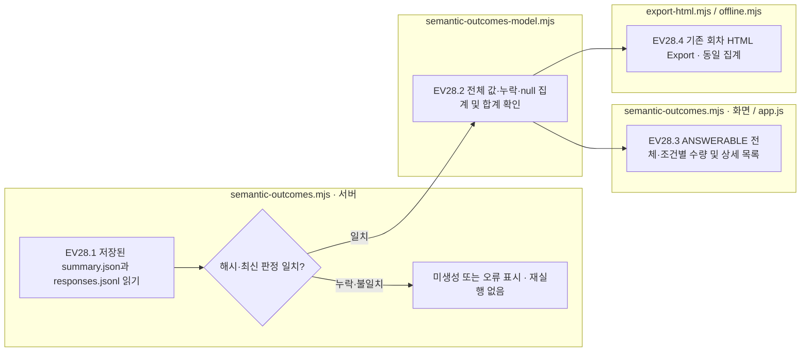

이 흐름은 저장 자료를 읽는 JavaScript 처리입니다. Python 분류 로직 변경이나 LLM 호출은 하지 않습니다. 박스는 실제 파일별 처리이며 추가 상세도로 연결하는 분홍색 노드는 없습니다.


## A04 생략 정책 표시 · EV29

`finalization-policy.json`의 `skip_a04=true`인 회차만 적용합니다. 화면 A04 연구 해석은 파이프라인 A03 자료이며 유지합니다. 생략 대상은 파이프라인 A04 연구발견 그룹화입니다. 과거 호출·실패·부분 산출물은 보존하여 열람하되 현재 남은 작업·재시도 대상에서 제외합니다.

|단계|파일|책임|
|---|---|---|
|EV29.1|`src/finarch/experiments/viewer/finalization.mjs`|회차 정책, A03 COLLECTED 및 valid/request 일치, 루트 Analysis·pipeline COMPLETE, 실제 Python 후처리 기록, summary와 응답 해시 확인|
|EV29.2|`repository.mjs`, `progress.mjs`|캐시 갱신·완료 상태 공유, 생략 단계의 과거 기록 보존, 최신 preparation 대기 상태와 이전 HOLD 구분|
|EV29.3|`app.js`, `progress-dashboard.mjs`, `model.mjs`|상태·단계·진행률·ANSWERABLE 중간 산출물 안내|
|EV29.4|`export-html.mjs`|동일 완료 상태를 기존 회차 Export에 포함|

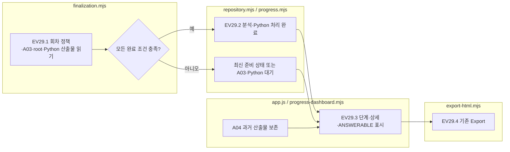

모든 박스는 기존 저장 자료를 읽는 JavaScript 처리입니다. 새 LLM 호출·Python 분류 재실행은 없습니다. 별도 상세도로 연결하는 분홍색 노드는 없습니다. CLASSIFIED 파일만 있거나 의미적 정답 여부만으로 전체 완료를 판단하지 않습니다. 정책 없는 회차의 완료 흐름은 유지합니다.


### EV28.5 데이터셋·모델 취합

A05 상단은 사용자 지정 9개 회차를 읽습니다. TAT-QA는 004-sol-low Luna, 005 Haiku, 012 Qwen3 8B, 014 Qwen3 14B, 016 Qwen3.8 27B이며, FR은 009 Luna, 010 Haiku, 013 Qwen3 8B, 015 Qwen3 14B입니다. FR native·embedded를 합산하고 구성 수량·회차·저장 시각을 펼쳐 확인합니다. 전체/7변형/H1/원본 범위를 선택하며 각 모델의 해당 범위 전체를 분모로 사용합니다. 검증 실패·미생성은 0으로 대체하지 않습니다. 모델 버튼은 해당 회차 A05로 연결합니다. 기존 회차 HTML Export는 해당 회차만 포함하며 온라인 다회차 비교표는 포함하지 않습니다.

`outcome-comparison.mjs`(서버)는 기존 해시 검증 reader와 공통 `outcomePage`로 모든 분류값을 집계합니다. `semantic-outcomes.mjs`(화면)의 비교표는 각 모델의 원래 값·개수·비율을 표시합니다. 의미 분류나 실험 실행은 변경하지 않습니다.

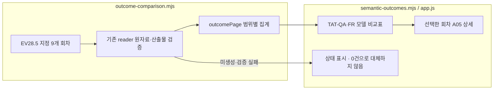
