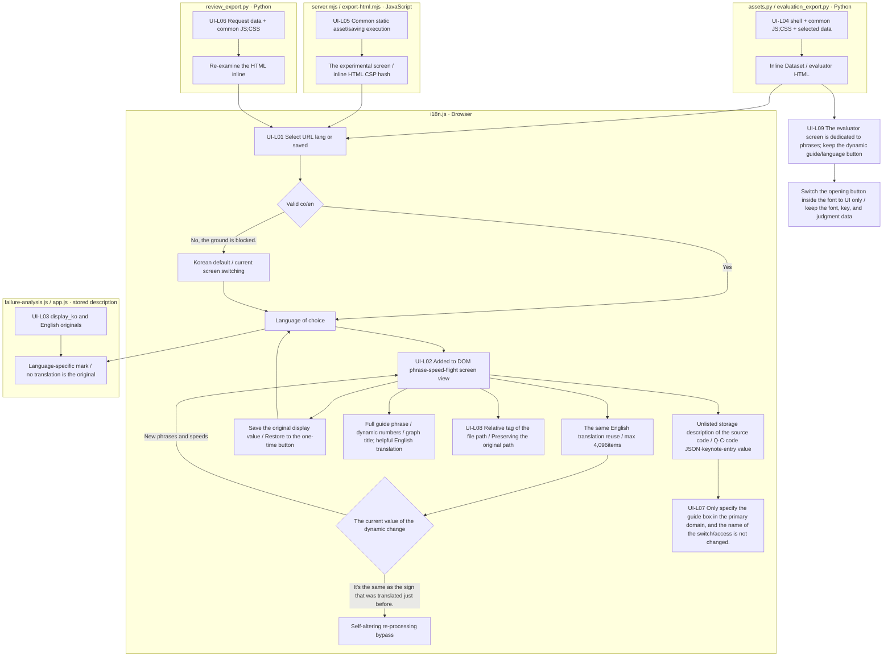

# Dataset:Experiments Screen language

[Local screen guide](../README.md) → [i18n.js](i18n.js) → [i18n.css](i18n.css) It reads in order. It just changes the screen, and it doesn't call the translation model.

|ID|Actual file|Input → process → output|
|---|---|---|
|UI-L01|`viewer/shared/i18n.js`|URL: Language of the screen → Korean default; one/either button → Screen language|
|UI-L02|`viewer/shared/i18n.js`|Guidance, including screen phrases; numbers; dynamic update → full sentence dictionary; dynamic sentence rules; maximum 4,096items conversion reuse, original display value conservation → step, substrate, graph, popup, proximity name|
|UI-L03|`common/failure-analysis.js`, `experiments/app.js`|Save `display_ko`·English original → Language text selection → Failure/research interpretation|
|UI-L04|`src/finarch/dataset/viewer/assets.py`, `evaluation_export.py`|Common assets: Selection execution → Inline assembly → Dataset screen: evaluator HTML|
|UI-L05|`src/finarch/experiments/viewer/server.mjs`, `export-html.mjs`|Common assets; cache execution → static supply/inline; CSP hashing → experimental screen; action HTML|
|UI-L06|`src/finarch/dataset/viewer/annotation/review_export.py`|Re-examination data, common assets, inline assembly, and annotation request|
|UI-L07|`viewer/dataset/shell.html`, `prepare/answer`, `prepare/generation`|Only the generated directory box `data-i18n-ui` Specify → Keep the source code, state the phrase conversion|
|UI-L08|`viewer/shared/i18n.js`|File path mark → In English project relative path: hanging file name URL tag → only mark change, keep the original path: copy reference|
|UI-L09|`viewer/dataset/evaluation.js`, `evaluation/review.js`, `viewer/shared/i18n.js`|Evaluator Export's save language; custom screen sentence → title; traffic; key guide; import error; graph help switch, language button hold, text unfold button only `data-i18n-ui` Specify → offline one-time rating screen|

The file box is the actual responsibility unit, and there is no pink extension node in this detail. The process above does not perform the re-executing, re-repeating, PASS/FAIL verification of the production and experimental pipeline. If it fails to export, it will not treat the existing files as new completed copies, but will display errors. HTML's internal data readings and language transitions are performed without servers, and real-time server updates are only possible on a live screen.

`translate="no"`, `data-i18n-skip`And the text in the font field is excluded from the prefix. `title`·`aria-label`So it's a screen guide, and it switches to English. `.prose` It's not in the box. `data-i18n-ui`It's not in the question and text code key. `bindText`The stored one-dimensional description is selected exactly. `originalText`and `clone`The language switching does not reconfigure the DOM, so the form value, the judgment selection, the filter, the present location are retained. The previous distribution HTML must include new functions to export again.

The language selection button on the English screen is **Korean / English**It's the process of converting the phrases in the stages, numbers, graphs, pop-ups into whole phrases. The dynamic phrases rule doesn't change the execution ID, numerator, calculator. `fin-arch/` The front local folder name is omitted from the English mark. The hangal file name is shown as a URL tag, while the actual file link and copy path keeps the source. When returned to Korean, it restores the original mark value that was saved.

The dynamic change sensor remembers the character-speed value immediately after the translation and does not process the same sign again. When the external code changes to a new phrase, it translates as before. 4,096If you keep it up to the items, and you cross the limit, you remove the oldest results. 1,080[Speed and return checks](../../log/annotation-manager-20261001/README.md)It distinguishes between the first server visit and the time of the screen's movement.

[Real data for authentication](../../outputs/viewer-i18n-20261002/README.md) · [Check log verification limit](../../log/viewer-i18n-20261002/README.md)
