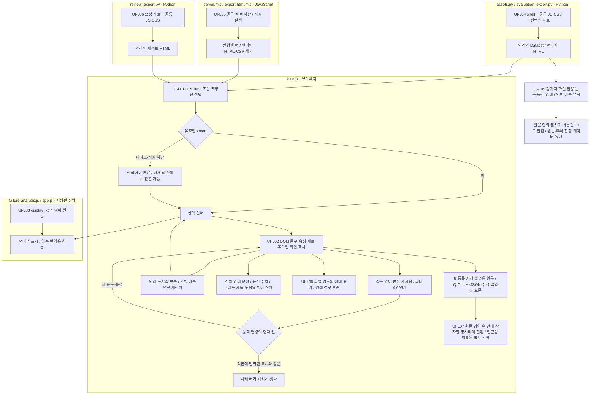

# Dataset·Experiments 화면 언어

[전체 화면 안내](../README.md) → [i18n.js](i18n.js) → [i18n.css](i18n.css) 순서로 읽습니다. 화면 표시만 변경하며 번역 모델을 호출하지 않습니다.

|ID|실제 파일|입력 → 처리 → 출력|
|---|---|---|
|UI-L01|`viewer/shared/i18n.js`|URL·저장 언어 → 한국어 기본값·한/영 버튼 → 화면 표시 언어|
|UI-L02|`viewer/shared/i18n.js`|화면 문구·숫자를 포함한 안내·동적 갱신 → 전체 문장 사전·동적 문장 규칙·최대 4,096개 변환 재사용·원래 표시값 보존 → 단계·수식·그래프·팝업·접근성 이름|
|UI-L03|`common/failure-analysis.js`, `experiments/app.js`|저장 `display_ko`·영어 원문 → 언어별 텍스트 선택 → 실패/연구 해석|
|UI-L04|`src/finarch/dataset/viewer/assets.py`, `evaluation_export.py`|공통 자산·선택 실행 → 인라인 조립 → Dataset 화면·평가자 HTML|
|UI-L05|`src/finarch/experiments/viewer/server.mjs`, `export-html.mjs`|공통 자산·저장 실행 → 정적 제공/인라인·CSP 해시 → 실험 화면·실행 HTML|
|UI-L06|`src/finarch/dataset/viewer/annotation/review_export.py`|재검토 자료·공통 자산 → 인라인 조립 → Annotation 요청 HTML|
|UI-L07|`viewer/dataset/shell.html`, `prepare/answer`, `prepare/generation`|원문 표시와 상태 안내 → 생성된 안내 상자만 `data-i18n-ui` 지정 → 원문·코드 유지, 상태 문구 전환|
|UI-L08|`viewer/shared/i18n.js`|파일 경로 표시 → 영어에서는 프로젝트 상대 경로·한글 파일명 URL 표기 → 표시만 변경, 원래 경로·복사 참조 유지|
|UI-L09|`viewer/dataset/evaluation.js`, `evaluation/review.js`, `viewer/shared/i18n.js`|평가자 Export의 저장 언어·전용 화면 문구 → 제목·목차·주석 안내·Import 오류·그래프 도움말 전환, 언어 버튼 유지, 본문 펼치기 버튼만 `data-i18n-ui` 지정 → 오프라인 한영 평가 화면|

파일 박스는 실제 책임 단위이며 이 상세도에는 분홍 확장 노드가 없습니다. 위 과정은 제작·실험 파이프라인의 재실행·재시도·PASS/FAIL 판정을 수행하지 않습니다. 내보내기에 실패하면 기존 파일을 새 완성본으로 취급하지 않고 오류를 표시합니다. HTML의 내장 자료 읽기와 언어 전환은 서버 없이 수행되며, 실시간 서버 갱신은 라이브 화면에서만 가능합니다.

`translate="no"`, `data-i18n-skip`와 원문 표시 영역의 본문은 사전 치환에서 제외합니다. 원문 안의 근거 버튼·코드 줄에 붙인 `title`·`aria-label`은 화면 안내이므로 영어로 전환합니다. 실제 원문과 같은 `.prose` 상자에 만든 상태 안내는 `data-i18n-ui`를 명시하여 전환하고, 질문·본문·코드·주석에는 이를 지정하지 않습니다. `bindText`는 저장된 한·영 설명을 그대로 선택합니다. `originalText`와 `clone`은 단축키 비교·floating 버튼 복사에서 번역된 표시값이 동작 기준을 바꾸지 않도록 합니다. 언어 전환은 DOM을 재구성하지 않으므로 폼 값·판정 선택·필터·현재 위치를 유지합니다. 이전 배포 HTML은 다시 Export해야 새 기능을 포함합니다.

영어 화면에서 언어 선택 버튼은 **Korean / English**입니다. 단계·수식·그래프·팝업의 고정 문구와 숫자가 포함된 문장을 전체 문장으로 전환합니다. 동적 문장 규칙은 실행 ID·수치·계산값을 바꾸지 않습니다. 한글의 완성형과 분해형을 모두 확인하며, 경로의 `fin-arch/` 앞 로컬 폴더명은 영어 표시에서 생략합니다. 한글 파일명은 URL 표기로 보여 주되 실제 파일 연결과 복사 경로는 원문을 유지합니다. 한국어로 되돌리면 보존된 원래 표시값을 복원합니다.

동적 변경 감시는 번역 직후의 문자·속성 값을 기억하여 같은 표시를 다시 처리하지 않습니다. 외부 코드가 새 문구로 바꾸면 기존과 같이 번역합니다. 영어 변환 결과는 최대 4,096개까지만 보관하고 한도를 넘으면 가장 오래된 결과를 제거합니다. 한국어·영어 전환은 보존된 원래 표시값을 계속 사용합니다. Annotation의 실제 1,080문항 자료로 확인한 [속도·회귀 검사](../../log/annotation-manager-20261001/README.md)는 최초 서버 조회 시간과 화면 내 이동을 구별합니다.

[확인용 실제 자료](../../outputs/viewer-i18n-20261002/README.md) · [검사 로그·확인 한계](../../log/viewer-i18n-20261002/README.md)
