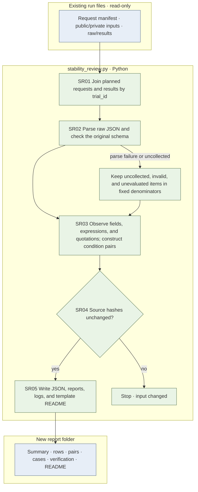

# {{run_id}} response format, expression, and condition sensitivity — repeat stability not evaluated

This report analyzes response format/expression and sensitivity to condition changes using all {{rows}} planned requests as the denominator. It does not evaluate stability across repeated runs under identical conditions. Original-answer numeric comparisons remain separate. There are 0 new model calls; SHA-256 hashes of {{source_files}} existing source files were checked before and after reading. Existing responses, scores, reference answers, and numeric rules are unchanged.

Response pairs include only cases where both response objects were actually observed. Missing collection on either side remains unevaluated (null). A valid response containing `answer=null` is an observed value and is distinct from an uncollected response. Original comparison rows are labeled `Original P0/off` and `Original P0/on`. Prompt/schema equality across runs is checked through request hashes; CLI/API routes and cache usage are reported from actual saved observations.

The existing JSON `*_empty*` transitions retain their original definition: observed responses from which a normalized number could not be read. Explicit `answer=null` transitions are recorded separately as `numeric_to_null` and `null_to_numeric`; the main tables use this strict null definition. Uncollected responses are not counted as transitions under either definition.

## Reading order and file responsibilities

1. [analysis.md](analysis.md): initial interpretation, fixed denominators, counts by type/condition, and limits on paper claims.
2. [cases.md](cases.md): actual JSON examples with raw-response/result paths.
3. [summary.json](summary.json): condition counts and heuristic definitions.
4. [rows.jsonl](rows.jsonl): one row per request, with reparsed raw responses, frozen-schema checks, quotations, and explanation observations.
5. [pairs.jsonl](pairs.jsonl) · [source-links.jsonl](source-links.jsonl): condition pairs and evidence for reversing source insertions.
6. `comparison.json`, `comparison-pairs.jsonl`, `comparator-summary.json`: before/after run comparisons produced only with `--compare-run`.
7. [verification.json](verification.json) · [events.jsonl](events.jsonl): input hashes and execution events.
8. `run.log`, `checks.json`, `checks.log`: execution output and separate offline-check records, when available.
9. `missing-pair-regression-checks.json`, `missing-pair-baseline-preservation-checks.json`: checks distinguishing missing responses from valid nulls and preserving existing aggregates/source hashes.

This README is generated from `src/finarch/experiments/02-analysis/legacy/content-analysis/stability-review-template.md`. Intermediate JSON observations and this guide are in English.

## Reproduction

Run from the repository root using the project virtual environment with `jsonschema` installed.

```sh
{{command}}
```

After a new experiment, pass its run to `--run`, exp-006 to `--compare-run`, and use a new report folder to apply the same observation rules. Do not assume that V4 abstention status and V5/V6 null numbers have the same meaning. Format-validation rules can also differ by version; inspect validity rates together with common-field observations.

## Execution flow and responsibilities

| File | Responsibility |
| --- | --- |
| `stability_review.py` | SR01 read inputs; SR02 inspect raw responses/frozen schemas; SR03 build observations/pairs; SR04 verify source preservation; SR05 write artifacts/README. |
| `stability-review-template.md` | README source for reading order, commands, and interpretation scope. |
| Existing run `01-input`, requests, raw/results | Read-only analysis inputs and existing score reference. |



Blue boxes represent files; green boxes represent Python processing. There is no LLM processing or retry. No pink expansion nodes are used because no separate detailed expansion is provided. Semantic scoring and repeated-run reproducibility under identical conditions remain unevaluated.

## Viewer and verification state

No per-result-folder HTML is created. Integration with the shared `viewer/` to select this `reports/run` record and inspect saved analysis files belongs to the parent workflow. This generator does not mark screen verification or user viewing complete; both fields in `verification.json` remain false.
