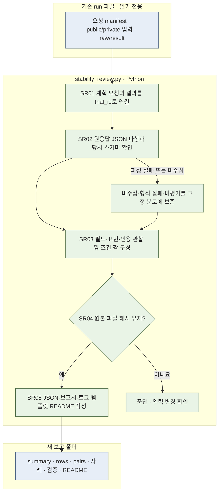

# {{run_id}} 응답 형식·표현 및 조건 민감도 분석 — 반복 안정성 미평가

계획 요청 {{rows}}건을 분모로 응답 형식·표현과 조건 변화에 대한 민감도를 분석한 보고서입니다. 같은 조건을 반복했을 때의 안정성은 평가하지 않습니다. 원문 숫자 비교도 별도로 유지합니다. 새 모델 호출 0건이며 기존 기록 {{source_files}}개 파일의 읽기 전후 SHA-256을 확인했습니다. 기존 응답, 채점, 참조 정답과 숫자 규칙을 수정하지 않습니다.

응답 비교에는 양쪽 응답 객체가 실제 관측된 쌍만 포함하고, 한쪽 또는 양쪽 미수집은 미평가(null)로 남깁니다. 유효 응답이 반환한 `answer=null`은 실제 관측값이므로 미수집과 구별합니다. 원문 비교 행은 `원문 P0/off`, `원문 P0/on`으로 표기합니다. 실행 간 프롬프트·스키마 동일성은 요청 해시로 확인하고, CLI/API 경로와 캐시 사용량도 저장 결과의 실제 관측값을 보고합니다.

기존 JSON의 `*_empty*` 전이 수치는 정규화된 숫자를 읽을 수 없는 관측 응답을 뜻하던 정의로 보존합니다. 명시적인 `answer=null` 전이는 새 `numeric_to_null`·`null_to_numeric` 항목으로 분리하며, 본문 표는 이 엄격한 null 전이를 사용합니다. 미수집은 두 정의 모두에서 전이로 집계하지 않습니다.

## 읽는 순서와 파일 역할

1. [analysis.md](analysis.md): 1차 판단, 고정 분모, 유형·조건별 집계와 논문에서 주장할 수 있는 범위
2. [cases.md](cases.md): 실제 JSON과 원응답·결과 경로가 있는 대표 사례
3. [summary.json](summary.json): 조건별 수치와 휴리스틱 정의
4. [rows.jsonl](rows.jsonl): 요청당 1행, 원응답 재파싱·동결 스키마·인용·설명 관찰
5. [pairs.jsonl](pairs.jsonl) · [source-links.jsonl](source-links.jsonl): 조건 비교쌍과 출처 삽입 되돌리기의 근거
6. `comparison.json`, `comparison-pairs.jsonl`, `comparator-summary.json`: `--compare-run`을 지정했을 때만 생성하는 이전/이후 실행 비교
7. [verification.json](verification.json) · [events.jsonl](events.jsonl): 입력 해시와 실행 로그
8. `run.log` · `checks.json` · `checks.log`: 실행 출력과 별도 오프라인 검사 기록이 있는 경우 확인하는 로그
9. `missing-pair-regression-checks.json` · `missing-pair-baseline-preservation-checks.json`: 미수집·유효 null 구분과 기존 집계·원본 해시 보존 검사 기록

README는 `src/finarch/experiments/02-analysis/legacy/content-analysis/stability-review-template.md` 템플릿에서 자동 생성합니다. 모든 중간 JSON 관찰값은 영어입니다. 이 안내와 분석 설명은 한국어입니다.

## 재현

프로젝트 루트에서 실행합니다. `jsonschema`가 설치된 프로젝트 가상환경을 사용합니다.

```sh
{{command}}
```

재실험 후에는 `--run`에 새 실행, `--compare-run`에 exp-006을 지정하고 새 보고 폴더를 사용하면 동일 관찰 규칙으로 비교할 수 있습니다. V4의 유보 status와 V5/V6의 null 숫자는 같은 의미라고 가정하지 않습니다. 버전별 형식 검사 규칙도 달라질 수 있어 유효 비율과 공통 필드 관찰을 함께 확인합니다.

## 실제 실행 흐름과 책임

|파일|책임|
|---|---|
|`stability_review.py`|SR01 입력 읽기, SR02 원응답·동결 스키마 확인, SR03 관찰과 짝 구성, SR04 원본 보존 확인, SR05 산출물·README 작성|
|`stability-review-template.md`|읽는 순서·실행 방법·해석 범위를 담은 README 원본|
|기존 run의 `01-input`·요청·raw/result|읽기 전용 분석 입력과 기존 점수 기준|



파란 박스는 파일, 초록 박스는 Python 처리입니다. LLM 처리·재시도는 없습니다. 별도의 상세도 확장 노드는 없어 분홍 노드를 쓰지 않았습니다. 의미 채점과 같은 조건의 반복 재현성은 미평가입니다.

## 화면과 확인 상태

결과 폴더별 HTML을 만들지 않습니다. 공통 `viewer/` 화면에서 이 `reports/run` 실행을 선택하여 저장된 분석 파일을 확인하는 통합 작업은 상위 작업에서 수행합니다. 이 생성기는 화면 확인이나 사용자 열람을 완료했다고 기록하지 않으며 `verification.json`의 두 항목을 false로 보존합니다.
