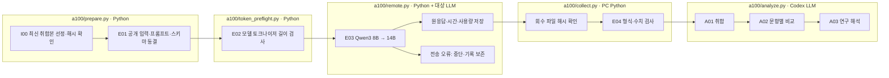

# A100 Evaluation → PC Analysis

대상: **{model}**, 원본 557문항 × 8유형 × 2풀이 지침 × 2추론 조건 = **17,824요청**.

## 읽는 순서

1. `source-provenance.json`: 최신 취합본 해시와 Luna 공개 입력 동일성.
2. `00_input/private.jsonl`: 원본의 `original_external_knowledge` 분류. 변형 자체의 재검증 결과가 아닙니다.
3. `a100-runtime.json`, `token-preflight.json`: GPU 설정과 토큰 길이 점검.
4. `01_evaluation/02_request`: 동결한 프롬프트·응답 스키마·문항별 요청.
5. `remote-state.json`, `server.log`, `remote-results`: 서버 상태·로그·원응답.
6. `01_evaluation/04_validation`: 복사한 원응답의 형식 검사와 수치 비교.
7. `02_analysis`: PC의 Codex 결과 취합·관계 비교·연구 해석.

## 실행 경계

- prefix cache OFF. 사용량에서 확인되지 않은 캐시 수치를 0으로 대체하지 않습니다.
- 요청 실패·응답 불명은 원기록을 보존하고 자동 재요청하지 않습니다.
- 컨텍스트는 전체 입력과 8,192 출력 여유를 보존하도록 12,288로 조정합니다. 나머지 최적화값은 유지합니다.
- 기존 최적화는 다른 스키마의 소규모 평가 결과이므로 이번 전체 실험의 속도를 보장하지 않습니다.
- 외부 API 비용 0, 서버 비용 미산정. Codex는 설정된 구독 분석을 사용합니다.
- `EXTERNAL_RULE` 분류와 정답은 서버의 문제 입력에 보내지 않습니다.

상자는 실제 파일의 담당 처리입니다. 별도 상세도 링크가 없어 분홍색 노드는 없습니다.

[공통 실험 뷰어](http://127.0.0.1:8894/?run={run}&tab=overview)에서 실행을 선택합니다.
