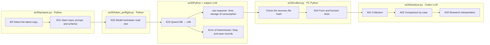

# A100 Evaluation → PC Analysis

Subjects: **{model}**The original. 557This is the first case. 8Type × 2The direction of the grass x 2The condition of the equation is **17,824Request**.

## Reading order

1. `source-provenance.json`: latest copy of the hash and Luna public input identification.
2. `00_input/private.jsonl`The original: `original_external_knowledge` It's not a re-examination of the variation itself.
3. `a100-runtime.json`, `token-preflight.json`: GPU settings and token length checking.
4. `01_evaluation/02_request`: Concluded Prompt Response Schema Question Request.
5. `remote-state.json`, `server.log`, `remote-results`: Server status log: raw response.
6. `01_evaluation/04_validation`: Format validation and statistical comparison of the copied raw response.
7. `02_analysis`: The results of the Codex of PC: synthesis; correlation comparison; research interpretation.

## Running boundaries

- Prefix cache OFF. Unchecked cache number in the usage 0It's not replacing it.
- Request Failure: Unanswered Name does not save the original file and automatically request it again.
- The context is the entire input and the 8,192 To preserve the power supply. 12,288So the rest of the optimization remains.
- The existing optimization is the result of a small evaluation of other schemes, so it doesn't guarantee the speed of the whole experiment.
- External API costs 0Codex uses set subscription analysis.
- `EXTERNAL_RULE` The classification and the correct answer don't send to the server's problem input.

The box is the actual file manager, no details, no links, no pink nodes.

[Common experiment viewer](http://127.0.0.1:8894/?run={run}&tab=overview)Select the execution from.
