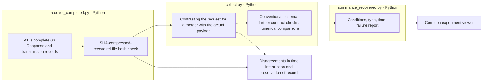

# A100 Results are recovered

FinanceReasoning originals 1,080· variants 7,560For a model for a items. 34,560I recovered the data, remote raw response hash, and I checked the recovered compression, file hash, and compared the output prompt, input scheme, and the actual payload of the transmission.

$comparison

$links

We distinguished remote JSON schematic testing from local total response contract testing. The original numerical unit together with the plan denominator and the actual comparison denominator is shown in the conditional report.

The prefix cache of the target model is OFF and the start-finish hit is 0The unique cache token was kept in a misnomer by Microphora. 0The cost of the GPU is $$$$$, and the average response time and the total scan time is different because of the simultaneous run.

Readings by model RESULTS.md → [comparison data](comparison.json) → This folder is `recovery-*.log` → Model by model `recovery-receipt.json`·`_recovery/manifest.json` → E04 The compression file is the original recovered and the code that created this report is the code that is the original. `src/finarch/experiments/a100/recover_completed.py`, `collect.py`, `summarize_recovered.py`This is the guide. `src/finarch/experiments/templates/a100-recovery-index.md`and `a100-recovered-results.md`It's generated from.

This task is to recover the existing results; Python check-in system and call the new model 0So that's it.2·A03 I didn't run the LLM analysis.

The box is the input → Python processing → storage result order. There is no LLM call in the recovery phase.
