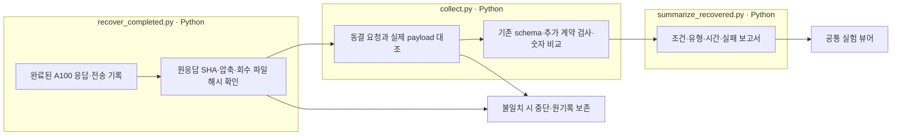

# A100 결과 회수

FinanceReasoning 원본 1,080개·변형 7,560개에 대한 모델당 34,560건을 회수했습니다. 원격 원응답 해시와 회수 압축·파일 해시를 확인하고, 동결 프롬프트·입력·스키마와 실제 전송 payload를 대조했습니다.

$comparison

$links

원격의 JSON 스키마 검사와 로컬의 전체 응답 계약 검사를 구별했습니다. 원본 숫자 일치는 조건별 보고서에 계획 분모·실제 비교 분모를 함께 표시합니다. 형식 통과와 숫자 일치는 의미 정답 검증이 아닙니다.

대상 모델의 prefix cache는 OFF이며 시작·종료 hit는 0입니다. 건별 캐시 토큰은 미보고라 미확인으로 보존했습니다. 외부 API 비용은 0달러이고 GPU 비용은 미산정입니다. 동시 실행 때문에 건별 평균 응답 시간과 전체 경과 시간은 다른 값입니다.

읽는 순서: 모델별 RESULTS.md → [전체 비교 데이터](comparison.json) → 이 폴더의 `recovery-*.log` → 모델별 `recovery-receipt.json`·`_recovery/manifest.json` → E04 실패 목록과 실험 뷰어의 실제 문항입니다. 압축 파일은 회수 원본이며 이 보고서를 만든 코드는 `src/finarch/experiments/a100/recover_completed.py`, `collect.py`, `summarize_recovered.py`입니다. 안내 문서는 `src/finarch/experiments/templates/a100-recovery-index.md`와 `a100-recovered-results.md`에서 생성합니다.

이번 작업은 기존 결과 회수·Python 검사·집계이며 새 모델 호출 0건입니다. 이번 회수 작업에서 A02·A03 LLM Analysis를 실행하지 않았습니다.

상자는 입력 → Python 처리 → 저장 결과 순서입니다. 회수 단계에는 LLM 호출이 없습니다.
