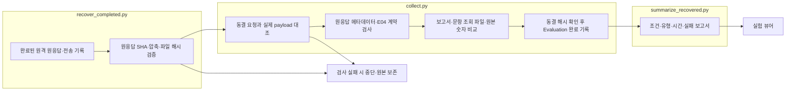
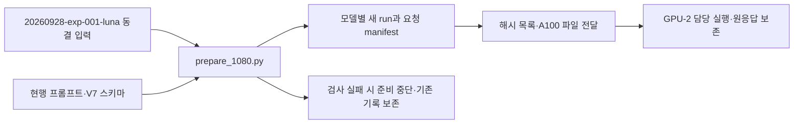

# A100 실행 연결

기존 Evaluation 산출물 형식으로 GPU 서버 결과를 회수하고, 기존 Analysis를 PC에서 실행합니다.

|파일|입력 → 역할 → 출력|
|---|---|
|prepare.py|최신 취합본 → 557문항 선정·Luna 공개 입력 대조 → 독립 모델별 run|
|prepare_1080.py|20260928-exp-001-luna의 동결 입력과 현행 프롬프트 → 1,080문항·모델별 34,560개 요청 생성·해시 확인 → GPU-2 전달 파일. 모델 호출 없음|
|wire.py|공개 요청과 런타임 → Qwen 채팅·스키마·추론 조건 → 서버 요청|
|token_preflight.py|동결 요청과 실제 토크나이저 → 입력 길이 검사 → token-preflight.json|
|install_worker_hook.py|보존한 worker 원본 → gpu-2 전용 단일 실행 분기 → 해시 기록|
|remote.py|공개 요청 → 8B·14B 순차 평가 → 원응답·전송상태·캐시·시간·회수 해시|
|coordinate.py|원격 완료 상태 → PC 회수·해시 검사 → collect와 analyze 실행|
|collect.py|회수 원응답 → 형식·수치 검사 → 기존 Evaluation 산출물|
|import_completed.py|pipeline recover-a100 → 봉인 패키지·로컬 private 해시 연결·안내 템플릿 연결 → 기존 회수·E04·뷰어 등록. 모델 호출 없음|
|recover_completed.py|완료된 원격 run → 원응답 SHA·압축·로컬 파일 해시 확인 → 원본 파일·회수 기록. 모델 호출 없음|
|summarize_recovered.py|로컬 E04와 수신 시간·cache 지표 → 조건·유형·실패·시간 집계 → RESULTS.md와 비교 보고서. 모델 호출 없음|
|analyze.py|검증된 결과와 private 분류 → 설정된 Codex 분석 → A01·A02·A03|

상세 흐름은 `src/finarch/experiments/templates/a100-readme-template.md`에서 모델별 README로 생성합니다.
대상 실행은 `reports/experiments-run/20260928-a100-qwen3-8b`, `20260928-a100-qwen3-14b`입니다.
오류·응답 미확인은 자동으로 다시 보내지 않습니다. 완료 상태는 분석의 실제 COMPLETE를 확인한 뒤 기록합니다.

공개 평가 입력에는 정답과 EXTERNAL_RULE 분류를 포함하지 않습니다. 분류는 원본 제작 검증 기준이며 변형 자체의 확인된 속성이 아닙니다.
현재 실행의 입력 길이를 보존하려고 컨텍스트를 10,240에서 12,288로 조정한 내역은 각 run의 preparation-revisions와 events에 있습니다.

## 2026-09-28 회수 복구

GPU 응답은 두 모델 모두 17,824건 완료됐으나 전체 디렉터리 압축 중 변경 감지로 coordinator가 종료됐습니다. recovery-manifest와 transfer-manifest에 명시된 파일만 압축하고 기존 해시 검사 후 회수합니다. 두 모델 회수·검증 후 순차 분석합니다. 원격 평가 재호출은 없습니다.

읽는 순서: recovery-repair.json → coordinator.log → 각 run README와 Evaluation/Analysis 상태. 뷰어: http://127.0.0.1:8894/ 에서 모델별 run 선택.

## 2026-09-29 1,080문항 전달

`prepare_1080.py`는 두 모델의 새 run에 현행 FinancialAnswerV7 프롬프트와 공개 입력을 동결합니다. 각 run의 README는 `src/finarch/experiments/templates/a100-1080-handoff-readme.md`에서 생성됩니다. private 정답·외부지식 분류는 로컬 run에 보존하며 A100 전달 목록에서 제외합니다. GPU-2 세션이 전송된 요청을 검증하고 실행합니다. 이전 `remote.py`의 실행 경로는 이번 요청에 그대로 적용하지 않습니다. `collect.py`는 동결 manifest의 실제 요청 수와 원격 완료 상태를 대조합니다.

## 2026-09-30 결과 회수

`recover_completed.py`가 원응답·전송 payload·수신 상태·서버 설정을 회수하고 파일별 SHA-256을 확인합니다. 원격의 변경된 안내 문서와 상태는 `remote-evidence/`에 둡니다. `collect.py`는 실제 전송 payload와 동결 입력을 대조한 뒤 E04 검사를 실행합니다. `summarize_recovered.py`는 모델별 RESULTS.md와 `reports/run/20260930-a100-recovery/README.md`를 템플릿에서 생성합니다. 원격 JSON 스키마 통과와 로컬 추가 필드 계약 통과를 별도 집계합니다. LLM Analysis는 시작하지 않습니다.

`collect.py`는 실제 원응답의 usage·finish_reason을 읽습니다. 원격 수신 메타데이터가 누락된 경우 원본을 유지하며 불일치를 기록합니다. `--repair-delivery-metadata`는 이전 로컬 판정을 별도 파일에 보존한 뒤 이 누락에 해당하는 판정만 정정합니다. 다른 결과 변경은 중단합니다. E04 보고서·문항별 조회 파일·숫자 비교 생성과 동결 해시 확인이 끝난 뒤에만 Evaluation 완료를 기록합니다.

상자는 입력 → Python 처리 → 저장 결과 순서이며, 회수 처리에는 모델 호출이 없습니다. 동결 manifest에 포함된 README는 유지하고 결과 안내를 EVALUATION.md와 RESULTS.md에 저장합니다. vLLM Chat Completions의 응답 본문은 call_layout.response_text()에서 읽어 잘린 응답도 뷰어에서 표시합니다.

상자는 입력 → Python 파일 준비 → 산출물 → 원격 실행 주체 순서입니다. 마지막 GPU 실행은 이 파일 준비 코드의 동작이 아닙니다.

## 서버에서 준비된 완료 run 등록

`experiments/pipeline.py recover-a100`는 `import_completed.py`를 거쳐 완료된 서버 패키지를 등록합니다. 서버 봉인 압축과 전달 파일 해시, 로컬 원본 public/private 해시를 확인하며 기존 요청을 재생성하지 않습니다. private 자료는 같은 해시의 로컬 source run에서 연결합니다. 모델 버전의 점을 포함한 실행 ID는 원격 이름 그대로 보존합니다.

GPU 공개 패키지에 빠진 로컬 안내 템플릿은 `ensure_report_templates()`가 ordered-model/ordered-run 템플릿에서 연결합니다. 연결한 파일의 출처·해시는 imported-report-templates.json과 이벤트에 기록합니다. 원래 동결 manifest·프롬프트·스키마·원응답은 수정하지 않습니다. 등록 결과는 RESULTS.md → recovered-summary.json → recovery-receipt.json 순서로 읽으며 Analysis는 중지 상태로 남깁니다.
