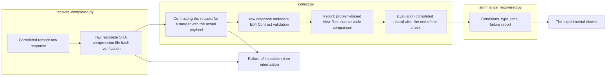
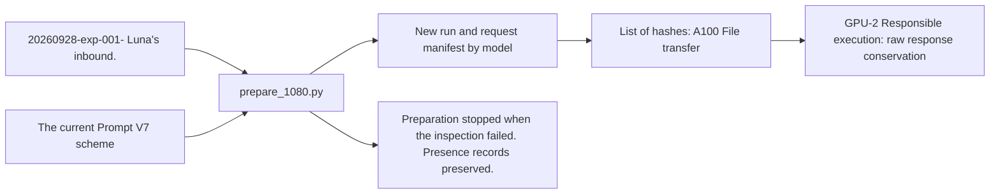

# A100 Run connection

It takes the results of the GPU server in the existing Evaluation output format and runs the existing Analysis on the PC.

|File|Input → Role → Output|
|---|---|
|prepare.py|The latest copy 557Select the article Luna public input vs. independent model run|
|prepare_1080.py|20260928-exp-001- The lunar flux input and current prompt 1,080Article: Model by model 34,560The items request is generated, the hash is verified, the GPU is2 Delivery file. No model call|
|wire.py|Public requests and runtime → Qwen chat, schemes, promotional terms → server requests|
|token_preflight.py|The request for synchronization and the actual tokenizer → input length checking → token-preflight.json|
|install_worker_hook.py|The preserved worker original → gpu-2 Dedicated single run quarter → hash record|
|remote.py|Public request 8B·14B The first time I saw the data, I was able to see the data.|
|coordinate.py|Remote completed state → PC recovery; decryption check → collect and analyze run|
|collect.py|Recovery raw response → Form-processing testing → existing Evaluation output|
|import_completed.py|pipeline recover-a100 → Sealing package; local private hash connection; internal template connection → existing recovery; E04·View registration. No model calls|
|recover_completed.py|Complete remote run → raw response SHA; compress; local file hash check → original file; recover record. No model call|
|summarize_recovered.py|Local E04and receiving time; cache indicator → condition; pattern; failure; time estimate → report comparison with RESULTS.md.|
|analyze.py|Verified results and private classification → set Codex analysis → A01·A02·A03|

The detailed flow is `src/finarch/experiments/templates/a100-readme-template.md`It's generated by model to README.
The target execution is `reports/experiments-run/20260928-a100-qwen3-8b`, `20260928-a100-qwen3-14b`.
The error-response inaccuracy is not automatically returned. The completed state is recorded after verifying the actual COMPLETE of the analysis.

The public evaluation input does not include the correct answer and the EXTERNAL_RULE classification. The classification is based on the original manufacturing verification and is not a verified attribute of the modification itself.
To preserve the current input length of the run, we need to change the context. 10,240in 12,288The internal settings are in the preparation-revisions and events of each run.

## 2026-09-28 Recovery is coming.

GPU response is both models. 17,824It's done, but the coordinator is off with the change in the entire directory compression, compressing only the files specified in the recovery-manifest and transfer-manifest, and then retrieving them after the existing hash check, and then sequentially analyzing the two models after the retrieval and verification, and no remote evaluation re-entry.

Reads in order: recovery-repair.json → coordinator.log → Each run README and Evaluation/Analysis state. Viewer: http://127.0.0.1:8894/ Run from model to model.

## 2026-09-29 1,080case delivery

`prepare_1080.py`The current FinancialAnswerV7 prompt and public input are aligned on the new run of both models. `src/finarch/experiments/templates/a100-1080-handoff-readme.md`The private right-to-external classification is stored on the local run and the A100 And that's not included in the transfer list.2 The session verifies and executes the request that was sent. `remote.py`The execution path does not apply to this request exactly. `collect.py`The actual number of requests for the synchronization manifest is contrasted with the remote completion state.

## 2026-09-30 Results are recovered

`recover_completed.py`Go raw response, transfer payload, status of service, recover server settings and file-by-file SHA-256Check the changed guidance document and the status of the remote. `remote-evidence/`Put it in. `collect.py`is the actual transfer payload and the input of the incoming current compared to the E04 I run the test. `summarize_recovered.py`The model-by-model RESULTS.md and `reports/run/20260930-a100-recovery/README.md`It generates from the template. It calculates remote JSON schematic passing and local additional field contract passing. LLM Analysis doesn't start.

`collect.py`It reads the usage·finish_reason of the actual raw response. If the remote receiving metadata is missing, it keeps the original and records the inconsistency. `--repair-delivery-metadata`The previous local resolution is saved to a separate file and then only the resolution that corresponds to this missing point is fixed.4 Report: Problem-based review file: Figure comparison and synthesis only after the verification is complete.

The box is the input → Python processing → storage result sequence, and the recovery processing has no model call. README contained in the syntax manifest keeps the result guide in EVALUATION.md and RESULTS.md. The response text of vLLM Chat Completions read in call_layout.response_text() also displays the response cut in the viewer.

The box is the input → Python file preparation → output → remote run subject sequence. The last GPU execution is not the operation of this file preparation code.

## Register the completed run prepared by the server

`experiments/pipeline.py recover-a100` `import_completed.py`The server registers the completed server packages through the server sealing compression and forwarding file hash, verifying the local source public/private hash and not reproducing the existing request. Private data is connected to the local source run of the same hash. Running ID, including the model version point, is stored remotely as a noun.

The local guide template that's missing from the public GPU package is `ensure_report_templates()`The source and description of the linked file is recorded in imported-report-templates.json and the event. The original syntax manifest; prompt; schema; raw response is not corrected. The registration results are read in RESULTS.md → recovered-summary.json → recovery-receipt.json order, and the Analysis is left in standby mode.
