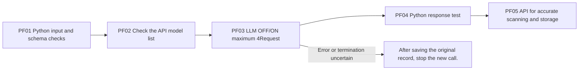

# Pre-testing of the API

The model: `{model}` · Check-in time: {checked_at} · State of play: `{status}`.
Request for actual creation {requests}That's the API for the sum of the required ${cost}The real value is `None`It's not clear.

The order of reading is as follows:

1. [summary.json](summary.json): OFF/ON request, usage, cache return value, format validation, cost and official data.
2. [model.json](model.json): Model and price verified from the actual API model list.
3. [public-input.json](public-input.json), [prompt.txt](prompt.txt), [response-schema.json](response-schema.json)The public input and response agreement for a single case from an existing experiment.
4. Each request is in the folder `request-wire.json` → `raw-response.json` → `response-headers.json` → `result.json`: transmission text, raw response, return headers and test results.
5. `receipts/`Come on, we're going to execution.log.](execution.log): request-by-request API exact records and start and finish logs.
6. [verification.json](verification.json): Whether the same message is sent, different response ID; raw response hash, API key bug checks of the saved file.

This test doesn't start the entire Evaluation-Analysis. Repeated requests in the same public case are to verify the reasoning of the API and the automated caching behavior. `UNKNOWN`And the 0Whether cache OFF control and support for all experimental conditions requires no verification.

The source for the inspector is `src/finarch/experiments/checks/orca_api_preflight.py`So that's PF0.1The public input prompt scheme checker, PF02Check the model list, PF03The maximum 4Conference-level API calls and record keeping, PF04The Python format, the short quotation, the usage test, PF05There is no automatic re-schedule of the logical call. `UNKNOWN_DELIVERY`It's not preserved and re-transmitted.

And the result is that no HTML or report viewer menu is created. `src/finarch/experiments/templates/api-preflight-readme-template.md`It's generated from.
