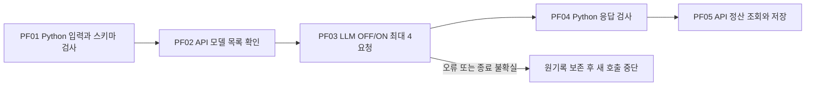

# API 사전 검사

모델: `{model}` · 확인 시각: {checked_at} · 상태: `{status}`.
실제 생성 요청 {requests}건, 요청별 API 정산액 합계 ${cost}. 정산값이 `None`이면 미확인입니다.

읽는 순서는 다음과 같습니다.

1. [summary.json](summary.json): OFF/ON 요청, 사용량, 캐시 반환값, 형식 검사, 비용과 공식 자료.
2. [model.json](model.json): 실제 API 모델 목록에서 확인한 모델과 가격.
3. [public-input.json](public-input.json), [prompt.txt](prompt.txt), [response-schema.json](response-schema.json): 기존 실험에서 가져온 한 문항의 공개 입력과 응답 계약. 정답 자료는 전송하지 않습니다.
4. 각 요청 폴더의 `request-wire.json` → `raw-response.json` → `response-headers.json` → `result.json`: 전송 본문, 원응답, 반환 헤더와 검사 결과.
5. `receipts/`와 [execution.log](execution.log): 요청별 API 정산 기록과 시작·종료 로그.
6. [verification.json](verification.json): 같은 메시지 전송 여부, 서로 다른 응답 ID·원응답 해시, 저장 파일의 API 키 미포함 검사.

이 검사는 전체 Evaluation·Analysis를 시작하지 않습니다. 같은 공개 문항의 반복 요청은 API의 reasoning과 자동 캐시 동작을 확인하기 위한 것입니다. 캐시 사용량이 없는 필드는 `UNKNOWN`이며 0으로 간주하지 않습니다. 캐시 OFF 제어와 모든 실험 조건의 지원 여부는 별도 확인이 필요합니다. JSON 형식 통과를 의미 정답으로 해석하지 않습니다.

검사 담당 소스는 `src/finarch/experiments/checks/orca_api_preflight.py`입니다. PF01은 공개 입력·프롬프트·스키마 검사, PF02는 모델 목록 확인, PF03은 최대 4회의 순차 API 호출과 원기록 보존, PF04는 Python 형식·근거 인용·사용량 검사, PF05는 정산 조회와 요약 저장을 담당합니다. 추론 호출의 자동 재시도는 없습니다. 시간 초과는 `UNKNOWN_DELIVERY`로 보존하며 재전송하지 않습니다.

별도 결과 HTML이나 보고서용 뷰어 메뉴는 만들지 않습니다. 이 README는 `src/finarch/experiments/templates/api-preflight-readme-template.md`에서 생성했습니다.
