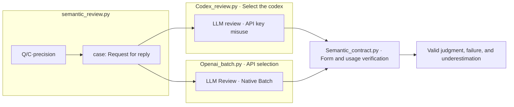

# {{run}} · A01 Input and reply review

The way we analyze **{{backend}}** • Models **{{model}}** · Theories **{{effort}}**Set the run. `config.json.analysis`And it's independent of the Evaluation setting of the target model.

|The Step by Step.|Input → process → output|Run the file.|
|---|---|---|
|A01.01 numeric_check|Private's correct answer. Evaluation response. `numeric-analysis.md`, `response-diagnostics.jsonl`|`numeric_analysis.py`|
|A01.02 LLM_input_review|public Q/C·precision → Self-review of the article → `01-LLM-input/`|`semantic_review.py` → Selected API/Codex|
|A01.03 LLM_response_review|Q/C: Problem review, profit name response, calculation, rounding, consistency contrast `02-LLM-response/`|`semantic_review.py` → Selected API/Codex|
|A01.04 collect|Schema: use: reply link verification → passing: failure: underestimate|`semantic_contract.py`|

## Reading order

1. [Number-form observation](numeric-analysis.md): distinguish between the matching of the original numbers and the meaning validity.
2. `00-definition/`: Copy of the prompt-schema used in this analysis.
3. `01-LLM-input/manifest.jsonl` → `results.jsonl`: Review the phrases that haven't seen the response.
4. `02-LLM-response/manifest.jsonl` → `results.jsonl`: Reviewing the response with a conditioning. `identity_map`It's for raw response connectivity and it's not transmitted to the analytical model.
5. The Codex is a collection of files in each folder. `calls/<trial>/request.json`, `provider-request.json`, `raw-response.jsonl`, `result.json`It stores the raw response query. `batch-001/`It stores the transmission and output power.
6. [A02 Conditions of comparison](../02_comparison/README.md) → [A03 Research interpretation](../03_research/README.md).

|Analysis stage|Status|Request|API cost estimate USD or USD|
|---|---|---:|---|
{{states}}

Codex is a ChatGPT subscription certification and does not automatically switch to a paid API. It does not guarantee the same output tokens as the Codex cache OFF and API. API analysis uses Native Batch as a separate model. `COLLECTED`The re-classification is a collection of records and does not mean that all judgments are valid. 1Keep the circle star and do not call back the success response.

Running only one of the two call paths selected from the settings. The analytics results are not human approval or gold, and the improvements are reflected after the user and the poll.
