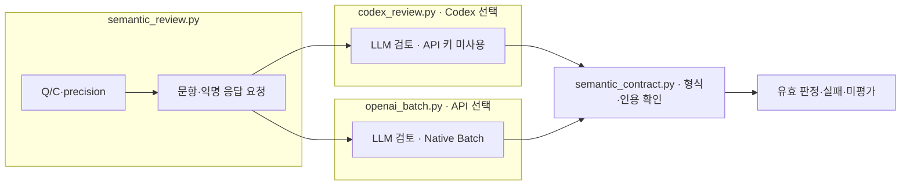

# {{run}} · A01 입력·응답 검토

분석 방식 **{{backend}}** · 모델 **{{model}}** · 추론 **{{effort}}**. 설정은 run의 `config.json.analysis`이며 대상 모델의 Evaluation 설정과 독립적입니다.

|세부 스텝|입력 → 처리 → 산출물|실행 파일|
|---|---|---|
|A01.01 numeric_check|private의 정답·Evaluation 응답 → 숫자 비교·관찰 → `numeric-analysis.md`, `response-diagnostics.jsonl`|`numeric_analysis.py`|
|A01.02 LLM_input_review|public Q/C·precision → 문항 자체 검토 → `01-LLM-input/`|`semantic_review.py` → 선택한 API/Codex|
|A01.03 LLM_response_review|Q/C·문항 검토·익명 응답 → 계산·근거·일관성 대조 → `02-LLM-response/`|`semantic_review.py` → 선택한 API/Codex|
|A01.04 collect|schema·인용·응답 연결 확인 → 통과·실패·미평가 구분|`semantic_contract.py`|

## 읽는 순서

1. [숫자·형식 관찰](numeric-analysis.md): 원본 숫자 일치와 의미 타당성을 구분합니다.
2. `00-definition/`: 이 분석에 사용한 prompt·schema 사본.
3. `01-LLM-input/manifest.jsonl` → `results.jsonl`: 풀이 응답을 보지 않은 문항 검토.
4. `02-LLM-response/manifest.jsonl` → `results.jsonl`: 조건명을 가린 응답 검토. `identity_map`은 원응답 연결용이며 분석 모델에는 전송하지 않습니다.
5. Codex는 각 폴더의 `calls/<trial>/request.json`, `provider-request.json`, `raw-response.jsonl`, `result.json`에 요청·실행 옵션·원응답·검사를 저장합니다. API는 `batch-001/`에 전송·원출력을 저장합니다.
6. [A02 조건 비교](../02_comparison/README.md) → [A03 연구 해석](../03_research/README.md).

|분석 단계|상태|요청|API 비용 추정 USD 또는 미산정|
|---|---|---:|---|
{{states}}

Codex는 ChatGPT 구독 인증이며 유료 API로 자동 전환하지 않습니다. Codex 캐시 OFF 및 API와 동일한 출력 토큰 상한은 보장하지 않습니다. API 분석은 별도로 선택한 모델로 Native Batch를 사용합니다. `COLLECTED`는 반환 기록 수집 상태이며 모든 판정이 유효하다는 뜻이 아닙니다. 재시도는 기술적 실패만 1회 별도 보관하고 성공 응답을 다시 호출하지 않습니다.

두 호출 경로 중 설정에서 선택한 하나만 실행합니다. 분석 결과는 사람 승인이나 gold가 아니며, 개선안은 사용자와 토의 후 반영합니다.
