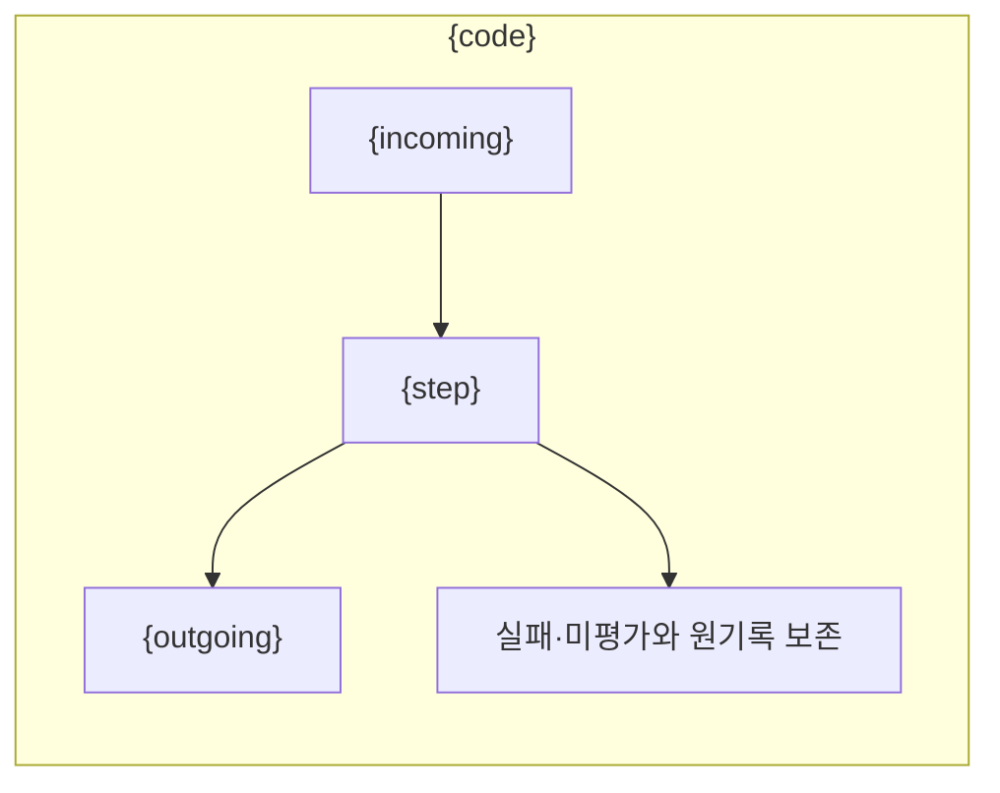

# {title}

{purpose}

## 세부 스텝과 실행 파일

{steps}

## 실행·재개 방법

이 폴더는 실험의 단계 산출물이며 Python 실행 위치가 아닙니다. 프로젝트 루트에서 상위 `pipeline.py`를 실행합니다.

```sh
RUN_PATH="{root}"
PYTHONPATH=src .venv/bin/python -u -B -m finarch.experiments.pipeline run --evaluation-only --run "$RUN_PATH"
tail -f "$RUN_PATH/pipeline.log"
```

Evaluation은 위 명령으로 제출·조회·수집·검사를 이어갑니다. Analysis를 실행하기로 정했고 입력 메타와 설정이 준비된 경우에는 `--evaluation-only`를 빼서 A01 → A02 → A03를 이어갑니다. 하위 단계 함수나 별도 모델 호출로 결과를 직접 채우지 않습니다. 같은 pipeline이 실행 중이면 새 프로세스를 추가하지 않습니다. 기존 Batch·완료된 분석 응답은 동일 ID로 이어 읽습니다.

`prepare`는 새로운 실험 폴더와 요청을 생성하는 명령이며 이 실행의 재개 명령이 아닙니다. 현재 상태는 run 루트 `state.json`, 단계의 처리 여부는 해당 단계 `state.json`과 아래 실제 파일에서 확인합니다.

## 읽는 파일과 산출물

{files}

{status}



상자는 입력 → 처리 → 산출물 순서입니다. 완료 표시는 실제 저장 상태를 따르며 사람의 검토 완료를 뜻하지 않습니다. 실행 로그는 run 최상위 `events.jsonl`입니다.
