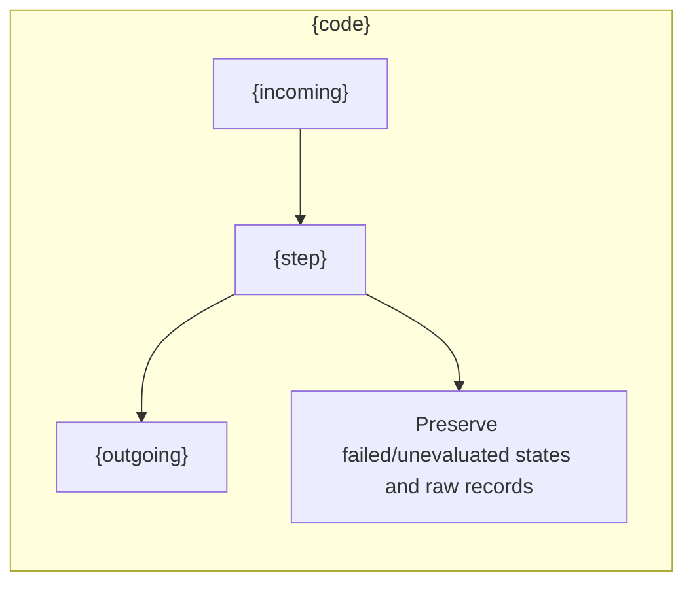

# {title}

{purpose}

## Steps and executables

{steps}

## Execution and resumption

This directory contains experiment artifacts. Run the parent pipeline from the repository root rather than executing Python here.

```sh
RUN_PATH="{root}"
PYTHONPATH=src .venv/bin/python -u -B -m finarch.experiments.pipeline run --evaluation-only --run "$RUN_PATH"
tail -f "$RUN_PATH/pipeline.log"
```

The command continues Evaluation submission, polling, collection, and validation. Remove `--evaluation-only` only when Analysis is intended and its metadata and settings are ready. Use the pipeline's saved Batch IDs and completed Analysis responses; do not fill outputs through unrelated model calls or stage functions. Do not launch another coordinator for an active run.

`prepare` creates a new experiment folder and requests; it does not resume this run. Read root `state.json`, this stage's state, and the actual files below to determine progress.

## Files and outputs

{files}

{status}



The boxes follow input → processing → output. Completion follows saved execution state and does not establish human-review completion. Detailed events are in the run-root `events.jsonl`.
